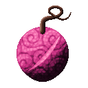
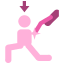

<!-- Generated by tools/build_pack_reference.py. Edit the pack sources and regenerate. -->

# Muchi Muchi no Mi

{ .entry-page-icon }

[Fruits](index.md) · [Missing Missing no Mi](../../reference/content/inomissing.md)

<!-- fruit inomissing:muchi_muchi_no_mi -->

| Stat | Value |
| --- | --- |
| Type | Paramecia |
| Tier | 2 |
| Fruit damage scaling | 1.00× at 10,000 Doriki → 2× at 50,000 Doriki |
| Abilities | 9 (9 active, 0 passive) |
| Fruit boxes | [Iron Box](../fruit-boxes.md) |

See [damage calculations](../combat-stats.md#damage-from-doriki).

!!! note "Reading the stats"
    Listed base damage is for the named part of the move. Pack and Doriki multipliers are shown separately. Times assume 20 ticks per second.

<!-- move inomissing:muchi_whip -->

## Whip

{ .entry-move-icon loading=lazy } *Active*

The user takes out their whip, the other techniques of the fruit need it in hand. Used again it is put away The whip vanishes if it leaves the user's hands

| Stat | Value |
| --- | --- |
| Cooldown | 2 s (40 ticks) |
| Pack multiplier when dealing damage | 2.9× |

<!-- move inomissing:muchi_lash -->

## Lash

{ .entry-move-icon loading=lazy } *Active*

The user lashes the enemy they look at with the whip. A player lashed obeys a short order, to stop, to step back or to drop what they hold Needs the whip in hand, take it out with Whip

| Stat | Value |
| --- | --- |
| Cooldown | 3 s (60 ticks) |
| Base damage | 6 HP |
| Conditional cooldown | 0.5 s (10 ticks) |
| Pack multiplier when dealing damage | 1.95× |

<!-- move inomissing:muchi_obey -->

## Obey

{ .entry-move-icon loading=lazy } *Active*

The user lashes the creature they look at and it fights for them for a while. Three at most, never a boss Needs the whip in hand, take it out with Whip

| Stat | Value |
| --- | --- |
| Cooldown | 15 s (300 ticks) |
| Conditional cooldown | 0.5 s (10 ticks) |
| Pack multiplier when dealing damage | 2.9× |

<!-- move inomissing:muchi_move -->

## Move!

{ .entry-move-icon loading=lazy } *Active*

The user lashes the ground they look at. It tears itself out and flies at the nearest enemy, then bursts. The hole closes after a while Needs the whip in hand, take it out with Whip

| Stat | Value |
| --- | --- |
| Cooldown | 20 s (400 ticks) |
| Base damage | 18 HP |
| Conditional cooldown | 0.5 s (10 ticks) |
| Pack multiplier when dealing damage | 2.9× |

<!-- move inomissing:muchi_close_in -->

## Close in!

{ .entry-move-icon loading=lazy } *Active*

The user lashes the enemy they look at and the ground closes round it, holding it for a moment. It lasts less on players and bosses Needs the whip in hand, take it out with Whip

| Stat | Value |
| --- | --- |
| Cooldown | 20 s (400 ticks) |
| Base damage | 4 HP |
| Conditional cooldown | 0.5 s (10 ticks) |
| Pack multiplier when dealing damage | 2.9× |

<!-- move inomissing:muchi_back -->

## Back!

{ .entry-move-icon loading=lazy } *Active*

The user lashes a projectile flying at them and it turns back on the one who sent it Needs the whip in hand, take it out with Whip

| Stat | Value |
| --- | --- |
| Cooldown | 8 s (160 ticks) |
| Conditional cooldown | 0.5 s (10 ticks) |
| Pack multiplier when dealing damage | 2.9× |

<!-- move inomissing:muchi_stand -->

## Stand!

{ .entry-move-icon loading=lazy } *Active*

The user lashes the ground they look at and it rises as a wall that stops enemies and projectiles. Used again the wall comes down Needs the whip in hand, take it out with Whip

| Stat | Value |
| --- | --- |
| Cooldown | 15 s (300 ticks) |
| Pack multiplier when dealing damage | 2.9× |

<!-- move inomissing:muchi_halt -->

## Halt!

{ .entry-move-icon loading=lazy } *Active*

The user lashes the one they look at and it cannot move for a few seconds. It can still fight back Needs the whip in hand, take it out with Whip

| Stat | Value |
| --- | --- |
| Cooldown | 16 s (320 ticks) |
| Pack multiplier when dealing damage | 2.9× |

<!-- move inomissing:muchi_kneel -->

## Kneel!

{ .entry-move-icon loading=lazy } *Active*

The user lashes the one they look at and for a few seconds it can not jump nor sprint and walks slower Needs the whip in hand, take it out with Whip A target at least twice as big as the user falls to its knees, can not walk and bows its head down to the user's height

| Stat | Value |
| --- | --- |
| Cooldown | 14 s (280 ticks) |
| Pack multiplier when dealing damage | 2.9× |

