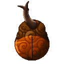
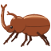
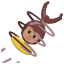
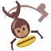
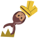
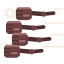
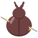
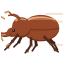

<!-- Generated by tools/build_pack_reference.py. Edit the pack sources and regenerate. -->

# Mushi Mushi no Mi, Model: Kabutomushi

{ .entry-page-icon }

[Fruits](index.md) · [Missing Missing no Mi](../../reference/content/inomissing.md)

<!-- fruit inomissing:mushi_mushi_no_mi_model_kabutomushi -->

| Stat | Value |
| --- | --- |
| Type | Zoan |
| Tier | 2 |
| Fruit damage scaling | 1.00× at 10,000 Doriki → 2× at 50,000 Doriki |
| Abilities | 10 (8 active, 2 passive) |
| Fruit boxes | [Iron Box](../fruit-boxes.md) |

See [damage calculations](../combat-stats.md#damage-from-doriki).

!!! note "Reading the stats"
    Listed base damage is for the named part of the move. Pack and Doriki multipliers are shown separately. Times assume 20 ticks per second.

<!-- move inomissing:kabutomushi_heavy_point -->

## Kabutomushi Heavy Point

{ .entry-move-icon loading=lazy } *Active · Transformation*

Transforms the user into a rhinoceros beetle hybrid, with a horn, a hard shell, four arms and wings to fly.

| Stat | Value |
| --- | --- |
| Pack multiplier when dealing damage | 1.25× |

**Stats while transformed**

| Stat | Value |
| --- | --- |
| Movement speed | +15% of base |
| Maximum health | +20% |
| Punch damage | +6 HP |
| Armour | +8 |
| Toughness | +4 |
| Step height | +0.5 blocks |
| Jump | +1 |

<!-- move inomissing:kabutomushi_walk_point -->

## Kabutomushi Walk Point

{ .entry-move-icon loading=lazy } *Active · Transformation*

Transforms the user into a big rhinoceros beetle with a thick shell. It can fly and carry another player.

| Stat | Value |
| --- | --- |
| Pack multiplier when dealing damage | 1.25× |

**Stats while transformed**

| Stat | Value |
| --- | --- |
| Movement speed | +10% of base |
| Maximum health | +30% |
| Punch damage | +5 HP |
| Armour | +12 |
| Toughness | +6 |
| Step height | +1 blocks |
| Jump | +0.5 |

<!-- move inomissing:kabutomushi_flight -->

## Kabutomushi Flight

*Passive*

| Stat | Value |
| --- | --- |
| Pack multiplier when dealing damage | 1.25× |

<!-- move inomissing:kabutomushi_rideable -->

## Kabutomushi Rideable

*Passive*

Allows another player to ride on the beetle's back.

| Stat | Value |
| --- | --- |
| Pack multiplier when dealing damage | 1.25× |

<!-- move inomissing:beetle_upper -->

## Beetle Upper

{ .entry-move-icon loading=lazy } *Active*

While in the hybrid form, the user rushes forward at full speed while spinning and headbutts all enemies in their path, launching them into the air.

| Stat | Value |
| --- | --- |
| Base damage | 16 HP |
| Cooldown | 11 s (220 ticks) |
| Pack multiplier when dealing damage | 1.25× |

<!-- move inomissing:horn_toss -->

## Horn Toss

{ .entry-move-icon loading=lazy } *Active*

The user scoops up the enemy in front of them with their horn and throws it over their back.

| Stat | Value |
| --- | --- |
| Base damage | 6 HP |
| Cooldown | 7 s (140 ticks) |
| Pack multiplier when dealing damage | 1.1× |

<!-- move inomissing:horn_dive -->

## Horn Dive

{ .entry-move-icon loading=lazy } *Active*

While in the air, the user dives horn first where they are looking, damaging all enemies around the impact and sending them flying. The higher the dive, the more damage it deals.

| Stat | Value |
| --- | --- |
| Min damage | 14 HP |
| Max damage | 26 HP |
| Cooldown | 14 s (280 ticks) |
| Pack multiplier when dealing damage | 1.25× |

<!-- move inomissing:four_arm_rush -->

## Four Arm Rush

{ .entry-move-icon loading=lazy } *Active*

While in the hybrid form, the user throws a flurry of fast punches with their four arms at the enemies in front of them. The last punch sends them flying.

| Stat | Value |
| --- | --- |
| Base damage | 4 HP |
| Cooldown | 12 s (240 ticks) |
| Pack multiplier when dealing damage | 1.25× |

<!-- move inomissing:shell_guard -->

## Shell Guard

{ .entry-move-icon loading=lazy } *Active*

The user closes their shell for a few seconds, taking much less damage and sending back enemy projectiles, but they cannot attack while it is closed. Using it again opens the shell.

| Stat | Value |
| --- | --- |
| Cooldown | 20 s (400 ticks) |
| Pack multiplier when dealing damage | 1.25× |

<!-- move inomissing:beetle_ram -->

## Beetle Ram

{ .entry-move-icon loading=lazy } *Active*

While in the whole beetle form, the user charges forward with their horn, damaging all enemies in their path and pushing them aside. The charge also breaks leaves, glass and wood.

| Stat | Value |
| --- | --- |
| Base damage | 22 HP |
| Cooldown | 16 s (320 ticks) |
| Pack multiplier when dealing damage | 1.25× |

