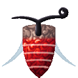
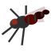
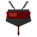
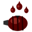
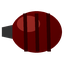
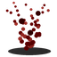

<!-- Generated by tools/build_pack_reference.py. Edit the pack sources and regenerate. -->

# Mushi Mushi no Mi, Model: Mosquito

{ .entry-page-icon }

[Fruits](index.md) · [InoFruits](../../reference/content/inofruits.md)

<!-- fruit inofruits:mushi_mushi_no_mi_model_mosquito -->

| Stat | Value |
| --- | --- |
| Type | Zoan |
| Tier | 2 |
| Fruit damage scaling | 1.00× at 10,000 Doriki → 2× at 50,000 Doriki |
| Abilities | 8 (5 active, 3 passive) |
| Fruit boxes | [Iron Box](../fruit-boxes.md) |

See [damage calculations](../combat-stats.md#damage-from-doriki).

!!! note "Reading the stats"
    Listed base damage is for the named part of the move. Pack and Doriki multipliers are shown separately. Times assume 20 ticks per second.

<!-- move inofruits:mushi_mushi_fly_point -->

## Mushi Mushi Fly Point

{ .entry-move-icon loading=lazy } *Active · Transformation*

Transforms the user into a mosquito, the smallest and weakest form there is.

| Stat | Value |
| --- | --- |
| Pack multiplier when dealing damage | 2.8× |

**Stats while transformed**

| Stat | Value |
| --- | --- |
| Movement speed | +10% of base |
| Punch damage | +1 HP |
| Jump | +1 |

<!-- move inofruits:mushi_mushi_heavy_point -->

## Mushi Mushi Heavy Point

{ .entry-move-icon loading=lazy } *Active · Transformation*

Transforms the user into a mosquito hybrid with big eyes, a proboscis and wings

| Stat | Value |
| --- | --- |
| Pack multiplier when dealing damage | 2.8× |

**Stats while transformed**

| Stat | Value |
| --- | --- |
| Movement speed | +0% of base |
| Punch damage | +4 HP |
| Armor | +1 |
| Jump | +1.2 |

<!-- move inofruits:mushi_mushi_flight -->

## Mushi Mushi Flight

{ .entry-move-icon loading=lazy } *Passive*

| Stat | Value |
| --- | --- |
| Pack multiplier when dealing damage | 2.8× |

<!-- move inofruits:mushi -->

## Mushi

{ .entry-move-icon loading=lazy } *Passive*

While in the mosquito form, hostile mobs won't target the user.

| Stat | Value |
| --- | --- |
| Pack multiplier when dealing damage | 2.8× |

<!-- move inofruits:kyuketsu -->

## Kyuketsu

{ .entry-move-icon loading=lazy } *Active*

Stabs the proboscis into whatever is in front of the user and heals them with part of the damage

| Stat | Value |
| --- | --- |
| Base damage | 7 HP |
| Cooldown | 3 s (60 ticks) |
| Conditional cooldown | 0.5 s (10 ticks) |
| Pack multiplier when dealing damage | 1.9× |

<!-- move inofruits:chibukure -->

## Chibukure

{ .entry-move-icon loading=lazy } *Active*

Uses all the stored blood at once to heal and get a burst of speed, even while flying.

| Stat | Value |
| --- | --- |
| Cooldown | 10 s (200 ticks) |
| Pack multiplier when dealing damage | 2.8× |

<!-- move inofruits:chibukuro -->

## Chibukuro

{ .entry-move-icon loading=lazy } *Passive*

Stores part of the blood the user drinks but it slowly goes bad

| Stat | Value |
| --- | --- |
| Pack multiplier when dealing damage | 2.8× |

<!-- move inofruits:kabashira -->

## Kabashira

{ .entry-move-icon loading=lazy } *Active*

Creates a column of mosquitoes around the user that bites everything inside it.

| Stat | Value |
| --- | --- |
| Pulse damage | 2 HP |
| Min cooldown | 5 s (100 ticks) |
| Cooldown | 11 s (220 ticks) |
| Pack multiplier when dealing damage | 2.8× |

