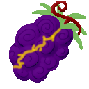
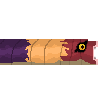
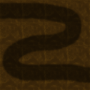
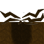
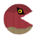

<!-- Generated by tools/build_pack_reference.py. Edit the pack sources and regenerate. -->

# Mushi Mushi no Mi, Model: Sand Wyrm

{ .entry-page-icon }

[Fruits](index.md) · [Akuma no Mi](../../reference/content/akuma.md)

<!-- fruit akuma:mushi_mushi_no_mi_model_sand_wyrm -->

| Stat | Value |
| --- | --- |
| Type | Mythical Zoan |
| Tier | 4 |
| Fruit damage scaling | 1.00× at 10,000 Doriki → 1.75× at 50,000 Doriki |
| Abilities | 6 (5 active, 1 passive) |
| Fruit boxes | [Noble Box](../fruit-boxes.md) |

See [damage calculations](../combat-stats.md#damage-from-doriki).

!!! note "Reading the stats"
    Listed base damage is for the named part of the move. Pack and Doriki multipliers are shown separately. Times assume 20 ticks per second.

<!-- move akuma:sand_wyrm_heavy_point -->

## Sand Wyrm Heavy Point

{ .entry-move-icon loading=lazy } *Active · Transformation*

Transforms the user into the nightmarish Sand Wyrm

| Stat | Value |
| --- | --- |
| Pack multiplier when dealing damage | 1.25× |

<!-- move akuma:tunneling -->

## Tunneling

{ .entry-move-icon loading=lazy } *Active*

Lets the user swim through the ground. Swimming starts by running into a ground block.

| Stat | Value |
| --- | --- |
| Cooldown | 1 s (20 ticks) |
| Pack multiplier when dealing damage | 1.25× |

<!-- move akuma:great_drill -->

## Great Drill

{ .entry-move-icon loading=lazy } *Active*

The user leaps into the air and drills face first into the ground, crushing everything around them.

| Stat | Value |
| --- | --- |
| Cooldown | 15 s (300 ticks) |
| Base damage | 50 HP |
| Pack multiplier when dealing damage | 1.25× |

<!-- move akuma:inhale -->

## Inhale

{ .entry-move-icon loading=lazy } *Active*

Creates a strong vacuum that pulls targets into the user's mouth, crushing them.

| Stat | Value |
| --- | --- |
| Cooldown | 22 s (440 ticks) |
| Base damage | 40 HP |
| Pack multiplier when dealing damage | 1.25× |

<!-- move akuma:consume -->

## Consume

{ .entry-move-icon loading=lazy } *Active*

The user swallows a target whole and carries them around, crushing and blinding them.

| Stat | Value |
| --- | --- |
| Cooldown | 25 s (500 ticks) |
| Miss cooldown | 2 s (40 ticks) |
| Base damage | 5 HP |
| Pack multiplier when dealing damage | 1.25× |

<!-- move akuma:sand_wyrm_night_vision -->

## Night Vision

*Passive*

Grants the user night vision.

| Stat | Value |
| --- | --- |
| Pack multiplier when dealing damage | 1.25× |

