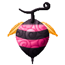
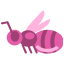
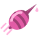
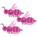
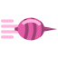
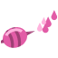
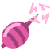

<!-- Generated by tools/build_pack_reference.py. Edit the pack sources and regenerate. -->

# Mushi Mushi no Mi, Model: Suzumebachi

{ .entry-page-icon }

[Fruits](index.md) · [Missing Missing no Mi](../../reference/content/inomissing.md)

<!-- fruit inomissing:mushi_mushi_no_mi_model_suzumebachi -->

| Stat | Value |
| --- | --- |
| Type | Zoan |
| Tier | 2 |
| Fruit damage scaling | 1.00× at 10,000 Doriki → 2× at 50,000 Doriki |
| Abilities | 9 (8 active, 1 passive) |
| Fruit boxes | [Iron Box](../fruit-boxes.md) |

See [damage calculations](../combat-stats.md#damage-from-doriki).

!!! note "Reading the stats"
    Listed base damage is for the named part of the move. Pack and Doriki multipliers are shown separately. Times assume 20 ticks per second.

<!-- move inomissing:suzumebachi_heavy_point -->

## Suzumebachi Heavy Point

{ .entry-move-icon loading=lazy } *Active · Transformation*

Transforms the user into a giant hornet hybrid with four arms that attack fast, wings to fly with and a poisonous stinger.

| Stat | Value |
| --- | --- |
| Pack multiplier when dealing damage | 2.25× |

**Stats while transformed**

| Stat | Value |
| --- | --- |
| Movement speed | +40% of base |
| Maximum health | +20% |
| Punch damage | +6 HP |
| Armour | +5 |
| Toughness | +2 |
| Step height | +0.5 blocks |
| Jump | +1 |

<!-- move inomissing:suzumebachi_walk_point -->

## Suzumebachi Walk Point

{ .entry-move-icon loading=lazy } *Active · Transformation*

Transforms the user into a giant hornet, which is light, fast in the air and has a poisonous stinger.

| Stat | Value |
| --- | --- |
| Pack multiplier when dealing damage | 2.25× |

**Stats while transformed**

| Stat | Value |
| --- | --- |
| Movement speed | +30% of base |
| Maximum health | +10% |
| Punch damage | +5 HP |
| Armour | +3 |
| Toughness | +1 |
| Step height | +1 blocks |
| Jump | +0.5 |

<!-- move inomissing:suzumebachi_flight -->

## Suzumebachi Flight

*Passive*

| Stat | Value |
| --- | --- |
| Pack multiplier when dealing damage | 2.25× |

<!-- move inomissing:stinger -->

## Stinger

{ .entry-move-icon loading=lazy } *Active*

The user stabs the enemy in front of them with their stinger and gives it a strong poison.

| Stat | Value |
| --- | --- |
| Base damage | 7 HP |
| Cooldown | 6 s (120 ticks) |
| Pack multiplier when dealing damage | 1.6× |

<!-- move inomissing:pink_hornets -->

## Pink Hornets

{ .entry-move-icon loading=lazy } *Active*

While in either form, the user calls four pink hornets for 15 seconds. They sting the enemy the user is looking at, or whoever fights the user, and poison it.

| Stat | Value |
| --- | --- |
| Cooldown | 30 s (600 ticks) |
| Pack multiplier when dealing damage | 2.25× |

<!-- move inomissing:needle_dash -->

## Needle Dash

{ .entry-move-icon loading=lazy } *Active*

The user dashes stinger first where they are looking, on the ground or in the air. Every enemy in the way is hurt and poisoned.

| Stat | Value |
| --- | --- |
| Base damage | 14 HP |
| Cooldown | 10 s (200 ticks) |
| Pack multiplier when dealing damage | 2.25× |

<!-- move inomissing:venom_spray -->

## Venom Spray

{ .entry-move-icon loading=lazy } *Active*

The user sprays venom at the eyes of the enemies in front of them. They are hurt, blinded, slowed and poisoned, and a blinded mob loses its target.

| Stat | Value |
| --- | --- |
| Base damage | 5 HP |
| Cooldown | 15 s (300 ticks) |
| Pack multiplier when dealing damage | 2.25× |

<!-- move inomissing:numbing_sting -->

## Numbing Sting

{ .entry-move-icon loading=lazy } *Active*

The user stabs the enemy in front of them with their stinger. The venom paralyses it for 3 seconds.

| Stat | Value |
| --- | --- |
| Base damage | 9 HP |
| Cooldown | 18 s (360 ticks) |
| Pack multiplier when dealing damage | 2.25× |

<!-- move inomissing:mandible_bite -->

## Mandible Bite

{ .entry-move-icon loading=lazy } *Active*

While in the hybrid form, the user bites the enemy in front of them with their mandibles, dealing heavy damage.

| Stat | Value |
| --- | --- |
| Base damage | 22 HP |
| Cooldown | 14 s (280 ticks) |
| Conditional cooldown | 0.5 s (10 ticks) |
| Pack multiplier when dealing damage | 2.25× |

