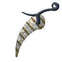
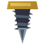
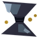
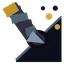

<!-- Generated by tools/build_pack_reference.py. Edit the pack sources and regenerate. -->

# Neji Neji no Mi

{ .entry-page-icon }

[Fruits](index.md) · [InoFruits](../../reference/content/inofruits.md)

<!-- fruit inofruits:neji_neji_no_mi -->

| Stat | Value |
| --- | --- |
| Type | Paramecia |
| Tier | 1 |
| Fruit damage scaling | 1.00× at 10,000 Doriki → 2.25× at 50,000 Doriki |
| Abilities | 5 (5 active, 0 passive) |
| Fruit boxes | [Wooden Box](../fruit-boxes.md) |

See [damage calculations](../combat-stats.md#damage-from-doriki).

!!! note "Reading the stats"
    Listed base damage is for the named part of the move. Pack and Doriki multipliers are shown separately. Times assume 20 ticks per second.

<!-- move inofruits:neji_neji_point -->

## Neji Neji Point

{ .entry-move-icon loading=lazy } *Active · Transformation*

Turns both of the user's forearms into spinning drills, hitting hard but slowly and breaking through stone

| Stat | Value |
| --- | --- |
| Pack multiplier when dealing damage | 1.95× |

**Stats while transformed**

| Stat | Value |
| --- | --- |
| Punch damage | +6 HP |
| Movement speed | -2% of base |

<!-- move inofruits:rasen -->

## Rasen

{ .entry-move-icon loading=lazy } *Active*

Drills a line forward where the user is looking hurting everything in it.

| Stat | Value |
| --- | --- |
| Base damage | 7 HP |
| Cooldown | 5 s (100 ticks) |
| Pack multiplier when dealing damage | 1.5× |

<!-- move inofruits:nejikiri -->

## Nejikiri

{ .entry-move-icon loading=lazy } *Active*

Grabs one target in sight and twists them off their feet

| Stat | Value |
| --- | --- |
| Base damage | 11 HP |
| Cooldown | 6 s (120 ticks) |
| Conditional cooldown | 0.5 s (10 ticks) |
| Pack multiplier when dealing damage | 1.5× |

<!-- move inofruits:nejikomi -->

## Nejikomi

{ .entry-move-icon loading=lazy } *Active*

Drills forward through the ground digging a tunnel and hurting everything caught in it.

| Stat | Value |
| --- | --- |
| Base damage | 12 HP |
| Cooldown | 12 s (240 ticks) |
| Pack multiplier when dealing damage | 1.95× |

<!-- move inofruits:totsushin -->

## Totsushin

{ .entry-move-icon loading=lazy } *Active*

The user points both drills forward and charges, hurting everything they go through.

| Stat | Value |
| --- | --- |
| Base damage | 9 HP |
| Cooldown | 7 s (140 ticks) |
| Pack multiplier when dealing damage | 1.5× |

