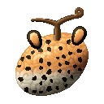
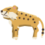
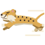
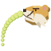
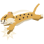
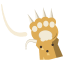
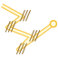

<!-- Generated by tools/build_pack_reference.py. Edit the pack sources and regenerate. -->

# Neko Neko no Mi, Model: Cheetah

{ .entry-page-icon }

[Fruits](index.md) · [Missing Missing no Mi](../../reference/content/inomissing.md)

<!-- fruit inomissing:neko_neko_no_mi_model_cheetah -->

| Stat | Value |
| --- | --- |
| Type | Zoan |
| Tier | 2 |
| Fruit damage scaling | 1.00× at 10,000 Doriki → 2× at 50,000 Doriki |
| Abilities | 7 (7 active, 0 passive) |
| Fruit boxes | [Iron Box](../fruit-boxes.md) |

See [damage calculations](../combat-stats.md#damage-from-doriki).

!!! note "Reading the stats"
    Listed base damage is for the named part of the move. Pack and Doriki multipliers are shown separately. Times assume 20 ticks per second.

<!-- move inomissing:cheetah_heavy_point -->

## Cheetah Heavy Point

{ .entry-move-icon loading=lazy } *Active · Transformation*

Transforms the user into a cheetah hybrid, very fast and light with sharp claws.

| Stat | Value |
| --- | --- |
| Pack multiplier when dealing damage | 1.35× |

**Stats while transformed**

| Stat | Value |
| --- | --- |
| Movement speed | +60% of base |
| Punch damage | +6 HP |
| Armor | +6 |
| Jump | +1.2 |

<!-- move inomissing:cheetah_walk_point -->

## Cheetah Walk Point

{ .entry-move-icon loading=lazy } *Active · Transformation*

Transforms the user into a cheetah, the fastest runner of all with a keen nose.

| Stat | Value |
| --- | --- |
| Pack multiplier when dealing damage | 1.35× |

**Stats while transformed**

| Stat | Value |
| --- | --- |
| Movement speed | +150% of base |
| Punch damage | +5 HP |
| Armor | +3 |
| Step height | +1 blocks |
| Jump | +1.5 |

<!-- move inomissing:sanbai_soku_rocket_dash -->

## Sanbai-soku Rocket Dash

{ .entry-move-icon loading=lazy } *Active*

While in the full cheetah form, the user runs more than twice as fast for a few seconds and turns sharp where they look, the tail keeps them on course. Enemies on the way get hurt and thrown aside

| Stat | Value |
| --- | --- |
| Base damage | 10 HP |
| Cooldown | 15 s (300 ticks) |
| Pack multiplier when dealing damage | 1.35× |

<!-- move inomissing:kagitsuke -->

## Kagitsuke

{ .entry-move-icon loading=lazy } *Active*

While in a cheetah form, the user smells the creature they are looking at, even through walls. It glows, and the user alone sees the trail it left in the last 30 seconds and the one it leaves now

| Stat | Value |
| --- | --- |
| Cooldown | 40 s (800 ticks) |
| Conditional cooldown | 0.5 s (10 ticks) |
| Pack multiplier when dealing damage | 1.35× |

<!-- move inomissing:hayatobi -->

## Hayatobi

{ .entry-move-icon loading=lazy } *Active*

While in a cheetah form, the user leaps on the target and strikes it. Deals more damage if the user was running

| Stat | Value |
| --- | --- |
| Base damage | 14 HP |
| Cooldown | 8 s (160 ticks) |
| Pack multiplier when dealing damage | 1.35× |

<!-- move inomissing:tsumekake -->

## Tsumekake

{ .entry-move-icon loading=lazy } *Active*

While in a cheetah form, the user hooks the leg of the enemy in front of them with a claw. The enemy falls and can't move for a moment, then it is slow for a while

| Stat | Value |
| --- | --- |
| Base damage | 12 HP |
| Cooldown | 9 s (180 ticks) |
| Pack multiplier when dealing damage | 1.35× |

<!-- move inomissing:zebra_rush -->

## Zebra Rush

{ .entry-move-icon loading=lazy } *Active*

While in a cheetah form, the user rushes through the enemies around in a lightning zigzag, 6 times in 3 seconds. Each enemy crossed by a pass gets hit by a claw

| Stat | Value |
| --- | --- |
| Base damage | 5 HP |
| Cooldown | 40 s (800 ticks) |
| Conditional cooldown | 0.5 s (10 ticks) |
| Pack multiplier when dealing damage | 1.35× |

