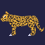

<!-- Generated by tools/build_pack_reference.py. Edit the pack sources and regenerate. -->

# Neko Neko no Mi, Model: Leopard

{ .entry-page-icon }

[Fruits](index.md) · [Mine Mine no Mi](../../reference/content/mineminenomi.md)

<!-- fruit mineminenomi:neko_neko_no_mi_model_leopard -->

| Stat | Value |
| --- | --- |
| Type | Zoan |
| Tier | 2 |
| Fruit damage scaling | 1.00× at 10,000 Doriki → 2× at 50,000 Doriki |
| Abilities | 5 (4 active, 1 passive) |
| Fruit boxes | [Iron Box](../fruit-boxes.md) |

See [damage calculations](../combat-stats.md#damage-from-doriki).

[Jump to awakening](#awakening)

!!! note "Reading the stats"
    Listed base damage is for the named part of the move. Pack and Doriki multipliers are shown separately. Times assume 20 ticks per second.

<!-- move mineminenomi:leopard_walk_point -->

## Leopard Walk Point

{ .entry-move-icon loading=lazy } *Active · Transformation*

Transforms the user into a leopard, which focuses on speed.

| Stat | Value |
| --- | --- |
| Pack multiplier when dealing damage | 4.35× |

<!-- move mineminenomi:leopard_heavy_point -->

## Leopard Heavy Point

{ .entry-move-icon loading=lazy } *Active · Transformation*

Transforms the user into a half-leopard hybrid, which focuses on speed and strength.

| Stat | Value |
| --- | --- |
| Pack multiplier when dealing damage | 4.35× |

<!-- move mineminenomi:ferocious_leap -->

## Ferocious Leap

{ .entry-move-icon loading=lazy } *Active*

Leaps at the enemy and damages all nearby entities on landing.

| Stat | Value |
| --- | --- |
| Cooldown | 8 s (160 ticks) |
| Base damage | 10 HP |
| Pack multiplier when dealing damage | 4.35× |

<!-- move mineminenomi:claw_strike -->

## Claw Strike

{ .entry-move-icon loading=lazy } *Active*

Hits using the user's sharp claws.

| Stat | Value |
| --- | --- |
| Cooldown | 5 s (100 ticks) |
| Pack multiplier when dealing damage | 2.7× |

<!-- move mineminenomi:neko_night_vision -->

## Night Vision

*Passive*

Grants the user night vision.

| Stat | Value |
| --- | --- |
| Pack multiplier when dealing damage | 4.35× |

## Awakening

**Source** · Awaken Awaken no Mi

| Stat | Value |
| --- | --- |
| Doriki | 40,000 |
| Active time with the fruit | About 24 hours (1,728,000 ticks) |

<!-- move awakenawakennomi:awaken_leopard_heavy_point -->

### Awaken Leopard Heavy Point { #awakening-awaken-leopard-heavy-point }

{ .entry-move-icon loading=lazy } *Active · Transformation*

Transforms the user into an awakened leopard hybrid, which focuses on strength and speed.

| Stat | Value |
| --- | --- |
| Cooldown | 0.5 s (10 ticks) |

**Stats while transformed**

| Stat | Value |
| --- | --- |
| Armour | +10 |
| Punch damage | +20 HP |
| Jump | +5 |
| Toughness | +4 |
| Step height | +1 blocks |

<!-- move awakenawakennomi:awaken_leopard_walk_point -->

### Awaken Leopard Walk Point { #awakening-awaken-leopard-walk-point }

{ .entry-move-icon loading=lazy } *Active · Transformation*

Transforms the user into an awakened leopard, which focuses on speed.

| Stat | Value |
| --- | --- |
| Cooldown | 0.5 s (10 ticks) |

**Stats while transformed**

| Stat | Value |
| --- | --- |
| Movement speed | +210% of base |
| Punch damage | +15 HP |
| Jump | +3.5 |
| Step height | +1 blocks |
| Toughness | +2 |

<!-- move awakenawakennomi:shugan -->

### Shugan { #awakening-shugan }

{ .entry-move-icon loading=lazy } *Active*

The user pulls back a hand with all 5 claws out, jumps at the enemy in front and stabs the whole hand through them. Armour does not stop it. Requires the awakened Heavy Point. Shares its cooldown with Shigan.

| Stat | Value |
| --- | --- |
| Cooldown | 25 s (500 ticks) |
| Whiff cooldown | 3 s (60 ticks) |
| Base damage | 55 HP |

<!-- move awakenawakennomi:shugan_madara -->

### Shugan: Madara { #awakening-shugan-madara }

{ .entry-move-icon loading=lazy } *Active*

The user stabs with both clawed hands one after the other, 10 stabs in 1.5 seconds, at every enemy in reach in front. Armour does not stop them and the last stab knocks the enemies back. Requires the awakened Heavy Point. Shares its cooldown with Shigan.

| Stat | Value |
| --- | --- |
| Cooldown | 30 s (600 ticks) |
| Whiff cooldown | 3 s (60 ticks) |
| Base damage | 9 HP |

<!-- move awakenawakennomi:tobu_shigan_bachi -->

### Tobu Shigan "Bachi" { #awakening-tobu-shigan-bachi }

{ .entry-move-icon loading=lazy } *Active*

The user flicks 3 bullets of compressed air from their claws one after the other, each one goes where the user is looking when it is fired. Requires the awakened Heavy Point. Shares its cooldown with Shigan.

| Stat | Value |
| --- | --- |
| Cooldown | 12 s (240 ticks) |
| Whiff cooldown | 1 s (20 ticks) |

<!-- move awakenawakennomi:rankyaku_gaicho -->

### Rankyaku "Gaicho" { #awakening-rankyaku-gaicho }

{ .entry-move-icon loading=lazy } *Active*

The user kicks a blade of air shaped like a big bird with open wings. It cuts every enemy in its way and breaks on the first wall it hits. Requires the awakened Heavy Point. Shares its cooldown with Rankyaku.

| Stat | Value |
| --- | --- |
| Cooldown | 18 s (360 ticks) |

<!-- move awakenawakennomi:rankyaku_hyobi -->

### Rankyaku "Hyobi" { #awakening-rankyaku-hyobi }

{ .entry-move-icon loading=lazy } *Active*

The user spins around and their tail throws a curved blade of air all around them, cutting every enemy it reaches and knocking them back. Requires the awakened Heavy Point. Shares its cooldown with Rankyaku.

| Stat | Value |
| --- | --- |
| Cooldown | 12 s (240 ticks) |
| Base damage | 36 HP |

<!-- move awakenawakennomi:tekkai_utsugi -->

### Tekkai "Utsugi" { #awakening-tekkai-utsugi }

{ .entry-move-icon loading=lazy } *Active*

The user hardens their body for a moment. Every hit that lands in that time is blocked and an enemy that hit from up close takes their own hit back and gets knocked away. Requires the awakened Heavy Point. Shares its cooldown with Tekkai.

| Stat | Value |
| --- | --- |
| Cooldown | 15 s (300 ticks) |
| Whiff cooldown | 4 s (80 ticks) |
| Base damage | 45 HP |

<!-- move awakenawakennomi:sai_dai_rin_rokuogan -->

### Sai Dai Rin: Rokuogan { #awakening-sai-dai-rin-rokuogan }

{ .entry-move-icon loading=lazy } *Active*

The user puts both fists on the enemy in front of them, charges up all their strength and releases it as a shockwave through the enemy's body. Armour does not stop it. The enemy has to be in reach when it is released. Requires the awakened Heavy Point. Shares its cooldown with Rokuogan.

| Stat | Value |
| --- | --- |
| Cooldown | 40 s (800 ticks) |
| Whiff cooldown | 5 s (100 ticks) |
| Base damage | 100 HP |

<!-- move awakenawakennomi:mauling -->

### Mauling { #awakening-mauling }

{ .entry-move-icon loading=lazy } *Active*

The leopard jumps on the enemy in front of it, pins it down and bites it many times, then throws it away with a last bite. Neither of them can move until it is over. Requires the awakened Walk Point.

| Stat | Value |
| --- | --- |
| Cooldown | 27 s (540 ticks) |
| Whiff cooldown | 3 s (60 ticks) |
| Bite damage | 10 HP |
| Last bite damage | 30 HP |

<!-- move awakenawakennomi:tail_hold -->

### Tail Hold { #awakening-tail-hold }

{ .entry-move-icon loading=lazy } *Active*

The user's tail wraps around the closest enemy in front and holds them so they can't move. The user still has both hands free and can walk and attack while holding them. Requires the awakened Heavy Point. Using Sai Dai Rin: Rokuogan lets go of the enemy when it hits.

| Stat | Value |
| --- | --- |
| Cooldown | 20 s (400 ticks) |
| Whiff cooldown | 3 s (60 ticks) |

