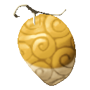
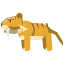
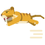
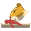
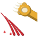
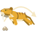
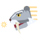
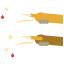

<!-- Generated by tools/build_pack_reference.py. Edit the pack sources and regenerate. -->

# Neko Neko no Mi, Model: Saber Tiger

{ .entry-page-icon }

[Fruits](index.md) · [Missing Missing no Mi](../../reference/content/inomissing.md)

<!-- fruit inomissing:neko_neko_no_mi_model_saber_tiger -->

| Stat | Value |
| --- | --- |
| Type | Ancient Zoan |
| Tier | 2 |
| Fruit damage scaling | 1.00× at 10,000 Doriki → 2× at 50,000 Doriki |
| Abilities | 11 (11 active, 0 passive) |
| Fruit boxes | [Iron Box](../fruit-boxes.md) |

See [damage calculations](../combat-stats.md#damage-from-doriki).

!!! note "Reading the stats"
    Listed base damage is for the named part of the move. Pack and Doriki multipliers are shown separately. Times assume 20 ticks per second.

<!-- move inomissing:saber_tiger_heavy_point -->

## Saber Tiger Heavy Point

{ .entry-move-icon loading=lazy } *Active · Transformation*

Transforms the user into a saber tiger hybrid, which is very fast and agile and has long fangs and sharp claws.

| Stat | Value |
| --- | --- |
| Pack multiplier when dealing damage | 1.35× |

**Stats while transformed**

| Stat | Value |
| --- | --- |
| Movement speed | +30% of base |
| Punch damage | +10 HP |
| Armour | +15 |
| Toughness | +3 |
| Step height | +0.5 blocks |
| Jump | +1.2 |

<!-- move inomissing:saber_tiger_walk_point -->

## Saber Tiger Walk Point

{ .entry-move-icon loading=lazy } *Active · Transformation*

Transforms the user into a saber tiger, a very fast big cat that hunts by surprise with its long fangs.

| Stat | Value |
| --- | --- |
| Pack multiplier when dealing damage | 1.35× |

**Stats while transformed**

| Stat | Value |
| --- | --- |
| Movement speed | +50% of base |
| Punch damage | +13 HP |
| Armour | +15 |
| Toughness | +3 |
| Step height | +1 blocks |
| Jump | +1.2 |

<!-- move inomissing:saber_bite -->

## Saber Bite

{ .entry-move-icon loading=lazy } *Active*

The user bites the enemy in front of them with their long fangs, which go through part of its armor and make it bleed. Deals more damage while crouching or from behind.

| Stat | Value |
| --- | --- |
| Base damage | 16 HP |
| Bleed | 4 s (80 ticks) |
| Cooldown | 10 s (200 ticks) |
| Pack multiplier when dealing damage | 1.35× |

<!-- move inomissing:pounce -->

## Pounce

{ .entry-move-icon loading=lazy } *Active*

The user leaps where they are looking and throws the first enemy they meet to the ground, where it can't move for a moment. Deals more damage if the user was crouching or hits from behind.

| Stat | Value |
| --- | --- |
| Base damage | 16 HP |
| Cooldown | 11 s (220 ticks) |
| Pack multiplier when dealing damage | 1.35× |

<!-- move inomissing:throat_hold -->

## Throat Hold

{ .entry-move-icon loading=lazy } *Active*

After a Pounce, the user holds the enemy they threw down under their fangs, it can't move and takes damage that goes through part of its armor. Use the ability again to let it go.

| Stat | Value |
| --- | --- |
| Base damage | 4 HP |
| Cooldown | 15 s (300 ticks) |
| Pack multiplier when dealing damage | 1.35× |

<!-- move inomissing:claw_rake -->

## Claw Rake

{ .entry-move-icon loading=lazy } *Active*

The user slashes all the enemies in front of them with their claws, making them bleed and pushing them back.

| Stat | Value |
| --- | --- |
| Base damage | 14 HP |
| Bleed | 4 s (80 ticks) |
| Cooldown | 8 s (160 ticks) |
| Pack multiplier when dealing damage | 1.35× |

<!-- move inomissing:roar -->

## Roar

{ .entry-move-icon loading=lazy } *Active*

The user roars, pushing back and weakening all nearby enemies.

| Stat | Value |
| --- | --- |
| Cooldown | 18 s (360 ticks) |
| Pack multiplier when dealing damage | 1.35× |

<!-- move inomissing:evasive_leap -->

## Evasive Leap

{ .entry-move-icon loading=lazy } *Active*

The user leaps backwards and can't be hit during the jump.

| Stat | Value |
| --- | --- |
| Cooldown | 7 s (140 ticks) |
| Pack multiplier when dealing damage | 1.35× |

<!-- move inomissing:gagan -->

## Gagan

{ .entry-move-icon loading=lazy } *Active*

The user shoots a blast of air shaped like their fangs from their mouth at the enemy they are looking at, it goes through part of its armor.

| Stat | Value |
| --- | --- |
| Base damage | 18 HP |
| Cooldown | 10 s (200 ticks) |
| Pack multiplier when dealing damage | 1.35× |

<!-- move inomissing:tekkai_kibasen -->

## Tekkai: Kibasen

{ .entry-move-icon loading=lazy } *Active*

The user hardens their body and fangs and leaps face first where they are looking, the first enemy they meet is hit through part of its armor and sent back. The user takes half the damage during the leap.

| Stat | Value |
| --- | --- |
| Base damage | 20 HP |
| Cooldown | 13 s (260 ticks) |
| Pack multiplier when dealing damage | 1.35× |

<!-- move inomissing:shigan_madara -->

## Shigan: Madara

{ .entry-move-icon loading=lazy } *Active*

The user stabs the enemies in front of them 8 times very fast with the claws of both index fingers, making them bleed.

| Stat | Value |
| --- | --- |
| Base damage | 2.5 HP |
| Bleed | 3 s (60 ticks) |
| Cooldown | 11 s (220 ticks) |
| Pack multiplier when dealing damage | 1.35× |

