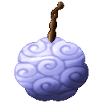

<!-- Generated by tools/build_pack_reference.py. Edit the pack sources and regenerate. -->

# Nemu Nemu no Mi

{ .entry-page-icon }

[Fruits](index.md) · [Missing Missing no Mi](../../reference/content/inomissing.md)

<!-- fruit inomissing:nemu_nemu_no_mi -->

| Stat | Value |
| --- | --- |
| Type | Paramecia |
| Tier | 1 |
| Fruit damage scaling | 1.00× at 10,000 Doriki → 2.25× at 50,000 Doriki |
| Abilities | 5 (5 active, 0 passive) |
| Fruit boxes | [Wooden Box](../fruit-boxes.md) |

See [damage calculations](../combat-stats.md#damage-from-doriki).

!!! note "Reading the stats"
    Listed base damage is for the named part of the move. Pack and Doriki multipliers are shown separately. Times assume 20 ticks per second.

<!-- move inomissing:nemu_komoriuta -->

## Komoriuta

{ .entry-move-icon loading=lazy } *Active*

The user sings a low lullaby and the enemies around fall asleep. A sleeper can't move, hit or use abilities until something hits it. Bosses sleep half as long

| Stat | Value |
| --- | --- |
| Cooldown | 20 s (400 ticks) |
| Pack multiplier when dealing damage | 1.65× |

<!-- move inomissing:nemu_yume_kui -->

## Yume Kui

{ .entry-move-icon loading=lazy } *Active*

The user eats a memory of the sleeper they look at. The user gets stronger and the sleeper weaker for a while and it keeps sleeping When the user gets hit one memory spills out and goes back to its owner

| Stat | Value |
| --- | --- |
| Cooldown | 3 s (60 ticks) |
| Conditional cooldown | 0.5 s (10 ticks) |
| Pack multiplier when dealing damage | 1.65× |

<!-- move inomissing:nemu_saimin -->

## Saimin

{ .entry-move-icon loading=lazy } *Active*

The user looks in the eyes of a sleeper and hypnotizes it. A creature wakes up as the user puppet and fights for them for a while. A player only wakes up slowed. Bosses can't be hypnotized

| Stat | Value |
| --- | --- |
| Cooldown | 30 s (600 ticks) |
| Conditional cooldown | 0.5 s (10 ticks) |
| Pack multiplier when dealing damage | 1.65× |

<!-- move inomissing:nemu_omokage -->

## Omokage

{ .entry-move-icon loading=lazy } *Active*

The user breathes out a purple smoke where the enemies see people from their past. The view of those inside gets blurry and monsters go after the images instead of the user

| Stat | Value |
| --- | --- |
| Cooldown | 25 s (500 ticks) |
| Pack multiplier when dealing damage | 1.65× |

<!-- move inomissing:nemu_yume_no_sekai -->

## Yume no Sekai

{ .entry-move-icon loading=lazy } *Active*

The user sends a white wave and every enemy around falls asleep. The user eats a memory of each of them, up to four, swells up and floats while getting stronger for a while. With nobody around there is nothing to eat Each hit the user gets gives back a part of the memories to everyone Using it again ends the dream, the sleepers wake, the memories stay, and the cooldown is only for the time spent

| Stat | Value |
| --- | --- |
| Cooldown | 120 s (2400 ticks) |
| Pack multiplier when dealing damage | 1.65× |

