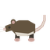
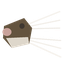

<!-- Generated by tools/build_pack_reference.py. Edit the pack sources and regenerate. -->

# Nezu Nezu no Mi, Model: Rat

{ .entry-page-icon }

[Fruits](index.md) · [InoFruits](../../reference/content/inofruits.md)

<!-- fruit inofruits:nezu_nezu_no_mi_model_rat -->

| Stat | Value |
| --- | --- |
| Type | Zoan |
| Tier | 1 |
| Fruit damage scaling | 1.00× at 10,000 Doriki → 2.25× at 50,000 Doriki |
| Abilities | 6 (5 active, 1 passive) |
| Fruit boxes | [Wooden Box](../fruit-boxes.md) |

See [damage calculations](../combat-stats.md#damage-from-doriki).

!!! note "Reading the stats"
    Listed base damage is for the named part of the move. Pack and Doriki multipliers are shown separately. Times assume 20 ticks per second.

<!-- move inofruits:nezu_nezu_walk_point -->

## Nezu Nezu Walk Point

{ .entry-move-icon loading=lazy } *Active · Transformation*

Transforms the user into a rat, which is small enough to fit anywhere and too light to get hurt by falls.

| Stat | Value |
| --- | --- |
| Pack multiplier when dealing damage | 2.85× |

**Stats while transformed**

| Stat | Value |
| --- | --- |
| Movement speed | +45% of base |
| Punch damage | +2 HP |
| Armour | +1 |
| Step height | +0.5 blocks |
| Jump | +1.2 |

<!-- move inofruits:nezu_nezu_heavy_point -->

## Nezu Nezu Heavy Point

{ .entry-move-icon loading=lazy } *Active · Transformation*

Transforms the user into a rat hybrid with whiskers and a tail, a third smaller and harder to hit

| Stat | Value |
| --- | --- |
| Pack multiplier when dealing damage | 2.85× |

**Stats while transformed**

| Stat | Value |
| --- | --- |
| Movement speed | +30% of base |
| Punch damage | +5 HP |
| Armour | +3 |
| Step height | +0.5 blocks |
| Jump | +1 |
| Toughness | +1 |

<!-- move inofruits:ekibyo -->

## Ekibyo

{ .entry-move-icon loading=lazy } *Active*

Bites the first target in the way giving it a plague that spreads to others.

| Stat | Value |
| --- | --- |
| Cooldown | 15 s (300 ticks) |
| Pack multiplier when dealing damage | 2.85× |

<!-- move inofruits:hassho -->

## Hassho

{ .entry-move-icon loading=lazy } *Active*

Sets off the plague on every nearby carrier dealing all of its remaining damage at once

| Stat | Value |
| --- | --- |
| Cooldown | 12 s (240 ticks) |
| Conditional cooldown | 0.5 s (10 ticks) |
| Pack multiplier when dealing damage | 2.85× |

<!-- move inofruits:hige -->

## Hige

{ .entry-move-icon loading=lazy } *Passive*

While in either rat form, the user can see in the dark

| Stat | Value |
| --- | --- |
| Pack multiplier when dealing damage | 2.85× |

<!-- move inofruits:kajiru -->

## Kajiru

{ .entry-move-icon loading=lazy } *Active*

Gnaws through the block the rat is looking at, taking a bite every half second.

| Stat | Value |
| --- | --- |
| Cooldown | 0.5 s (10 ticks) |
| Pack multiplier when dealing damage | 2.85× |

