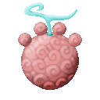
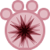
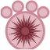

<!-- Generated by tools/build_pack_reference.py. Edit the pack sources and regenerate. -->

# Nikyu Nikyu no Mi

{ .entry-page-icon }

[Fruits](index.md) · [Mine Mine no Mi](../../reference/content/mineminenomi.md)

<!-- fruit mineminenomi:nikyu_nikyu_no_mi -->

| Stat | Value |
| --- | --- |
| Type | Paramecia |
| Tier | 3 |
| Fruit damage scaling | 1.00× at 10,000 Doriki → 1.75× at 50,000 Doriki |
| Abilities | 7 (7 active, 0 passive) |
| Fruit boxes | [Golden Box](../fruit-boxes.md) |

See [damage calculations](../combat-stats.md#damage-from-doriki).

[Jump to awakening](#awakening)

!!! note "Reading the stats"
    Listed base damage is for the named part of the move. Pack and Doriki multipliers are shown separately. Times assume 20 ticks per second.

<!-- move mineminenomi:pad_ho -->

## Pad Ho

{ .entry-move-icon loading=lazy } *Active*

Launches a paw-shaped shockwave at the opponent

| Stat | Value |
| --- | --- |
| Cooldown | 1.5 s (30 ticks) |
| Pack multiplier when dealing damage | 3.5× |

<!-- move mineminenomi:hanpatsu -->

## Hanpatsu

{ .entry-move-icon loading=lazy } *Active*

Anyone the user punches gets sent flying far into the air

| Stat | Value |
| --- | --- |
| Cooldown | 5 s (100 ticks) |
| Pack multiplier when dealing damage | 6× |

<!-- move mineminenomi:tsuppari_pad_ho -->

## Tsuppari Pad Ho

{ .entry-move-icon loading=lazy } *Active*

Launches a barrage of paw-shaped shockwaves at the opponent

| Stat | Value |
| --- | --- |
| Cooldown | 15 s (300 ticks) |
| Pack multiplier when dealing damage | 6× |

<!-- move mineminenomi:ursus_shock -->

## Ursus Shock

{ .entry-move-icon loading=lazy } *Active*

The user compresses air and sends it towards the opponent to create a huge shockwave

| Stat | Value |
| --- | --- |
| Cooldown | 20 s (400 ticks) |
| Pack multiplier when dealing damage | 6× |

<!-- move mineminenomi:puni -->

## Puni

{ .entry-move-icon loading=lazy } *Active*

The user takes a defensive posture that uses their paw pads to repel and counter enemy attacks

| Stat | Value |
| --- | --- |
| Cooldown | 4 s (80 ticks) |
| Base damage | 15 HP |
| Pack multiplier when dealing damage | 3.5× |

<!-- move mineminenomi:nikyu_push -->

## Nikyu Push

{ .entry-move-icon loading=lazy } *Active*

Allows the user to push themselves in the direction they're looking at incredible speed

| Stat | Value |
| --- | --- |
| Cooldown | 7 s (140 ticks) |
| Pack multiplier when dealing damage | 6× |

<!-- move mineminenomi:pain_repel -->

## Pain Repel

{ .entry-move-icon loading=lazy } *Active*

Extracts all the damage their target has suffered condensing it into a small paw-shaped ball.

| Stat | Value |
| --- | --- |
| Cooldown | 60 s (1200 ticks) |
| Pack multiplier when dealing damage | 6× |

## Awakening

**Source** · Awaken Awaken no Mi

| Stat | Value |
| --- | --- |
| Doriki | 40,000 |
| Active time with the fruit | About 24 hours (1,728,000 ticks) |

<!-- move awakenawakennomi:dai_hanpatsu -->

### Dai Hanpatsu { #awakening-dai-hanpatsu }

{ .entry-move-icon loading=lazy } *Active*

Blasts the target with a huge paw, sending them flying far away where they land safely Use while crouching to send yourself away instead. Can only send them to places that were already explored

| Stat | Value |
| --- | --- |
| Cooldown | 360 s (7200 ticks) |

<!-- move awakenawakennomi:nikyu_no_itami -->

### Nikyu no Itami { #awakening-nikyu-no-itami }

{ .entry-move-icon loading=lazy } *Passive*

Absorbs 20% of incoming damage into a pain gauge Stops absorbing once the gauge is full.

<!-- move awakenawakennomi:ursus_calamiti -->

### Ursus Calamiti { #awakening-ursus-calamiti }

{ .entry-move-icon loading=lazy } *Active*

Releases all the stored pain as a huge repulsive shockwave Damage and blast size go up with the stored pain.

| Stat | Value |
| --- | --- |
| Min cooldown | 15 s (300 ticks) |
| Max cooldown | 60 s (1200 ticks) |
| Cooldown | 60 s (1200 ticks) |

