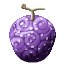

<!-- Generated by tools/build_pack_reference.py. Edit the pack sources and regenerate. -->

# Noko Noko no Mi

{ .entry-page-icon }

[Fruits](index.md) · [Missing Missing no Mi](../../reference/content/inomissing.md)

<!-- fruit inomissing:noko_noko_no_mi -->

| Stat | Value |
| --- | --- |
| Type | Paramecia |
| Tier | 2 |
| Fruit damage scaling | 1.00× at 10,000 Doriki → 2× at 50,000 Doriki |
| Abilities | 7 (7 active, 0 passive) |
| Fruit boxes | [Iron Box](../fruit-boxes.md) |

See [damage calculations](../combat-stats.md#damage-from-doriki).

!!! note "Reading the stats"
    Listed base damage is for the named part of the move. Pack and Doriki multipliers are shown separately. Times assume 20 ticks per second.

<!-- move inomissing:spin_drill -->

## Spin Drill

{ .entry-move-icon loading=lazy } *Active*

The user's hand becomes a drill that pierces the enemy in front of them and fills the wound with poisonous spores

| Stat | Value |
| --- | --- |
| Base damage | 12 HP |
| Cooldown | 7 s (140 ticks) |

<!-- move inomissing:shade_dance -->

## Shade Dance

{ .entry-move-icon loading=lazy } *Active*

The user fires 10 bullets of spores where they are looking, each one poisons the enemy it hits

| Stat | Value |
| --- | --- |
| Base damage | 1.5 HP |
| Cooldown | 8 s (160 ticks) |

<!-- move inomissing:cross_shade -->

## Cross Shade

{ .entry-move-icon loading=lazy } *Active*

The user fires 5 streams of spores at once in front of them, each bullet poisons the enemy it hits

| Stat | Value |
| --- | --- |
| Base damage | 1.5 HP |
| Cooldown | 12 s (240 ticks) |

<!-- move inomissing:lot_stiffen -->

## Lot Stiffen

{ .entry-move-icon loading=lazy } *Active*

The user creates 6 copies of themselves made of spores that attract the enemies around. A destroyed copy leaves a small cloud of spores

| Stat | Value |
| --- | --- |
| Cooldown | 25 s (500 ticks) |

<!-- move inomissing:run_hypha -->

## Run Hypha

{ .entry-move-icon loading=lazy } *Active*

Spores run through the ground to the enemy the user is looking at and grow into fungi around them, they are stuck in place and poisoned Use the ability again to release the enemy

| Stat | Value |
| --- | --- |
| Cooldown | 16 s (320 ticks) |

<!-- move inomissing:snow_spore -->

## Snow Spore

{ .entry-move-icon loading=lazy } *Active*

The user releases a cloud of spores in front of them, everyone inside is poisoned and paralyzed for a moment. Fire burns the cloud away

| Stat | Value |
| --- | --- |
| Cooldown | 25 s (500 ticks) |

<!-- move inomissing:fatal_bomb -->

## Fatal Bomb

{ .entry-move-icon loading=lazy } *Active*

The user fires a sphere full of spores that bursts into a huge deadly cloud, everyone inside but the user is heavily poisoned and paralyzed for a moment. Fire burns the cloud away

| Stat | Value |
| --- | --- |
| Base damage | 10 HP |
| Cooldown | 180 s (3600 ticks) |
| Pack multiplier when dealing damage | 0.75× |

