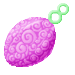
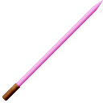
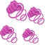

<!-- Generated by tools/build_pack_reference.py. Edit the pack sources and regenerate. -->

# Noro Noro no Mi

{ .entry-page-icon }

[Fruits](index.md) · [Mine Mine no Mi](../../reference/content/mineminenomi.md)

<!-- fruit mineminenomi:noro_noro_no_mi -->

| Stat | Value |
| --- | --- |
| Type | Paramecia |
| Tier | 1 |
| Fruit damage scaling | 1.00× at 10,000 Doriki → 2.25× at 50,000 Doriki |
| Abilities | 3 (3 active, 0 passive) |
| Fruit boxes | [Wooden Box](../fruit-boxes.md) |

See [damage calculations](../combat-stats.md#damage-from-doriki).

[Jump to awakening](#awakening)

!!! note "Reading the stats"
    Listed base damage is for the named part of the move. Pack and Doriki multipliers are shown separately. Times assume 20 ticks per second.

<!-- move mineminenomi:noro_noro_beam -->

## Noro Noro Beam

{ .entry-move-icon loading=lazy } *Active*

Shoots a beam of photons at the opponent, completely slowing them down (multiple hits stack the Slowness effect)

| Stat | Value |
| --- | --- |
| Cooldown | 3 s (60 ticks) |
| Pack multiplier when dealing damage | 2.8× |

<!-- move mineminenomi:noro_noro_beam_sword -->

## Noro Noro Beam Sword

{ .entry-move-icon loading=lazy } *Active*

Focuses photons inside a hilt to create a sword, which slows enemies upon hit

| Stat | Value |
| --- | --- |
| Pack multiplier when dealing damage | 2.8× |

<!-- move mineminenomi:kyubi_rush -->

## Kyubi Rush

{ .entry-move-icon loading=lazy } *Active*

While the opponent is slowed, the user delivers a series of punches, which hits the opponent all at once (a stronger slowness effect causes more damage)

| Stat | Value |
| --- | --- |
| Cooldown | 5 s (100 ticks) |
| Min damage | 1 HP |
| Max damage | 100 HP |
| Pack multiplier when dealing damage | 2.8× |

## Awakening

**Source** · Awaken Awaken no Mi

| Stat | Value |
| --- | --- |
| Doriki | 40,000 |
| Active time with the fruit | About 24 hours (1,728,000 ticks) |

<!-- move awakenawakennomi:reverse_slow -->

### Reverse Slow { #awakening-reverse-slow }

*Active*

Reverses the Noroma rays to give the user four levels of Speed. The faster the user goes, the faster their other abilities recover and charge.

<!-- move awakenawakennomi:reverse_slow_smash -->

### Reverse Slow : Smash { #awakening-reverse-slow-smash }

{ .entry-move-icon loading=lazy } *Passive*

Running into enemies at high speed damages them

<!-- move awakenawakennomi:noroma_field -->

### Noroma Field { #awakening-noroma-field }

{ .entry-move-icon loading=lazy } *Active*

Fills the area with Noroma photons, enemies inside get slower the longer they stay and their abilities recover and charge way slower. Projectiles fired by enemies move really slow inside the field.

| Stat | Value |
| --- | --- |
| Field cooldown | 60 s (1200 ticks) |
| Cooldown | 60 s (1200 ticks) |

