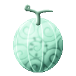

<!-- Generated by tools/build_pack_reference.py. Edit the pack sources and regenerate. -->

# Nuke Nuke no Mi

{ .entry-page-icon }

[Fruits](index.md) · [Missing Missing no Mi](../../reference/content/inomissing.md)

<!-- fruit inomissing:nuke_nuke_no_mi -->

| Stat | Value |
| --- | --- |
| Type | Paramecia |
| Tier | 1 |
| Fruit damage scaling | 1.00× at 10,000 Doriki → 2.25× at 50,000 Doriki |
| Abilities | 5 (5 active, 0 passive) |
| Fruit boxes | [Wooden Box](../fruit-boxes.md) |

See [damage calculations](../combat-stats.md#damage-from-doriki).

!!! note "Reading the stats"
    Listed base damage is for the named part of the move. Pack and Doriki multipliers are shown separately. Times assume 20 ticks per second.

<!-- move inomissing:pass_through -->

## Pass Through

{ .entry-move-icon loading=lazy } *Active*

The user walks through walls and floors. Crouching sinks into the ground and jumping rises through a ceiling The user cannot pass through water. If it ends inside a block, the user is pushed to the nearest free place

| Stat | Value |
| --- | --- |
| Min cooldown | 5 s (100 ticks) |
| Pack multiplier when dealing damage | 2.85× |

<!-- move inomissing:through_illusion -->

## Through Illusion

{ .entry-move-icon loading=lazy } *Active*

The user dives into the ground and comes up behind the enemy looked at, striking it with whatever is held

| Stat | Value |
| --- | --- |
| Base damage | 6 HP |
| Cooldown | 8 s (160 ticks) |
| Conditional cooldown | 0.5 s (10 ticks) |
| Pack multiplier when dealing damage | 2.85× |

<!-- move inomissing:bottomless_hell -->

## Bottomless Hell

{ .entry-move-icon loading=lazy } *Active*

The ground under the enemy looked at lets everything through, a deep pit opens for a moment then closes and throws out whoever fell in The blocks come back to their place. Where blocks cannot be changed, the enemies are held in the ground instead

| Stat | Value |
| --- | --- |
| Base damage | 8 HP |
| Cooldown | 20 s (400 ticks) |
| Pack multiplier when dealing damage | 2.85× |

<!-- move inomissing:take_along -->

## Take Along

{ .entry-move-icon loading=lazy } *Active*

The user takes the ally looked at along, held at the user's side the ally passes through blocks with the user A player must be crouching to be taken along, and is released by crouching again. When released, the ally is put in the nearest free place

| Stat | Value |
| --- | --- |
| Cooldown | 12 s (240 ticks) |
| Pack multiplier when dealing damage | 2.85× |

<!-- move inomissing:untouched -->

## Untouched

{ .entry-move-icon loading=lazy } *Active*

For a moment, arrows, bullets and thrown weapons pass through the user without harming him

| Stat | Value |
| --- | --- |
| Cooldown | 15 s (300 ticks) |
| Pack multiplier when dealing damage | 2.85× |

