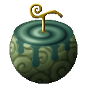
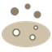
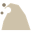

<!-- Generated by tools/build_pack_reference.py. Edit the pack sources and regenerate. -->

# Numa Numa no Mi

{ .entry-page-icon }

[Fruits](index.md) · [Missing Missing no Mi](../../reference/content/inomissing.md)

<!-- fruit inomissing:numa_numa_no_mi -->

| Stat | Value |
| --- | --- |
| Type | Logia |
| Tier | 3 |
| Fruit damage scaling | 1.00× at 10,000 Doriki → 1.75× at 50,000 Doriki |
| Abilities | 11 (10 active, 1 passive) |
| Fruit boxes | [Golden Box](../fruit-boxes.md) |

See [damage calculations](../combat-stats.md#damage-from-doriki).

!!! note "Reading the stats"
    Listed base damage is for the named part of the move. Pack and Doriki multipliers are shown separately. Times assume 20 ticks per second.

<!-- move inomissing:logia_invulnerability_numa -->

## Logia Invulnerability Numa

{ .entry-move-icon loading=lazy } *Passive*

Arrows and thrown items that hit the user's swamp body are absorbed and stored inside it.

| Stat | Value |
| --- | --- |
| Pack multiplier when dealing damage | 1.7× |

<!-- move inomissing:numa_numa_no_gatling_gun -->

## Numa Numa no Gatling Gun

{ .entry-move-icon loading=lazy } *Active*

Shoots a burst of the things stored inside the swamp, first the arrows and then mud balls

| Stat | Value |
| --- | --- |
| Cooldown | 10 s (200 ticks) |
| Mud damage | 1.5 HP |
| Pack multiplier when dealing damage | 1.7× |

<!-- move inomissing:numachi -->

## Numachi

{ .entry-move-icon loading=lazy } *Active*

Turns the ground around the user into a swamp for a while, everyone else sinks in it and is slowed.

| Stat | Value |
| --- | --- |
| Cooldown | 20 s (400 ticks) |
| Conditional cooldown | 1 s (20 ticks) |
| Pack multiplier when dealing damage | 1.7× |

<!-- move inomissing:numa_kyu -->

## Numa Kyu

{ .entry-move-icon loading=lazy } *Active*

Traps the enemy the user is looking at inside a sphere of mud, which holds it, blinds it and suffocates it

| Stat | Value |
| --- | --- |
| Close damage | 3 HP |
| Smother damage | 2 HP |
| Cooldown | 15 s (300 ticks) |
| Pack multiplier when dealing damage | 1.7× |

<!-- move inomissing:hikizuri_komi -->

## Hikizuri Komi

{ .entry-move-icon loading=lazy } *Active*

Pulls a nearby enemy inside the user's swamp body, where it is held and suffocates, and then spits it out. The range is bigger if the enemy is standing in the swamp. An ally can be hidden inside the same way, without harm, and comes out by crouching.

| Stat | Value |
| --- | --- |
| Smother damage | 2 HP |
| Spit damage | 4 HP |
| Cooldown | 18 s (360 ticks) |
| Pack multiplier when dealing damage | 1.7× |

<!-- move inomissing:numa_sensui -->

## Numa Sensui

{ .entry-move-icon loading=lazy } *Active*

The user sinks into the ground and moves under it while hidden, then comes back up

| Stat | Value |
| --- | --- |
| Min cooldown | 5 s (100 ticks) |
| Pack multiplier when dealing damage | 1.7× |

<!-- move inomissing:numa_kura -->

## Numa Kura

{ .entry-move-icon loading=lazy } *Active*

Opens the storage of the swamp. Everything the swamp absorbs is kept here, the arrows are used by the Gatling Gun.

| Stat | Value |
| --- | --- |
| Cooldown | 1 s (20 ticks) |
| Pack multiplier when dealing damage | 1.7× |

<!-- move inomissing:doro_nami -->

## Doro Nami

{ .entry-move-icon loading=lazy } *Active*

The user sends a wave of mud in front of them, damaging all enemies in its path, pushing them back and slowing them. The wave leaves a swamp behind it for a while

| Stat | Value |
| --- | --- |
| Base damage | 14 HP |
| Cooldown | 12 s (240 ticks) |
| Pack multiplier when dealing damage | 1.7× |

<!-- move inomissing:numa_no_te -->

## Numa no Te

{ .entry-move-icon loading=lazy } *Active*

Hands of mud come out of the ground and grab the enemy the user is looking at and all enemies standing in the swamp, damaging them and holding them in place

| Stat | Value |
| --- | --- |
| Base damage | 18 HP |
| Cooldown | 15 s (300 ticks) |
| Pack multiplier when dealing damage | 1.7× |

<!-- move inomissing:haki_dashi -->

## Haki Dashi

{ .entry-move-icon loading=lazy } *Active*

The swamp spits 3 big volleys of the things stored inside it in front of the user, first the arrows and then mud balls

| Stat | Value |
| --- | --- |
| Mud damage | 6 HP |
| Cooldown | 14 s (280 ticks) |
| Pack multiplier when dealing damage | 1.7× |

<!-- move inomissing:sokonashi_numa -->

## Sokonashi Numa

{ .entry-move-icon loading=lazy } *Active*

Turns the ground around the user into a bottomless swamp, all enemies standing in it are swallowed and suffocate for a few seconds, then the swamp spits them out with heavy damage

| Stat | Value |
| --- | --- |
| Smother damage | 3 HP |
| Spit damage | 28 HP |
| Cooldown | 45 s (900 ticks) |
| Laid cooldown | 20 s (400 ticks) |
| Conditional cooldown | 5 s (100 ticks) |
| Pack multiplier when dealing damage | 1.7× |

