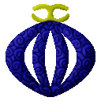

<!-- Generated by tools/build_pack_reference.py. Edit the pack sources and regenerate. -->

# Ori Ori no Mi

{ .entry-page-icon }

[Fruits](index.md) · [Mine Mine no Mi](../../reference/content/mineminenomi.md)

<!-- fruit mineminenomi:ori_ori_no_mi -->

| Stat | Value |
| --- | --- |
| Type | Paramecia |
| Tier | 1 |
| Fruit damage scaling | 1.00× at 10,000 Doriki → 2.25× at 50,000 Doriki |
| Abilities | 3 (3 active, 0 passive) |
| Fruit boxes | [Wooden Box](../fruit-boxes.md) |

See [damage calculations](../combat-stats.md#damage-from-doriki).

[Jump to awakening](#awakening)

!!! note "Reading the stats"
    Listed base damage is for the named part of the move. Pack and Doriki multipliers are shown separately. Times assume 20 ticks per second.

<!-- move mineminenomi:bind -->

## Bind

{ .entry-move-icon loading=lazy } *Active*

Punching ability that binds the target.

| Stat | Value |
| --- | --- |
| Cooldown | 5 s (100 ticks) |
| Pack multiplier when dealing damage | 3.5× |

<!-- move mineminenomi:great_cage -->

## Great Cage

{ .entry-move-icon loading=lazy } *Active*

Creates a big cage trapping the user and all nearby entities in it.

| Stat | Value |
| --- | --- |
| Min cooldown | 2 s (40 ticks) |
| Max cooldown | 17 s (340 ticks) |
| Pack multiplier when dealing damage | 6× |

<!-- move mineminenomi:awase_baori -->

## Awase Baori

{ .entry-move-icon loading=lazy } *Active*

Launches a short range projectile that creates a small cage around the hit target.

| Stat | Value |
| --- | --- |
| Cooldown | 10 s (200 ticks) |
| Pack multiplier when dealing damage | 6× |

## Awakening

**Source** · Awaken Awaken no Mi

| Stat | Value |
| --- | --- |
| Doriki | 40,000 |
| Active time with the fruit | About 24 hours (1,728,000 ticks) |

<!-- move awakenawakennomi:spirit_seal -->

### Spirit Seal { #awakening-spirit-seal }

{ .entry-move-icon loading=lazy } *Active*

Hits the target and seals them, stopping them from using any abilities for a while.

| Stat | Value |
| --- | --- |
| Cooldown | 40 s (800 ticks) |

<!-- move awakenawakennomi:iron_tether -->

### Iron Tether { #awakening-iron-tether }

{ .entry-move-icon loading=lazy } *Active*

Fires an iron band that chains the enemy it hits to the closest enemy nearby, or to the ground if there is none. Chained enemies can't get far from each other and share the damage they take. Using it again pulls the chain tight, slamming them together.

| Stat | Value |
| --- | --- |
| Snap damage | 60 HP |
| Cooldown | 90 s (1800 ticks) |
| Miss cooldown | 15 s (300 ticks) |

<!-- move awakenawakennomi:bound_hands -->

### Bound Hands { #awakening-bound-hands }

{ .entry-move-icon loading=lazy } *Passive*

Enemies near the user whose hands are bound can't use items, so no eating, no potions, no shields and no bows.
