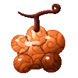

<!-- Generated by tools/build_pack_reference.py. Edit the pack sources and regenerate. -->

# Pamu Pamu no Mi

{ .entry-page-icon }

[Fruits](index.md) · [Missing Missing no Mi](../../reference/content/inomissing.md)

<!-- fruit inomissing:pamu_pamu_no_mi -->

| Stat | Value |
| --- | --- |
| Type | Paramecia |
| Tier | 2 |
| Fruit damage scaling | 1.00× at 10,000 Doriki → 2× at 50,000 Doriki |
| Abilities | 9 (9 active, 0 passive) |
| Fruit boxes | [Iron Box](../fruit-boxes.md) |

See [damage calculations](../combat-stats.md#damage-from-doriki).

!!! note "Reading the stats"
    Listed base damage is for the named part of the move. Pack and Doriki multipliers are shown separately. Times assume 20 ticks per second.

<!-- move inomissing:met_punc -->

## Met Punc

{ .entry-move-icon loading=lazy } *Active*

Makes the user's helmet inflate and explode into shrapnel all around them. The user needs to wear something on their head

| Stat | Value |
| --- | --- |
| Base damage | 14 HP |
| Cooldown | 10 s (200 ticks) |
| Pack multiplier when dealing damage | 1.65× |

<!-- move inomissing:bracchium -->

## Bracchium

{ .entry-move-icon loading=lazy } *Active*

Inflates the bands on the user's wrists until they explode, damaging the enemies right in front of them.

| Stat | Value |
| --- | --- |
| Base damage | 15 HP |
| Cooldown | 8 s (160 ticks) |
| Pack multiplier when dealing damage | 1.65× |

<!-- move inomissing:jirai_punc -->

## Jirai Punc

{ .entry-move-icon loading=lazy } *Active*

Turns the ground around the user into mines for a while, the blocks explodes when an enemy walks on them

| Stat | Value |
| --- | --- |
| Base damage | 10 HP |
| Cooldown | 20 s (400 ticks) |
| Conditional cooldown | 1 s (20 ticks) |
| Pack multiplier when dealing damage | 1.65× |

<!-- move inomissing:punc_bala -->

## Punc Bala

{ .entry-move-icon loading=lazy } *Active*

Swells the next projectile the user shoots, an arrow, a bullet, a cannonball or a trident. It bursts where it lands and hurts every enemy around

| Stat | Value |
| --- | --- |
| Base damage | 8 HP |
| Cooldown | 15 s (300 ticks) |
| Conditional cooldown | 0.5 s (10 ticks) |
| Pack multiplier when dealing damage | 1.65× |

<!-- move inomissing:catapult_punc -->

## Catapult Punc

{ .entry-move-icon loading=lazy } *Active*

Shoots multiple bullets from the launchers on the user's arms, that inflates while flying and explodes on impact

| Stat | Value |
| --- | --- |
| Base damage | 6 HP |
| Cooldown | 12 s (240 ticks) |
| Pack multiplier when dealing damage | 1.65× |

<!-- move inomissing:punc_rock_fest -->

## Punc Rock Fest

{ .entry-move-icon loading=lazy } *Active*

Makes the ground around the user inflate and explode, damaging and pushing back the enemies.

| Stat | Value |
| --- | --- |
| Base damage | 16 HP |
| Cooldown | 15 s (300 ticks) |
| Pack multiplier when dealing damage | 1.65× |

<!-- move inomissing:punc_hair -->

## Punc Hair

{ .entry-move-icon loading=lazy } *Active*

The user's hair explodes into a lot of needles that paralyzes the enemies they hit.

| Stat | Value |
| --- | --- |
| Base damage | 2.5 HP |
| Cooldown | 12 s (240 ticks) |
| Pack multiplier when dealing damage | 1.65× |

<!-- move inomissing:fashion_punc -->

## Fashion Punc

{ .entry-move-icon loading=lazy } *Active · Transformation*

Inflates the user into a giant balloon, the first hit taken makes it explode instead of damaging the user, launching needles all around

| Stat | Value |
| --- | --- |
| Blast damage | 12 HP |
| Needle damage | 2.5 HP |
| Cooldown | 20 s (400 ticks) |
| Pack multiplier when dealing damage | 1.65× |

**Stats while transformed**

| Stat | Value |
| --- | --- |
| Movement speed | -30% of base |
| Jump | -0.5 |

<!-- move inomissing:punc_rock_super_arena -->

## Punc Rock Super Arena

{ .entry-move-icon loading=lazy } *Active*

Inflates the ground in a huge area around the user and then makes it all explode at once, damaging all the enemies inside.

| Stat | Value |
| --- | --- |
| Base damage | 28 HP |
| Cooldown | 60 s (1200 ticks) |
| Pack multiplier when dealing damage | 1.65× |

