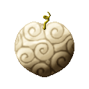
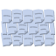

<!-- Generated by tools/build_pack_reference.py. Edit the pack sources and regenerate. -->

# Pasa Pasa no Mi

{ .entry-page-icon }

[Fruits](index.md) · [Missing Missing no Mi](../../reference/content/inomissing.md)

<!-- fruit inomissing:pasa_pasa_no_mi -->

| Stat | Value |
| --- | --- |
| Type | Logia |
| Tier | 3 |
| Fruit damage scaling | 1.00× at 10,000 Doriki → 1.75× at 50,000 Doriki |
| Abilities | 12 (10 active, 2 passive) |
| Fruit boxes | [Golden Box](../fruit-boxes.md) |

See [damage calculations](../combat-stats.md#damage-from-doriki).

!!! note "Reading the stats"
    Listed base damage is for the named part of the move. Pack and Doriki multipliers are shown separately. Times assume 20 ticks per second.

<!-- move inomissing:logia_invulnerability_pasa -->

## Logia Invulnerability Pasa

{ .entry-move-icon loading=lazy } *Passive*

The user's body is made of sheets of paper, fire always hurts them and deals 50% more damage. A dye or an ink sac used on the user smudges their pages for 10 seconds, no Sefer and no Warding Page, and fire is deadly again.

| Stat | Value |
| --- | --- |
| Cut damage | 3 HP |
| Pack multiplier when dealing damage | 2.15× |

<!-- move inomissing:paper_swarm -->

## Paper Swarm

{ .entry-move-icon loading=lazy } *Active*

The user scatters into a swarm of sheets of paper allowing them to fly, and the sheets cut the enemies the swarm goes through. Fire burns the sheets and stops the flight. The swarm ends when they land with no stamina left.

| Stat | Value |
| --- | --- |
| Cooldown | 2 s (40 ticks) |
| Cut damage | 4 HP |
| Pack multiplier when dealing damage | 1.6× |

<!-- move inomissing:paper_flight -->

## Paper Flight

{ .entry-move-icon loading=lazy } *Passive*

While scattered into a swarm of sheets with Paper Swarm the user can fly, until they have no more stamina.

| Stat | Value |
| --- | --- |
| Pack multiplier when dealing damage | 2.15× |

<!-- move inomissing:paper_blades -->

## Paper Blades

{ .entry-move-icon loading=lazy } *Active*

The user throws a volley of sheets of paper as sharp as blades where they are looking.

| Stat | Value |
| --- | --- |
| Base damage | 3 HP |
| Cooldown | 10 s (200 ticks) |
| Pack multiplier when dealing damage | 2.15× |

<!-- move inomissing:paper_storm -->

## Paper Storm

{ .entry-move-icon loading=lazy } *Active*

Sheets of paper whirl around the user and keep cutting all the enemies close to them. Fire on the user burns the sheets and ends it. Use the ability again to stop the storm.

| Stat | Value |
| --- | --- |
| Base damage | 4 HP |
| Cooldown | 16 s (320 ticks) |
| Pack multiplier when dealing damage | 2.15× |

<!-- move inomissing:paper_mummy -->

## Paper Mummy

{ .entry-move-icon loading=lazy } *Active*

Sheets of paper wrap the enemy the user is looking at like a mummy, they can't move, attack or use abilities and are damaged every second (2 seconds for a player or a boss). Fire on the enemy burns the sheets away.

| Stat | Value |
| --- | --- |
| Wind damage | 5 HP |
| Tighten damage | 2.5 HP |
| Cooldown | 20 s (400 ticks) |
| Pack multiplier when dealing damage | 2.15× |

<!-- move inomissing:paper_wall -->

## Paper Wall

{ .entry-move-icon loading=lazy } *Active*

Sheets of paper gather into a wall in front of the user that stops enemies and projectiles for a while. Fire burns the wall. Using the ability again brings the wall down.

| Stat | Value |
| --- | --- |
| Cooldown | 20 s (400 ticks) |
| Pack multiplier when dealing damage | 2.15× |

<!-- move inomissing:sefer_ha_bahir -->

## Sefer Ha-Bahir

{ .entry-move-icon loading=lazy } *Active*

The user throws a page marked with the symbol of brightness at the enemy in front of them. It explodes where it lands, hurting the enemies around, and sets its target on fire. The user throws pages marked with the symbol of splendor at the enemies in front of them. Each one explodes under a lightning strike, hurting the enemies around it. Using it puts the other Sefer on a 10 seconds cooldown.

| Stat | Value |
| --- | --- |
| Base damage | 18 HP |
| Cooldown | 12 s (240 ticks) |
| Zohar damage | 12 HP |
| Zohar cooldown | 16 s (320 ticks) |
| Pack multiplier when dealing damage | 2.15× |

<!-- move inomissing:sefer_atziluth -->

## Sefer Atziluth

{ .entry-move-icon loading=lazy } *Active*

The user throws pages marked with the symbol of emanation at the enemies in front of them, poisoning each one. The user throws pages marked with the symbol of action at the enemies in front of them, paralysing each one for a few seconds. Using it puts the other Sefer on a 10 seconds cooldown.

| Stat | Value |
| --- | --- |
| Base damage | 4 HP |
| Cooldown | 16 s (320 ticks) |
| Assiah damage | 3 HP |
| Assiah cooldown | 20 s (400 ticks) |
| Pack multiplier when dealing damage | 2.15× |

<!-- move inomissing:sefer_briah -->

## Sefer Briah

{ .entry-move-icon loading=lazy } *Active*

The user marks a page with the symbol of creation that heals them, and keeps healing them for a few seconds. Using it puts the other Sefer on a 10 seconds cooldown.

| Stat | Value |
| --- | --- |
| Cooldown | 45 s (900 ticks) |
| Pack multiplier when dealing damage | 2.15× |

<!-- move inomissing:sefer_yetzirah -->

## Sefer Yetzirah

{ .entry-move-icon loading=lazy } *Active*

The user marks a page with the symbol of formation and scatters into loose sheets, dodging every attack for a short time, even those imbued with Haki. Using it puts the other Sefer on a 10 seconds cooldown.

| Stat | Value |
| --- | --- |
| Cooldown | 25 s (500 ticks) |
| Pack multiplier when dealing damage | 2.15× |

<!-- move inomissing:warding_page -->

## Warding Page

{ .entry-move-icon loading=lazy } *Active*

The user marks a page that protects their paper from fire for a while, fire deals its normal damage and doesn't stop the flight anymore.

| Stat | Value |
| --- | --- |
| Cooldown | 45 s (900 ticks) |
| Pack multiplier when dealing damage | 2.15× |

