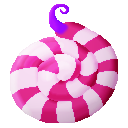

<!-- Generated by tools/build_pack_reference.py. Edit the pack sources and regenerate. -->

# Pero Pero no Mi

{ .entry-page-icon }

[Fruits](index.md) · [Mine Mine no Mi](../../reference/content/mineminenomi.md)

<!-- fruit mineminenomi:pero_pero_no_mi -->

| Stat | Value |
| --- | --- |
| Type | Paramecia |
| Tier | 2 |
| Fruit damage scaling | 1.00× at 10,000 Doriki → 2× at 50,000 Doriki |
| Abilities | 6 (5 active, 1 passive) |
| Fruit boxes | [Iron Box](../fruit-boxes.md) |

See [damage calculations](../combat-stats.md#damage-from-doriki).

[Jump to awakening](#awakening)

!!! note "Reading the stats"
    Listed base damage is for the named part of the move. Pack and Doriki multipliers are shown separately. Times assume 20 ticks per second.

<!-- move mineminenomi:candy_man -->

## Candy Man

{ .entry-move-icon loading=lazy } *Active*

Traps the target inside hardened candy, immobilizing and suffocating them.

| Stat | Value |
| --- | --- |
| Cooldown | 30 s (600 ticks) |
| Pack multiplier when dealing damage | 6× |

<!-- move mineminenomi:candy_wall -->

## Candy Wall

{ .entry-move-icon loading=lazy } *Active*

Creates a wall made out of candy in front of the user.

| Stat | Value |
| --- | --- |
| Cooldown | 5 s (100 ticks) |
| Pack multiplier when dealing damage | 6× |

<!-- move mineminenomi:candy_escalator -->

## Candy Escalator

{ .entry-move-icon loading=lazy } *Active*

Creates a line made out of candy in front of the user.

| Stat | Value |
| --- | --- |
| Cooldown | 8 s (160 ticks) |
| Pack multiplier when dealing damage | 6× |

<!-- move mineminenomi:candy_wave -->

## Candy Wave

{ .entry-move-icon loading=lazy } *Active*

Launches a wave of candy and traps enemies in hardened candy.

| Stat | Value |
| --- | --- |
| Cooldown | 12 s (240 ticks) |
| Pack multiplier when dealing damage | 6× |

<!-- move mineminenomi:candy_armor -->

## Candy Armor

{ .entry-move-icon loading=lazy } *Active*

Coats the user with a hard candy armor, which boosts defense, but reduces mobility.

| Stat | Value |
| --- | --- |
| Min cooldown | 2 s (40 ticks) |
| Max cooldown | 10 s (200 ticks) |
| Pack multiplier when dealing damage | 6× |

<!-- move mineminenomi:pero_immunities -->

## Pero Immunities

*Passive*

| Stat | Value |
| --- | --- |
| Pack multiplier when dealing damage | 6× |

## Awakening

**Source** · Awaken Awaken no Mi

| Stat | Value |
| --- | --- |
| Doriki | 40,000 |
| Active time with the fruit | About 24 hours (1,728,000 ticks) |

<!-- move awakenawakennomi:candy_transmutation -->

### Candy Transmutation { #awakening-candy-transmutation }

{ .entry-move-icon loading=lazy } *Active*

Shoots a candy beam at the target. Targets hit are turned into candy

| Stat | Value |
| --- | --- |
| Cooldown | 20 s (400 ticks) |

<!-- move awakenawakennomi:sugar_shell -->

### Sugar Shell { #awakening-sugar-shell }

{ .entry-move-icon loading=lazy } *Active*

Coats the user and every ally nearby in a shell of hard candy that absorbs damage for a while. A shell broken by blows shatters and glues the enemies around it in candy.

| Stat | Value |
| --- | --- |
| Cooldown | 45 s (900 ticks) |

<!-- move awakenawakennomi:sugar_coffin -->

### Sugar Coffin { #awakening-sugar-coffin }

{ .entry-move-icon loading=lazy } *Active*

Shuts the targeted enemy inside a coffin of hard candy that no blow can break, crushing them every second. While trapped they can't move, turn or attack and anyone can still hit them.

| Stat | Value |
| --- | --- |
| Cooldown | 40 s (800 ticks) |
| Miss cooldown | 2 s (40 ticks) |
| Total damage | 100 HP |

