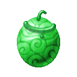
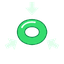

<!-- Generated by tools/build_pack_reference.py. Edit the pack sources and regenerate. -->

# Peto Peto no Mi

{ .entry-page-icon }

[Fruits](index.md) · [Missing Missing no Mi](../../reference/content/inomissing.md)

<!-- fruit inomissing:peto_peto_no_mi -->

| Stat | Value |
| --- | --- |
| Type | Paramecia |
| Tier | 2 |
| Fruit damage scaling | 1.00× at 10,000 Doriki → 2× at 50,000 Doriki |
| Abilities | 7 (7 active, 0 passive) |
| Fruit boxes | [Iron Box](../fruit-boxes.md) |

See [damage calculations](../combat-stats.md#damage-from-doriki).

!!! note "Reading the stats"
    Listed base damage is for the named part of the move. Pack and Doriki multipliers are shown separately. Times assume 20 ticks per second.

<!-- move inomissing:collar -->

## Collar

{ .entry-move-icon loading=lazy } *Active*

The user throws a collar of jelly, a creature it closes on serves them for 2 minutes and obeys the Command ability. Bosses can't be collared A player collared for 30 seconds can't be controlled, but suffers the user's Order ability. The user can hold 3 collars at once, and all of them break if the user dies

| Stat | Value |
| --- | --- |
| Cooldown | 5 s (100 ticks) |
| Pack multiplier when dealing damage | 1.5× |

<!-- move inomissing:order -->

## Order

{ .entry-move-icon loading=lazy } *Active*

The user gives a short order to the collared one they are looking at. A collared player's collar breaks after 3 orders Lie Down pins them in place. Drop makes them unable to strike.

| Stat | Value |
| --- | --- |
| Cooldown | 6 s (120 ticks) |
| Conditional cooldown | 0.5 s (10 ticks) |
| Pack multiplier when dealing damage | 1.5× |

<!-- move inomissing:full_strength -->

## Full Strength

{ .entry-move-icon loading=lazy } *Active*

The user orders the collared creature they are looking at to its full strength, it hits harder, runs faster and takes less damage for a while. With none in sight, all the user's creatures nearby are ordered

| Stat | Value |
| --- | --- |
| Cooldown | 35 s (700 ticks) |
| Pack multiplier when dealing damage | 1.5× |

<!-- move inomissing:red_collar -->

## Red Collar

{ .entry-move-icon loading=lazy } *Active · Transformation*

The user puts a red collar on their own neck and orders themselves to their full strength, they grow, hit harder, move and strike faster and take less damage When it ends, the user is weak and slow for a while

| Stat | Value |
| --- | --- |
| Cooldown | 70 s (1400 ticks) |
| Pack multiplier when dealing damage | 1.5× |

**Stats while transformed**

| Stat | Value |
| --- | --- |
| Armor | +6 |

<!-- move inomissing:peto_levitation -->

## Levitation

{ .entry-move-icon loading=lazy } *Active*

The collared one the user is looking at floats up, helpless, then falls. On a player it counts as one order

| Stat | Value |
| --- | --- |
| Cooldown | 18 s (360 ticks) |
| Conditional cooldown | 0.5 s (10 ticks) |
| Pack multiplier when dealing damage | 1.5× |

<!-- move inomissing:recall -->

## Recall

{ .entry-move-icon loading=lazy } *Active*

Every collared creature of the user is brought to their side at once

| Stat | Value |
| --- | --- |
| Cooldown | 20 s (400 ticks) |
| Pack multiplier when dealing damage | 1.5× |

<!-- move inomissing:release -->

## Release

{ .entry-move-icon loading=lazy } *Active*

The user breaks the collar of the collared one they are looking at so they can throw a new one. If they look at no one all their collars break

| Stat | Value |
| --- | --- |
| Cooldown | 2 s (40 ticks) |
| Pack multiplier when dealing damage | 1.5× |

