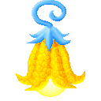
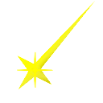

<!-- Generated by tools/build_pack_reference.py. Edit the pack sources and regenerate. -->

# Pika Pika no Mi

{ .entry-page-icon }

[Fruits](index.md) · [Mine Mine no Mi](../../reference/content/mineminenomi.md)

<!-- fruit mineminenomi:pika_pika_no_mi -->

| Stat | Value |
| --- | --- |
| Type | Logia |
| Tier | 3 |
| Fruit damage scaling | 1.00× at 10,000 Doriki → 1.75× at 50,000 Doriki |
| Abilities | 9 (6 active, 3 passive) |
| Fruit boxes | [Golden Box](../fruit-boxes.md) |

See [damage calculations](../combat-stats.md#damage-from-doriki).

[Jump to awakening](#awakening)

!!! note "Reading the stats"
    Listed base damage is for the named part of the move. Pack and Doriki multipliers are shown separately. Times assume 20 ticks per second.

<!-- move mineminenomi:yata_no_kagami -->

## Yata no Kagami

{ .entry-move-icon loading=lazy } *Active*

The user forms light between his hands, and reflects it off any surface he wishes, instantly teleporting it towards where the light hit.

| Stat | Value |
| --- | --- |
| Cooldown | 3 s (60 ticks) |
| Pack multiplier when dealing damage | 1.65× |

<!-- move mineminenomi:yasakani_no_magatama -->

## Yasakani no Magatama

{ .entry-move-icon loading=lazy } *Active*

Fires a torrent of deadly light particles, causing huge destruction

| Stat | Value |
| --- | --- |
| Cooldown | 14 s (280 ticks) |
| Pack multiplier when dealing damage | 1.65× |

<!-- move mineminenomi:ama_no_murakumo -->

## Ama no Murakumo

{ .entry-move-icon loading=lazy } *Active*

Focuses light in the user's hand to create a sword

| Stat | Value |
| --- | --- |
| Pack multiplier when dealing damage | 1.65× |

<!-- move mineminenomi:amaterasu -->

## Amaterasu

{ .entry-move-icon loading=lazy } *Active*

Charges up a powerful concentrated light beam. The longer its charged the more powerful it becomes.

| Stat | Value |
| --- | --- |
| Cooldown | 12 s (240 ticks) |
| Pack multiplier when dealing damage | 1.65× |

<!-- move mineminenomi:flash -->

## Flash

{ .entry-move-icon loading=lazy } *Active*

The user creates a bright flash of light, blinding their opponents. Longer charges means a longer distance.

| Stat | Value |
| --- | --- |
| Cooldown | 10 s (200 ticks) |
| Pack multiplier when dealing damage | 1.65× |

<!-- move mineminenomi:logia_invulnerability_pika -->

## Logia Invulnerability Pika

{ .entry-move-icon loading=lazy } *Passive*

| Stat | Value |
| --- | --- |
| Pack multiplier when dealing damage | 1.65× |

<!-- move mineminenomi:light_acceleration -->

## Light Acceleration

{ .entry-move-icon loading=lazy } *Active*

The user accelerates its attacks by converting into light before impact

| Stat | Value |
| --- | --- |
| Cooldown | 10 s (200 ticks) |
| Pack multiplier when dealing damage | 1.65× |

<!-- move mineminenomi:logia_immunities -->

## Logia Immunities

*Passive*

| Stat | Value |
| --- | --- |
| Pack multiplier when dealing damage | 2.5× |

<!-- move mineminenomi:pika_block_bypassing -->

## Pika Block Bypassing

*Passive*

| Stat | Value |
| --- | --- |
| Pack multiplier when dealing damage | 1.65× |

## Awakening

**Source** · Awaken Awaken no Mi

| Stat | Value |
| --- | --- |
| Doriki | 40,000 |
| Active time with the fruit | About 24 hours (1,728,000 ticks) |

<!-- move awakenawakennomi:lightfall_domain -->

### Lightfall Domain { #awakening-lightfall-domain }

{ .entry-move-icon loading=lazy } *Active*

Creates a dome where it is always bright daylight, even at night or deep underground. Every enemy inside glows and can be seen through walls The dome does not hurt anyone.

| Stat | Value |
| --- | --- |
| Zone cooldown | 45 s (900 ticks) |
| Cooldown | 45 s (900 ticks) |

<!-- move awakenawakennomi:kousoku -->

### Kousoku { #awakening-kousoku }

{ .entry-move-icon loading=lazy } *Active*

Fires a beam of light that hits instantly, striking everything along the line of sight The beam bounces off surfaces to reach down corridors and around corners. Deals massive damage in daylight but barely anything in the dark

| Stat | Value |
| --- | --- |
| Cooldown | 22.5 s (450 ticks) |
| Whiff cooldown | 4 s (80 ticks) |
| Base damage | 110 HP |

<!-- move awakenawakennomi:hi_no_megumi -->

### Sun's Blessing { #awakening-hi-no-megumi }

{ .entry-move-icon loading=lazy } *Passive*

The brighter the light around the user, the faster, stronger and quicker to heal they get. Darkness gives no bonus but no penalty either
