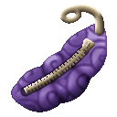

<!-- Generated by tools/build_pack_reference.py. Edit the pack sources and regenerate. -->

# Poke Poke no Mi

{ .entry-page-icon }

[Fruits](index.md) · [Missing Missing no Mi](../../reference/content/inomissing.md)

<!-- fruit inomissing:poke_poke_no_mi -->

| Stat | Value |
| --- | --- |
| Type | Paramecia |
| Tier | 1 |
| Fruit damage scaling | 1.00× at 10,000 Doriki → 2.25× at 50,000 Doriki |
| Abilities | 3 (3 active, 0 passive) |
| Fruit boxes | [Wooden Box](../fruit-boxes.md) |

See [damage calculations](../combat-stats.md#damage-from-doriki).

!!! note "Reading the stats"
    Listed base damage is for the named part of the move. Pack and Doriki multipliers are shown separately. Times assume 20 ticks per second.

<!-- move inomissing:poke_pockets -->

## Pockets

{ .entry-move-icon loading=lazy } *Active*

Opens the pockets in the user's body, they keep 54 stacks and stay with the user after death Bows, crossbows, guns and cannons take their ammo from the pockets when the inventory has none

| Stat | Value |
| --- | --- |
| Cooldown | 2 s (40 ticks) |
| Pack multiplier when dealing damage | 1.65× |

<!-- move inomissing:poke_swallow -->

## Swallowing Pocket

{ .entry-move-icon loading=lazy } *Active*

The user's belly swells and its zip opens into a big pocket that swallows the projectiles that come from the front Arrows, tridents, bullets and cannon balls go in the user's pockets if there is room, the other projectiles are stopped and disappear While the pocket is open the user cannot move or jump but can still turn A living target at least twice as small as the user is swallowed and spat out unhurt after 5 seconds or when used again, and the user can walk in the meantime

| Stat | Value |
| --- | --- |
| Cooldown | 20 s (400 ticks) |
| Pack multiplier when dealing damage | 1.65× |

<!-- move inomissing:poke_store -->

## Store

{ .entry-move-icon loading=lazy } *Active*

Puts things in the user's pockets without opening them. Held Item puts the item in the user's hand in the pockets Around puts the items lying on the ground around the user in the pockets

| Stat | Value |
| --- | --- |
| Cooldown | 2 s (40 ticks) |
| Around cooldown | 8 s (160 ticks) |
| Conditional cooldown | 0.5 s (10 ticks) |
| Pack multiplier when dealing damage | 1.65× |

