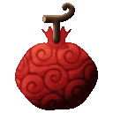
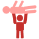
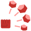
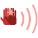

<!-- Generated by tools/build_pack_reference.py. Edit the pack sources and regenerate. -->

# Riki Riki no Mi

{ .entry-page-icon }

[Fruits](index.md) · [Missing Missing no Mi](../../reference/content/inomissing.md)

<!-- fruit inomissing:riki_riki_no_mi -->

| Stat | Value |
| --- | --- |
| Type | Paramecia |
| Tier | 2 |
| Fruit damage scaling | 1.00× at 10,000 Doriki → 2× at 50,000 Doriki |
| Abilities | 9 (8 active, 1 passive) |
| Fruit boxes | [Iron Box](../fruit-boxes.md) |

See [damage calculations](../combat-stats.md#damage-from-doriki).

!!! note "Reading the stats"
    Listed base damage is for the named part of the move. Pack and Doriki multipliers are shown separately. Times assume 20 ticks per second.

<!-- move inomissing:riki_strength -->

## Strength

{ .entry-move-icon loading=lazy } *Passive*

The user is abnormally strong. Their bare hits are harder, all their hits throw further and their hands break blocks faster

<!-- move inomissing:riki_mountain_throw -->

## Mountain Throw

{ .entry-move-icon loading=lazy } *Active*

The user tears a mass of ground out in front of them and lifts it over their head. Used again it is thrown where they look and bursts on what it hits The hole closes after a while

| Stat | Value |
| --- | --- |
| Base damage | 30 HP |
| Cooldown | 40 s (800 ticks) |
| Conditional cooldown | 0.5 s (10 ticks) |

<!-- move inomissing:riki_lift -->

## Lift

{ .entry-move-icon loading=lazy } *Active*

The user seizes the enemy in front of them and lifts it over their head. Used again it is thrown where they look and is hurt when it slams into something Hits on the user set it free. It lasts less on players and bosses

| Stat | Value |
| --- | --- |
| Base damage | 12 HP |
| Cooldown | 15 s (300 ticks) |

<!-- move inomissing:riki_ground_slam -->

## Ground Slam

{ .entry-move-icon loading=lazy } *Active*

The user slams both fists on the ground. The shock hurts the enemies around them and throws them up and away

| Stat | Value |
| --- | --- |
| Base damage | 14 HP |
| Cooldown | 12 s (240 ticks) |
| Conditional cooldown | 0.5 s (10 ticks) |

<!-- move inomissing:riki_charged_punch -->

## Charged Punch

{ .entry-move-icon loading=lazy } *Active*

The user draws their fist back and lets it go on the enemy in front of them. The longer it is drawn the harder it hits and the further it throws

| Stat | Value |
| --- | --- |
| Cooldown | 15 s (300 ticks) |
| Conditional cooldown | 0.5 s (10 ticks) |

<!-- move inomissing:riki_leap -->

## Leap

{ .entry-move-icon loading=lazy } *Active*

The user crouches to gather strength while the key is held then leaps high and far where they look. The longer it is held the higher they go The fall does them no harm and its shock hurts and throws back the enemies around where they land, more from higher

| Stat | Value |
| --- | --- |
| Cooldown | 8 s (160 ticks) |
| Full cooldown | 20 s (400 ticks) |
| Conditional cooldown | 0.5 s (10 ticks) |

<!-- move inomissing:riki_pillar_sweep -->

## Pillar Sweep

{ .entry-move-icon loading=lazy } *Active*

The user tears out the tree trunk they look at, or a pillar of ground, and holds it like a club. Used again it sweeps in a half circle in front and throws back the enemies hit The hole closes after a while

| Stat | Value |
| --- | --- |
| Base damage | 14 HP |
| Cooldown | 20 s (400 ticks) |
| Conditional cooldown | 0.5 s (10 ticks) |

<!-- move inomissing:riki_rock_volley -->

## Rock Volley

{ .entry-move-icon loading=lazy } *Active*

The user tears up the ground in front of them and smashes it into chunks that fly out in a fan and burst on what they hit The hole closes after a while

| Stat | Value |
| --- | --- |
| Base damage | 5 HP |
| Cooldown | 16 s (320 ticks) |
| Conditional cooldown | 0.5 s (10 ticks) |

<!-- move inomissing:riki_clap -->

## Clap

{ .entry-move-icon loading=lazy } *Active*

The user claps their hands and the shock goes out in front of them. The enemies hit are thrown back and stunned for a moment

| Stat | Value |
| --- | --- |
| Base damage | 6 HP |
| Cooldown | 14 s (280 ticks) |

