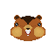
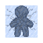

<!-- Generated by tools/build_pack_reference.py. Edit the pack sources and regenerate. -->

# Risu Risu no Mi, Model: Ratatoskr

{ .entry-page-icon }

[Fruits](index.md) · [Blitz Utility](../../reference/content/blitzutility.md)

<!-- fruit blitzutility:risu_risu_no_mi_model_ratatoskr -->

| Stat | Value |
| --- | --- |
| Type | Mythical Zoan |
| Tier | 3 |
| Fruit damage scaling | 1.00× at 10,000 Doriki → 1.75× at 50,000 Doriki |
| Abilities | 8 (6 active, 2 passive) |
| Fruit boxes | [Golden Box](../fruit-boxes.md) |

See [damage calculations](../combat-stats.md#damage-from-doriki).

!!! note "Reading the stats"
    Listed base damage is for the named part of the move. Pack and Doriki multipliers are shown separately. Times assume 20 ticks per second.

<!-- move blitzutility:ratatoskr_brain_point -->

## Ratatoskr Brain Point

{ .entry-move-icon loading=lazy } *Active · Transformation*

Transforms the user into a giant ratatoskr.

| Stat | Value |
| --- | --- |
| Pack multiplier when dealing damage | 2.55× |

<!-- move blitzutility:ratatoskr_heavy_point -->

## Ratatoskr Heavy Point

{ .entry-move-icon loading=lazy } *Active · Transformation*

Transforms the user into a half-ratatoskr hybrid.

| Stat | Value |
| --- | --- |
| Pack multiplier when dealing damage | 2.55× |

<!-- move blitzutility:niflheim -->

## Niflheim

{ .entry-move-icon loading=lazy } *Active*

The user's next hit is a powerful freezing strike that traps targets in a Flash Freeze.

| Stat | Value |
| --- | --- |
| Cooldown | 20 s (400 ticks) |
| Base damage | 30 HP |
| Pack multiplier when dealing damage | 2.55× |

<!-- move blitzutility:shatter -->

## Shatter

{ .entry-move-icon loading=lazy } *Active*

The user shatters those effected by their flash freeze.

| Stat | Value |
| --- | --- |
| Cooldown | 40 s (800 ticks) |
| Flash freeze shatter damage | 50 HP |
| Self frozen shatter damage | 15 HP |
| Base damage | 50 HP |
| Pack multiplier when dealing damage | 2.55× |

<!-- move blitzutility:freeze_over -->

## Freeze Over

{ .entry-move-icon loading=lazy } *Active*

The user unleashes a freezing blizzard around themselves for 5 seconds.

| Stat | Value |
| --- | --- |
| Cooldown | 30 s (600 ticks) |
| Pack multiplier when dealing damage | 2.55× |

<!-- move blitzutility:gnaw -->

## Gnaw

{ .entry-move-icon loading=lazy } *Active*

Grabs an opponent and bites them trapping them in a flash freeze.

| Stat | Value |
| --- | --- |
| Cooldown | 20 s (400 ticks) |
| Base damage | 10 HP |
| Pack multiplier when dealing damage | 2.55× |

<!-- move blitzutility:ratatoskr_night_vision -->

## Ratatoskr Night Vision

*Passive*

The user gains passive night vision.

| Stat | Value |
| --- | --- |
| Pack multiplier when dealing damage | 2.55× |

<!-- move blitzutility:ratatoskr_immunities -->

## Ratatoskr Immunities

*Passive*

| Stat | Value |
| --- | --- |
| Pack multiplier when dealing damage | 2.55× |

