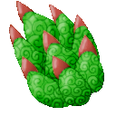
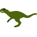
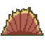
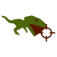

<!-- Generated by tools/build_pack_reference.py. Edit the pack sources and regenerate. -->

# Ryu Ryu no Mi, Model: Allosaurus

{ .entry-page-icon }

[Fruits](index.md) · [Mine Mine no Mi](../../reference/content/mineminenomi.md)

<!-- fruit mineminenomi:ryu_ryu_no_mi_model_allosaurus -->

| Stat | Value |
| --- | --- |
| Type | Ancient Zoan |
| Tier | 2 |
| Fruit damage scaling | 1.00× at 10,000 Doriki → 2× at 50,000 Doriki |
| Abilities | 5 (4 active, 1 passive) |
| Fruit boxes | [Iron Box](../fruit-boxes.md) |

See [damage calculations](../combat-stats.md#damage-from-doriki).

[Jump to awakening](#awakening)

After awakening, this fruit’s original damaging moves deal **1.5× damage**. The awakening techniques below have their own values.

Keep using your normal combat forms after awakening. See the [awakened Zoan form stats](../devil-fruits.md#what-changes-after-awakening) for the upgrade.

!!! note "Reading the stats"
    Listed base damage is for the named part of the move. Pack and Doriki multipliers are shown separately. Times assume 20 ticks per second.

<!-- move mineminenomi:allosaurus_walk_point -->

## Allosaurus Walk Point

{ .entry-move-icon loading=lazy } *Active · Transformation*

Transforms the user into an ancient allosaurus.

| Stat | Value |
| --- | --- |
| Pack multiplier when dealing damage | 2.3× |

<!-- move mineminenomi:allosaurus_heavy_point -->

## Allosaurus Heavy Point

{ .entry-move-icon loading=lazy } *Active · Transformation*

Transforms the user into a hybrid allosaurus.

| Stat | Value |
| --- | --- |
| Pack multiplier when dealing damage | 2.3× |

<!-- move mineminenomi:ancient_bite -->

## Ancient Bite

{ .entry-move-icon loading=lazy } *Active*

Bites the enemy dealing moderate damage.

| Stat | Value |
| --- | --- |
| Cooldown | 7 s (140 ticks) |
| Pack multiplier when dealing damage | 1.65× |

<!-- move mineminenomi:ancient_tail_spin -->

## Ancient Tail Spin

{ .entry-move-icon loading=lazy } *Active*

Spins around hitting all nearby enemies with the user's tail.

| Stat | Value |
| --- | --- |
| Cooldown | 10 s (200 ticks) |
| Base damage | 15 HP |
| Pack multiplier when dealing damage | 2.3× |

<!-- move mineminenomi:allosaurus_rideable -->

## Allosaurus Rideable

*Passive*

Allows other players to ride on your back.

| Stat | Value |
| --- | --- |
| Pack multiplier when dealing damage | 2.3× |

## Awakening

**Source** · Awaken Awaken no Mi

| Stat | Value |
| --- | --- |
| Doriki | 40,000 |
| Active time with the fruit | About 24 hours (1,728,000 ticks) |

<!-- move awakenawakennomi:ancient_spine_saw -->

### Ancient Spine Saw { #awakening-ancient-spine-saw }

{ .entry-move-icon loading=lazy } *Active*

The user rolls forward along its spined back, cutting everything in its path.

| Stat | Value |
| --- | --- |
| Hits per enemy | 1 |

<!-- move awakenawakennomi:apex_pursuit -->

### Apex Pursuit { #awakening-apex-pursuit }

{ .entry-move-icon loading=lazy } *Active*

Marks the target the allosaurus is looking at and chases it down way faster than it can run. When the target is close enough the allosaurus slams its upper jaw down on it and makes it bleed.

| Stat | Value |
| --- | --- |
| Cooldown | 30 s (600 ticks) |
| Miss cooldown | 10 s (200 ticks) |
| Bite damage | 60 HP |
| Bleed | 6 s (120 ticks) |

