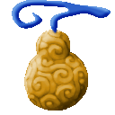
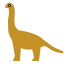
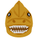
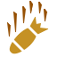
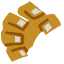
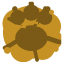
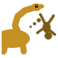

<!-- Generated by tools/build_pack_reference.py. Edit the pack sources and regenerate. -->

# Ryu Ryu no Mi, Model: Brachiosaurus

{ .entry-page-icon }

[Fruits](index.md) · [Mine Mine no Mi](../../reference/content/mineminenomi.md)

<!-- fruit mineminenomi:ryu_ryu_no_mi_model_brachiosaurus -->

| Stat | Value |
| --- | --- |
| Type | Ancient Zoan |
| Tier | 2 |
| Fruit damage scaling | 1.00× at 10,000 Doriki → 2× at 50,000 Doriki |
| Abilities | 5 (4 active, 1 passive) |
| Fruit boxes | [Iron Box](../fruit-boxes.md) |

See [damage calculations](../combat-stats.md#damage-from-doriki).

[Jump to awakening](#awakening)

After awakening, this fruit’s original damaging moves deal **1.5× damage**. The awakening techniques below have their own values.

Keep using your normal combat forms after awakening. See the [awakened Zoan form stats](../devil-fruits.md#what-changes-after-awakening) for the upgrade.

!!! note "Reading the stats"
    Listed base damage is for the named part of the move. Pack and Doriki multipliers are shown separately. Times assume 20 ticks per second.

<!-- move mineminenomi:brachiosaurus_guard_point -->

## Brachiosaurus Guard Point

{ .entry-move-icon loading=lazy } *Active · Transformation*

Transforms the user into an ancient brachiosaurus, which focuses on defense.

| Stat | Value |
| --- | --- |
| Pack multiplier when dealing damage | 4.65× |

<!-- move mineminenomi:brachiosaurus_heavy_point -->

## Brachiosaurus Heavy Point

{ .entry-move-icon loading=lazy } *Active · Transformation*

Transforms the user into an ancient half-brachiosaurus, which focuses on strength.

| Stat | Value |
| --- | --- |
| Pack multiplier when dealing damage | 4.65× |

<!-- move mineminenomi:brachio_bomber -->

## Brachio Bomber

{ .entry-move-icon loading=lazy } *Active*

Dives from a high place and lands on his opponent, crushing them under the user's weight.

| Stat | Value |
| --- | --- |
| Cooldown | 15 s (300 ticks) |
| Base damage | 20 HP |
| Pack multiplier when dealing damage | 4.65× |

<!-- move mineminenomi:brachio_grab -->

## Brachio Grab

{ .entry-move-icon loading=lazy } *Active*

Grabs an opponent and squashes them.

| Stat | Value |
| --- | --- |
| Cooldown | 15 s (300 ticks) |
| Base damage | 6 HP |
| Pack multiplier when dealing damage | 4.65× |

<!-- move mineminenomi:brachiosaurus_rideable -->

## Brachiosaurus Rideable

*Passive*

Allows other players to ride on your back.

| Stat | Value |
| --- | --- |
| Pack multiplier when dealing damage | 4.65× |

## Awakening

**Source** · Awaken Awaken no Mi

| Stat | Value |
| --- | --- |
| Doriki | 40,000 |
| Active time with the fruit | About 24 hours (1,728,000 ticks) |

<!-- move awakenawakennomi:brachio_stomp -->

### Brachio Stomp { #awakening-brachio-stomp }

{ .entry-move-icon loading=lazy } *Active*

The user stomps the ground a bunch of times, damaging everyone around them with each stomp

| Stat | Value |
| --- | --- |
| Cooldown | 60 s (1200 ticks) |
| Base damage | 20 HP |

<!-- move awakenawakennomi:neck_catapult -->

### Neck Catapult { #awakening-neck-catapult }

{ .entry-move-icon loading=lazy } *Active*

The brachiosaurus lowers its neck, picks up whoever is in front of it and throws them really far. Enemies take big damage when they land, allies land safely and get a speed boost.

| Stat | Value |
| --- | --- |
| Cooldown | 20 s (400 ticks) |
| Impact damage | 60 HP |

