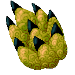
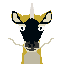
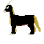

<!-- Generated by tools/build_pack_reference.py. Edit the pack sources and regenerate. -->

# Ryu Ryu no Mi, Model: Kirin

{ .entry-page-icon }

[Fruits](index.md) · [Blitz Utility](../../reference/content/blitzutility.md)

<!-- fruit blitzutility:ryu_ryu_no_mi_model_kirin -->

| Stat | Value |
| --- | --- |
| Type | Mythical Zoan |
| Tier | 3 |
| Fruit damage scaling | 1.00× at 10,000 Doriki → 1.75× at 50,000 Doriki |
| Abilities | 8 (6 active, 2 passive) |
| Fruit boxes | [Golden Box](../fruit-boxes.md) |

See [damage calculations](../combat-stats.md#damage-from-doriki).

!!! note "Reading the stats"
    Listed base damage is for the named part of the move. Pack and Doriki multipliers are shown separately. Times assume 20 ticks per second.

<!-- move blitzutility:kirin_heavy_point -->

## Kirin Heavy Point

{ .entry-move-icon loading=lazy } *Active · Transformation*

Transforms the user into a half-mythical Kirin.   BASE the standard hybrid look   ALTERNATIVE an alternate hybrid look

| Stat | Value |
| --- | --- |
| Pack multiplier when dealing damage | 4× |

<!-- move blitzutility:kirin_fly_point -->

## Kirin Fly Point

{ .entry-move-icon loading=lazy } *Active · Transformation*

Transforms the user into a mythical Kirin.

| Stat | Value |
| --- | --- |
| Pack multiplier when dealing damage | 4× |

<!-- move blitzutility:slumbertize -->

## Slumbertize

{ .entry-move-icon loading=lazy } *Active*

Puts the target to sleep for a short duration.   BEAM shoots a small sleep beam at the target   PUNCH the user's next punch puts the target to sleep

| Stat | Value |
| --- | --- |
| Beam cooldown | 15 s (300 ticks) |
| Punch cooldown | 25 s (500 ticks) |
| Cooldown | 15 s (300 ticks) |
| Pack multiplier when dealing damage | 4× |

<!-- move blitzutility:dream_manifestation_items -->

## Dream Manifestation: Items

{ .entry-move-icon loading=lazy } *Active*

If used on a sleeping player it manifests an item from their dreams.

| Stat | Value |
| --- | --- |
| Cooldown | 35 s (700 ticks) |
| Pack multiplier when dealing damage | 4× |

<!-- move blitzutility:nightmare_rifts -->

## Nightmare Rifts

{ .entry-move-icon loading=lazy } *Active*

Summons a Nightmare Rift that summons up to 6 MMA at a time.

| Stat | Value |
| --- | --- |
| Cooldown | 25 s (500 ticks) |
| Pack multiplier when dealing damage | 4× |

<!-- move blitzutility:kirin_flight -->

## Kirin Flight

*Passive*

| Stat | Value |
| --- | --- |
| Pack multiplier when dealing damage | 4× |

<!-- move blitzutility:kirin_rideable -->

## Kirin Rideable

*Passive*

Allows other players to ride on your back.

| Stat | Value |
| --- | --- |
| Pack multiplier when dealing damage | 4× |

<!-- move blitzutility:mule_kick -->

## Mule Kick

{ .entry-move-icon loading=lazy } *Active*

The user turns around and bucks their hind legs launching anyone in front of them.

| Stat | Value |
| --- | --- |
| Cooldown | 8 s (160 ticks) |
| Base damage | 40 HP |
| Pack multiplier when dealing damage | 4× |

