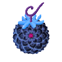
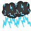

<!-- Generated by tools/build_pack_reference.py. Edit the pack sources and regenerate. -->

# Ryu Ryu no Mi, Model: Nidhoggr

{ .entry-page-icon }

[Fruits](index.md) · [Blitz Utility](../../reference/content/blitzutility.md)

<!-- fruit blitzutility:ryu_ryu_no_mi_model_nidhoggr -->

| Stat | Value |
| --- | --- |
| Type | Mythical Zoan |
| Tier | 3 |
| Fruit damage scaling | 1.00× at 10,000 Doriki → 1.75× at 50,000 Doriki |
| Abilities | 12 (7 active, 5 passive) |
| Fruit boxes | [Golden Box](../fruit-boxes.md) |

See [damage calculations](../combat-stats.md#damage-from-doriki).

!!! note "Reading the stats"
    Listed base damage is for the named part of the move. Pack and Doriki multipliers are shown separately. Times assume 20 ticks per second.

<!-- move blitzutility:nidhogg_fly_point -->

## Nidhogg Fly Point

{ .entry-move-icon loading=lazy } *Active · Transformation*

The user transforms into the mythical Nidhoggr.

<!-- move blitzutility:nidhogg_heavy_point -->

## Nidhogg Heavy Point

*Active · Transformation*

The user takes on the hybrid form of the mythical Nidhoggr, growing scaled legs, a heavy tail and a horned crown.

<!-- move blitzutility:thrudhiem -->

## Thrudhiem

{ .entry-move-icon loading=lazy } *Active*

Fires a concentrated lightning beam, then detonates into a massive electrical explosion.

| Stat | Value |
| --- | --- |
| Cooldown | 45 s (900 ticks) |
| Beam damage | 3 HP |
| Bolt damage | 20 HP |
| Sphere damage | 120 HP |
| Base damage | 120 HP |
| Pack multiplier when dealing damage | 1.5× |

<!-- move blitzutility:ragna_izuchi -->

## Ragna Izuchi

{ .entry-move-icon loading=lazy } *Active*

The user's next hit strikes a target with lightning.

| Stat | Value |
| --- | --- |
| Cooldown | 20 s (400 ticks) |
| Izuchi damage | 60 HP |
| Pack multiplier when dealing damage | 0.2× |

<!-- move blitzutility:lightning_reign -->

## Lightning Reign

{ .entry-move-icon loading=lazy } *Active*

The user calls down massive lightning bolts onto nearby entities. During thunderstorms the barrage is amplified.

Uses local thunder for both the cast and the ongoing storm check.

| Stat | Value |
| --- | --- |
| Cooldown | 70 s (1400 ticks) |
| Bonus damage | 10 HP |

<!-- move blitzutility:ragna_go_arrow -->

## Ragna Go Arrow

{ .entry-move-icon loading=lazy } *Active*

Fires a barrage of small lightning balls.

| Stat | Value |
| --- | --- |
| Cooldown | 14 s (280 ticks) |

<!-- move blitzutility:ragna_jinhiem -->

## Ragna Jinhiem

{ .entry-move-icon loading=lazy } *Active*

Strikes targets with two twin lightning bolts.

| Stat | Value |
| --- | --- |
| Cooldown | 18 s (360 ticks) |
| Base damage | 30 HP |

<!-- move blitzutility:nidhogg_flight -->

## Nidhogg Flight

*Passive*

<!-- move blitzutility:nidhogg_night_vision -->

## Nidhogg Night Vision

*Passive*

The user gains passive night vision.

<!-- move blitzutility:nidhogg_rideable -->

## Nidhogg Rideable

*Passive*

Allows up to 4 other players to ride on your back.

<!-- move blitzutility:nidhogg_immunities -->

## Nidhogg Immunities

*Passive*

<!-- move blitzutility:nidhogg_frozen_immunity -->

## Nidhogg Frozen Immunity

*Passive*
