<!-- Generated by tools/build_pack_reference.py. Edit the pack sources and regenerate. -->

# Ryu Ryu no Mi, Model: Pachycephalosaurus

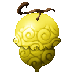{ .entry-page-icon }

[Fruits](index.md) · [Missing Missing no Mi](../../reference/content/inomissing.md)

<!-- fruit inomissing:ryu_ryu_no_mi_model_pachycephalosaurus -->

| Stat | Value |
| --- | --- |
| Type | Ancient Zoan |
| Tier | 2 |
| Fruit damage scaling | 1.00× at 10,000 Doriki → 2× at 50,000 Doriki |
| Abilities | 11 (9 active, 2 passive) |
| Fruit boxes | [Iron Box](../fruit-boxes.md) |

See [damage calculations](../combat-stats.md#damage-from-doriki).

!!! note "Reading the stats"
    Listed base damage is for the named part of the move. Pack and Doriki multipliers are shown separately. Times assume 20 ticks per second.

<!-- move inomissing:pachycephalosaurus_heavy_point -->

## Pachycephalosaurus Heavy Point

{ .entry-move-icon loading=lazy } *Active · Transformation*

Transforms the user into a pachycephalosaurus hybrid, which is fast, jumps high and has a skull as hard as a hammer.

| Stat | Value |
| --- | --- |
| Pack multiplier when dealing damage | 1.3× |

**Stats while transformed**

| Stat | Value |
| --- | --- |
| Movement speed | +17% of base |
| Punch damage | +10 HP |
| Armour | +15 |
| Toughness | +3 |
| Step height | +0.5 blocks |
| Jump | +1.6 |

<!-- move inomissing:pachycephalosaurus_walk_point -->

## Pachycephalosaurus Walk Point

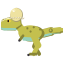{ .entry-move-icon loading=lazy } *Active · Transformation*

Transforms the user into a pachycephalosaurus, a big and strong dinosaur that runs on 2 legs and strikes with its head.

| Stat | Value |
| --- | --- |
| Pack multiplier when dealing damage | 1.3× |

**Stats while transformed**

| Stat | Value |
| --- | --- |
| Movement speed | +15% of base |
| Punch damage | +13 HP |
| Armour | +17 |
| Toughness | +4 |
| Step height | +1 blocks |
| Jump | +0.5 |

<!-- move inomissing:thick_skull -->

## Thick Skull

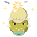{ .entry-move-icon loading=lazy } *Passive*

The user's headbutts stun the enemies they hit, and the user can't be pushed back or stunned while charging.

| Stat | Value |
| --- | --- |
| Pack multiplier when dealing damage | 1.3× |

<!-- move inomissing:skull_smash -->

## Skull Smash

{ .entry-move-icon loading=lazy } *Passive*

While running, the user rams the enemies in front of them, dealing damage and knocking them back.

| Stat | Value |
| --- | --- |
| Base damage | 3 HP |
| Pack multiplier when dealing damage | 1.3× |

<!-- move inomissing:ul_zugan -->

## Ul-Zugan

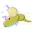{ .entry-move-icon loading=lazy } *Active*

The user leaps where they are looking and headbutts the first enemy they meet. Stronger and from further in the hybrid form.

| Stat | Value |
| --- | --- |
| Base damage | 20 HP |
| Hybrid damage | 22 HP |
| Cooldown | 12 s (240 ticks) |
| Pack multiplier when dealing damage | 1.3× |

<!-- move inomissing:ul_meteor -->

## Ul-Meteor

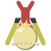{ .entry-move-icon loading=lazy } *Active*

The user grabs the enemy in front of them, holds it up and headbutts it.

| Stat | Value |
| --- | --- |
| Base damage | 26 HP |
| Cooldown | 15 s (300 ticks) |
| Pack multiplier when dealing damage | 1.3× |

<!-- move inomissing:wall_breaker -->

## Wall Breaker

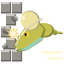{ .entry-move-icon loading=lazy } *Active*

The user charges forward head first, damaging and stunning all enemies in their path. The charge breaks the blocks in its path, even stone, ores and iron.

| Stat | Value |
| --- | --- |
| Base damage | 20 HP |
| Cooldown | 16 s (320 ticks) |
| Pack multiplier when dealing damage | 1.3× |

<!-- move inomissing:pin_down -->

## Pin Down

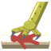{ .entry-move-icon loading=lazy } *Active*

The user holds the enemy in front of them under their claws, it can't move and takes damage. Use the ability again to let it go.

| Stat | Value |
| --- | --- |
| Base damage | 3 HP |
| Cooldown | 15 s (300 ticks) |
| Pack multiplier when dealing damage | 1.3× |

<!-- move inomissing:tail_sweep -->

## Tail Sweep

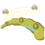{ .entry-move-icon loading=lazy } *Active*

The user spins and sweeps their tail around them, hitting all nearby enemies and pushing them away. Stronger and wider in the full pachycephalosaurus form.

| Stat | Value |
| --- | --- |
| Base damage | 14 HP |
| Walk damage | 18 HP |
| Cooldown | 10 s (200 ticks) |
| Pack multiplier when dealing damage | 1.3× |

<!-- move inomissing:skull_barrage -->

## Skull Barrage

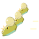{ .entry-move-icon loading=lazy } *Active*

The user headbutts the enemies in front of them many times in a row, the last hit stuns them and sends them back. Faster in the hybrid form, with a longer reach in the full pachycephalosaurus form.

| Stat | Value |
| --- | --- |
| Base damage | 3.5 HP |
| Last damage | 7 HP |
| Cooldown | 13 s (260 ticks) |
| Pack multiplier when dealing damage | 1.3× |

<!-- move inomissing:bounding_leap -->

## Bounding Leap

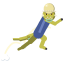{ .entry-move-icon loading=lazy } *Active*

The user bounds where they are looking, even in the air. Use the ability again to bound a second time. The user takes no fall damage until they land.

| Stat | Value |
| --- | --- |
| Cooldown | 8 s (160 ticks) |
| Pack multiplier when dealing damage | 1.3× |

