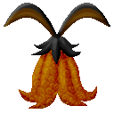
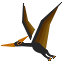
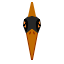
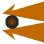
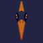
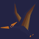

<!-- Generated by tools/build_pack_reference.py. Edit the pack sources and regenerate. -->

# Ryu Ryu no Mi, Model: Pteranodon

{ .entry-page-icon }

[Fruits](index.md) · [Mine Mine no Mi](../../reference/content/mineminenomi.md)

<!-- fruit mineminenomi:ryu_ryu_no_mi_model_pteranodon -->

| Stat | Value |
| --- | --- |
| Type | Ancient Zoan |
| Tier | 2 |
| Fruit damage scaling | 1.00× at 10,000 Doriki → 2× at 50,000 Doriki |
| Abilities | 7 (6 active, 1 passive) |
| Fruit boxes | [Iron Box](../fruit-boxes.md) |

See [damage calculations](../combat-stats.md#damage-from-doriki).

[Jump to awakening](#awakening)

!!! note "Reading the stats"
    Listed base damage is for the named part of the move. Pack and Doriki multipliers are shown separately. Times assume 20 ticks per second.

<!-- move mineminenomi:pteranodon_fly_point -->

## Pteranodon Fly Point

{ .entry-move-icon loading=lazy } *Active · Transformation*

Transforms the user into an ancient pteranodon.

| Stat | Value |
| --- | --- |
| Pack multiplier when dealing damage | 2.35× |

<!-- move mineminenomi:pteranodon_assault_point -->

## Pteranodon Assault Point

{ .entry-move-icon loading=lazy } *Active · Transformation*

Transforms the user into a half-pteranodon hybrid.

| Stat | Value |
| --- | --- |
| Pack multiplier when dealing damage | 2.35× |

<!-- move mineminenomi:tempuraudon -->

## Tempuraudon

{ .entry-move-icon loading=lazy } *Active*

Stretches its head back, releasing it really fast and acting as a sniper.

| Stat | Value |
| --- | --- |
| Cooldown | 12 s (240 ticks) |
| Pack multiplier when dealing damage | 2.35× |

<!-- move mineminenomi:tankyudon -->

## Tankyudon

{ .entry-move-icon loading=lazy } *Active*

Flying into enemies at great speeds deals damage and knocks them back.

| Stat | Value |
| --- | --- |
| Cooldown | 10 s (200 ticks) |
| Base damage | 10 HP |
| Pack multiplier when dealing damage | 2.35× |

<!-- move mineminenomi:beak_grab -->

## Beak Grab

{ .entry-move-icon loading=lazy } *Active*

Allows the user to carry their target.

| Stat | Value |
| --- | --- |
| Cooldown | 10 s (200 ticks) |
| Pack multiplier when dealing damage | 2.35× |

<!-- move mineminenomi:barizodon -->

## Barizodon

{ .entry-move-icon loading=lazy } *Active*

Shoots out a barrage of elliptic air projectiles using the user's wings.

| Stat | Value |
| --- | --- |
| Cooldown | 7 s (140 ticks) |
| Pack multiplier when dealing damage | 1.7× |

<!-- move mineminenomi:pteranodon_flight -->

## Pteranodon Flight

*Passive*

| Stat | Value |
| --- | --- |
| Pack multiplier when dealing damage | 2.35× |

## Awakening

**Source** · Awaken Awaken no Mi

| Stat | Value |
| --- | --- |
| Doriki | 40,000 |
| Active time with the fruit | About 24 hours (1,728,000 ticks) |

<!-- move awakenawakennomi:awaken_pteranodon_assault_point -->

### Awaken Pteranodon Assault Point { #awakening-awaken-pteranodon-assault-point }

{ .entry-move-icon loading=lazy } *Active · Transformation*

Transforms the user into an awakened pteranodon hybrid, which focuses on attacking.

| Stat | Value |
| --- | --- |
| Cooldown | 0.5 s (10 ticks) |

**Stats while transformed**

| Stat | Value |
| --- | --- |
| Movement speed | +100% of base |
| Punch damage | +14 HP |
| Armour | +16 |
| Toughness | +4 |
| Step height | +1 blocks |
| Jump | +2 |

<!-- move awakenawakennomi:awaken_pteranodon_fly_point -->

### Awaken Pteranodon Fly Point { #awakening-awaken-pteranodon-fly-point }

{ .entry-move-icon loading=lazy } *Active · Transformation*

Transforms the user into an awakened pteranodon, which focuses on flying.

| Stat | Value |
| --- | --- |
| Cooldown | 0.5 s (10 ticks) |

**Stats while transformed**

| Stat | Value |
| --- | --- |
| Armour | +4 |
| Punch damage | +30 HP |
| Toughness | +4 |

<!-- move awakenawakennomi:tei_kasane -->

### Tei-Kasané { #awakening-tei-kasane }

{ .entry-move-icon loading=lazy } *Active*

The user vibrates their wings so fast the edges turn jagged and sharp.

| Stat | Value |
| --- | --- |
| Cooldown | 50 s (1000 ticks) |

<!-- move awakenawakennomi:downdraft -->

### Downdraft { #awakening-downdraft }

{ .entry-move-icon loading=lazy } *Active*

The user flaps their awakened wings once and sends a blast of air straight down, slamming everything flying below into the ground. Anything it catches in the air can't fly again for a while, and anything already on the ground gets knocked off its feet.

| Stat | Value |
| --- | --- |
| Cooldown | 25 s (500 ticks) |
| Min damage | 25 HP |
| Max damage | 60 HP |

