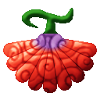
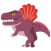
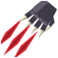
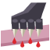
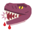
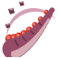
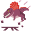

<!-- Generated by tools/build_pack_reference.py. Edit the pack sources and regenerate. -->

# Ryu Ryu no Mi, Model: Spinosaurus

{ .entry-page-icon }

[Fruits](index.md) · [Missing Missing no Mi](../../reference/content/inomissing.md)

<!-- fruit inomissing:ryu_ryu_no_mi_model_spinosaurus -->

| Stat | Value |
| --- | --- |
| Type | Ancient Zoan |
| Tier | 2 |
| Fruit damage scaling | 1.00× at 10,000 Doriki → 2× at 50,000 Doriki |
| Abilities | 9 (8 active, 1 passive) |
| Fruit boxes | [Iron Box](../fruit-boxes.md) |

See [damage calculations](../combat-stats.md#damage-from-doriki).

!!! note "Reading the stats"
    Listed base damage is for the named part of the move. Pack and Doriki multipliers are shown separately. Times assume 20 ticks per second.

<!-- move inomissing:spinosaurus_heavy_point -->

## Spinosaurus Heavy Point

{ .entry-move-icon loading=lazy } *Active · Transformation*

Transforms the user into a spinosaurus hybrid, which is agile and has big claws to tear their enemies apart.

| Stat | Value |
| --- | --- |
| Pack multiplier when dealing damage | 1.05× |

**Stats while transformed**

| Stat | Value |
| --- | --- |
| Movement speed | +15% of base |
| Punch damage | +10 HP |
| Armor | +16 |
| Toughness | +4 |
| Step height | +0.5 blocks |
| Jump | +0.5 |

<!-- move inomissing:spinosaurus_walk_point -->

## Spinosaurus Walk Point

{ .entry-move-icon loading=lazy } *Active · Transformation*

Transforms the user into a spinosaurus, a huge and strong dinosaur with a sail on its back and powerful jaws.

| Stat | Value |
| --- | --- |
| Pack multiplier when dealing damage | 1.05× |

**Stats while transformed**

| Stat | Value |
| --- | --- |
| Movement speed | +12% of base |
| Punch damage | +15 HP |
| Armor | +18 |
| Toughness | +4 |
| Step height | +1 blocks |
| Jump | +0.5 |

<!-- move inomissing:frenzy -->

## Frenzy

{ .entry-move-icon loading=lazy } *Passive*

The user deals more damage to enemies that have less than half of their health

| Stat | Value |
| --- | --- |
| Pack multiplier when dealing damage | 1.05× |

<!-- move inomissing:rending_claw -->

## Rending Claw

{ .entry-move-icon loading=lazy } *Active*

While in the spinosaurus hybrid form, the user slashes the enemies in front of them with their claws, making them bleed for 5 seconds and sending them flying

| Stat | Value |
| --- | --- |
| Base damage | 22 HP |
| Bleed | 5 s (100 ticks) |
| Cooldown | 10 s (200 ticks) |
| Pack multiplier when dealing damage | 1.05× |

<!-- move inomissing:shred -->

## Shred

{ .entry-move-icon loading=lazy } *Active*

While in the spinosaurus hybrid form, the user slashes the enemies in front of them 6 times with both claws, each hit makes them bleed 2 seconds longer

| Stat | Value |
| --- | --- |
| Base damage | 3 HP |
| Cooldown | 12 s (240 ticks) |
| Pack multiplier when dealing damage | 1.05× |

<!-- move inomissing:cling -->

## Cling

{ .entry-move-icon loading=lazy } *Active*

While in the spinosaurus hybrid form, the user latches onto the enemy in front of them and mauls it every half second, it is slowed and bleeds for 3 seconds at each bite. Use the ability again to let go

| Stat | Value |
| --- | --- |
| Base damage | 3 HP |
| Bleed | 3 s (60 ticks) |
| Cooldown | 16 s (320 ticks) |
| Conditional cooldown | 0.5 s (10 ticks) |
| Pack multiplier when dealing damage | 1.05× |

<!-- move inomissing:jaw_crush -->

## Jaw Crush

{ .entry-move-icon loading=lazy } *Active*

While in the full spinosaurus form, the user bites the enemy in front of them with their powerful jaws, dealing heavy damage and making it bleed for 6 seconds

| Stat | Value |
| --- | --- |
| Base damage | 24 HP |
| Bleed | 6 s (120 ticks) |
| Cooldown | 12 s (240 ticks) |
| Pack multiplier when dealing damage | 1.05× |

<!-- move inomissing:paddle_tail -->

## Paddle Tail

{ .entry-move-icon loading=lazy } *Active*

While in the full spinosaurus form, the user spins and sweeps their huge tail around them, hitting all nearby enemies, pushing them away and breaking blocks no harder than stone

| Stat | Value |
| --- | --- |
| Base damage | 22 HP |
| Cooldown | 15 s (300 ticks) |
| Pack multiplier when dealing damage | 1.05× |

<!-- move inomissing:crushing_leap -->

## Crushing Leap

{ .entry-move-icon loading=lazy } *Active*

While in the full spinosaurus form, the user leaps high where they are looking and crushes the ground when landing, damaging and pushing away all nearby enemies

| Stat | Value |
| --- | --- |
| Base damage | 22 HP |
| Cooldown | 16 s (320 ticks) |
| Pack multiplier when dealing damage | 1.05× |

