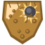
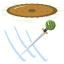
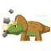
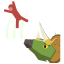

<!-- Generated by tools/build_pack_reference.py. Edit the pack sources and regenerate. -->

# Ryu Ryu no Mi, Model: Triceratops

{ .entry-page-icon }

[Fruits](index.md) · [Missing Missing no Mi](../../reference/content/inomissing.md)

<!-- fruit inomissing:ryu_ryu_no_mi_model_triceratops -->

| Stat | Value |
| --- | --- |
| Type | Ancient Zoan |
| Tier | 2 |
| Fruit damage scaling | 1.00× at 10,000 Doriki → 2× at 50,000 Doriki |
| Abilities | 10 (8 active, 2 passive) |
| Fruit boxes | [Iron Box](../fruit-boxes.md) |

See [damage calculations](../combat-stats.md#damage-from-doriki).

!!! note "Reading the stats"
    Listed base damage is for the named part of the move. Pack and Doriki multipliers are shown separately. Times assume 20 ticks per second.

<!-- move inomissing:triceratops_heavy_point -->

## Triceratops Heavy Point

{ .entry-move-icon loading=lazy } *Active · Transformation*

Transforms the user into a triceratops hybrid, with 3 horns, a thick hide and a frill that spins to fly.

| Stat | Value |
| --- | --- |
| Pack multiplier when dealing damage | 1.2× |

**Stats while transformed**

| Stat | Value |
| --- | --- |
| Movement speed | -5% of base |
| Punch damage | +9 HP |
| Armour | +18 |
| Toughness | +6 |
| Step height | +0.5 blocks |

<!-- move inomissing:triceratops_guard_point -->

## Triceratops Guard Point

{ .entry-move-icon loading=lazy } *Active · Transformation*

Transforms the user into a triceratops, a huge and slow beast on 4 legs with the thickest hide.

| Stat | Value |
| --- | --- |
| Pack multiplier when dealing damage | 1.2× |

**Stats while transformed**

| Stat | Value |
| --- | --- |
| Movement speed | -15% of base |
| Punch damage | +4 HP |
| Armour | +25 |
| Toughness | +10 |
| Step height | +1 blocks |

<!-- move inomissing:thick_hide -->

## Thick Hide

{ .entry-move-icon loading=lazy } *Passive*

No single hit can take more than a part of the user's max health. In the full triceratops form that part is smaller.

| Stat | Value |
| --- | --- |
| Pack multiplier when dealing damage | 1.2× |

<!-- move inomissing:frill_flight -->

## Frill Flight

{ .entry-move-icon loading=lazy } *Active*

The user's frill spins like a propeller around their neck allowing them to fly for a while

| Stat | Value |
| --- | --- |
| Cooldown | 15 s (300 ticks) |
| Pack multiplier when dealing damage | 1.2× |

<!-- move inomissing:triceratops_flight -->

## Triceratops Flight

*Passive*

| Stat | Value |
| --- | --- |
| Pack multiplier when dealing damage | 1.2× |

<!-- move inomissing:magnumceratops -->

## Magnumceratops

{ .entry-move-icon loading=lazy } *Active*

While flying with the frill, the user dives head first where they are looking, damaging all enemies around the impact and sending them flying. The damage is higher when diving from high up.

| Stat | Value |
| --- | --- |
| Min damage | 16 HP |
| Max damage | 30 HP |
| Cooldown | 14 s (280 ticks) |
| Conditional cooldown | 0.5 s (10 ticks) |
| Pack multiplier when dealing damage | 1.2× |

<!-- move inomissing:heliceratops -->

## Heliceratops

{ .entry-move-icon loading=lazy } *Active*

While flying with the frill, the user strikes the enemies in front of them 5 times with what they are holding, the last hit sends them flying. A better weapon deals more damage.

| Stat | Value |
| --- | --- |
| Base damage | 3 HP |
| Max damage | 6 HP |
| Cooldown | 14 s (280 ticks) |
| Pack multiplier when dealing damage | 1.2× |

<!-- move inomissing:horn_charge -->

## Horn Charge

{ .entry-move-icon loading=lazy } *Active*

The user charges forward horns first, damaging all enemies in their path and throwing them far away. The charge also breaks the blocks in its path, up to stone. The user's frill spins and propels them forward horns first, damaging all enemies in their path and throwing them away.

| Stat | Value |
| --- | --- |
| Base damage | 26 HP |
| Cooldown | 18 s (360 ticks) |
| T damage | 20 HP |
| T cooldown | 12 s (240 ticks) |
| Pack multiplier when dealing damage | 1.2× |

<!-- move inomissing:horn_lift -->

## Horn Lift

{ .entry-move-icon loading=lazy } *Active*

The user puts their horns under the enemies in front of them and throws them in the air.

| Stat | Value |
| --- | --- |
| Base damage | 20 HP |
| Cooldown | 10 s (200 ticks) |
| Pack multiplier when dealing damage | 1.2× |

<!-- move inomissing:ground_stomp -->

## Ground Stomp

{ .entry-move-icon loading=lazy } *Active*

The user stomps the ground, all nearby enemies standing on it are damaged, pushed away and slowed.

| Stat | Value |
| --- | --- |
| Base damage | 18 HP |
| Cooldown | 14 s (280 ticks) |
| Pack multiplier when dealing damage | 1.2× |

