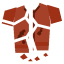

<!-- Generated by tools/build_pack_reference.py. Edit the pack sources and regenerate. -->

# Sabi Sabi no Mi

{ .entry-page-icon }

[Fruits](index.md) · [Mine Mine no Mi](../../reference/content/mineminenomi.md)

<!-- fruit mineminenomi:sabi_sabi_no_mi -->

| Stat | Value |
| --- | --- |
| Type | Paramecia |
| Tier | 1 |
| Fruit damage scaling | 1.00× at 10,000 Doriki → 2.25× at 50,000 Doriki |
| Abilities | 3 (2 active, 1 passive) |
| Fruit boxes | [Wooden Box](../fruit-boxes.md) |

See [damage calculations](../combat-stats.md#damage-from-doriki).

[Jump to awakening](#awakening)

!!! note "Reading the stats"
    Listed base damage is for the named part of the move. Pack and Doriki multipliers are shown separately. Times assume 20 ticks per second.

<!-- move mineminenomi:rust_touch -->

## Rust Touch

{ .entry-move-icon loading=lazy } *Active*

Rusts the enemy and the items equipped on them

| Stat | Value |
| --- | --- |
| Cooldown | 15 s (300 ticks) |
| Pack multiplier when dealing damage | 5.3× |

<!-- move mineminenomi:rust_break -->

## Rust Break

{ .entry-move-icon loading=lazy } *Active*

Rusts iron blocks in front of the user

| Stat | Value |
| --- | --- |
| Cooldown | 20 s (400 ticks) |
| Pack multiplier when dealing damage | 5.3× |

<!-- move mineminenomi:rust_skin -->

## Rust Skin

{ .entry-move-icon loading=lazy } *Passive*

Makes the user immune to attacks received from iron based items, damaging them in the processes

| Stat | Value |
| --- | --- |
| Pack multiplier when dealing damage | 5.3× |

## Awakening

**Source** · Awaken Awaken no Mi

| Stat | Value |
| --- | --- |
| Doriki | 40,000 |
| Active time with the fruit | About 24 hours (1,728,000 ticks) |

<!-- move awakenawakennomi:empire_of_decay -->

### Empire of Decay { #awakening-empire-of-decay }

{ .entry-move-icon loading=lazy } *Active*

Creates a zone that rusts enemies inside, the rust gets stronger the longer they stay.

| Stat | Value |
| --- | --- |
| Cooldown | 120 s (2400 ticks) |

<!-- move awakenawakennomi:collapse -->

### Collapse { #awakening-collapse }

{ .entry-move-icon loading=lazy } *Active*

Every rusted enemy nearby crumbles at once, taking damage for each level of rust and each iron armor piece they wear. Their rust is used up and their iron armor falls apart.

| Stat | Value |
| --- | --- |
| Min damage | 20 HP |
| Max damage | 140 HP |
| Cooldown | 60 s (1200 ticks) |
| Miss cooldown | 10 s (200 ticks) |
| Abort cooldown | 2 s (40 ticks) |

<!-- move awakenawakennomi:oxidized_plate -->

### Oxidized Plate { #awakening-oxidized-plate }

{ .entry-move-icon loading=lazy } *Passive*

Rusted enemies near the user lose armor for every level of rust and every iron armor piece they wear, until it protects nothing.
