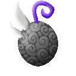
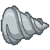

<!-- Generated by tools/build_pack_reference.py. Edit the pack sources and regenerate. -->

# Sai Sai no Mi

{ .entry-page-icon }

[Fruits](index.md) · [Mine Mine no Mi](../../reference/content/mineminenomi.md)

<!-- fruit mineminenomi:sai_sai_no_mi -->

| Stat | Value |
| --- | --- |
| Type | Zoan |
| Tier | 2 |
| Fruit damage scaling | 1.00× at 10,000 Doriki → 2× at 50,000 Doriki |
| Abilities | 5 (3 active, 2 passive) |
| Fruit boxes | [Iron Box](../fruit-boxes.md) |

See [damage calculations](../combat-stats.md#damage-from-doriki).

[Jump to awakening](#awakening)

!!! note "Reading the stats"
    Listed base damage is for the named part of the move. Pack and Doriki multipliers are shown separately. Times assume 20 ticks per second.

<!-- move mineminenomi:sai_walk_point -->

## Sai Walk Point

{ .entry-move-icon loading=lazy } *Active · Transformation*

Transforms the user into a rhino, which focuses on defense and damage.

| Stat | Value |
| --- | --- |
| Pack multiplier when dealing damage | 6× |

<!-- move mineminenomi:sai_heavy_point -->

## Sai Heavy Point

{ .entry-move-icon loading=lazy } *Active · Transformation*

Transforms the user into a hybrid rhino, which focuses on defense and damage.

| Stat | Value |
| --- | --- |
| Pack multiplier when dealing damage | 6× |

<!-- move mineminenomi:rhino_smash -->

## Rhino Smash

{ .entry-move-icon loading=lazy } *Passive*

Running into enemies deals damage and knocks them back.

| Stat | Value |
| --- | --- |
| Base damage | 2 HP |
| Pack multiplier when dealing damage | 6× |

<!-- move mineminenomi:horn_dash -->

## Horn Dash

{ .entry-move-icon loading=lazy } *Active*

Running into enemies deals damage and knocks them back.

| Stat | Value |
| --- | --- |
| Cooldown | 9 s (180 ticks) |
| Base damage | 10 HP |
| Pack multiplier when dealing damage | 6× |

<!-- move mineminenomi:sai_rideable -->

## Sai Rideable

*Passive*

Allows other players to ride on your back.

| Stat | Value |
| --- | --- |
| Pack multiplier when dealing damage | 6× |

## Awakening

**Source** · Awaken Awaken no Mi

| Stat | Value |
| --- | --- |
| Doriki | 40,000 |
| Active time with the fruit | About 24 hours (1,728,000 ticks) |

<!-- move awakenawakennomi:awaken_sai_heavy_point -->

### Awaken Sai Heavy Point { #awakening-awaken-sai-heavy-point }

{ .entry-move-icon loading=lazy } *Active · Transformation*

Transforms the user into an awakened rhino hybrid, which focuses on strength and charging.

| Stat | Value |
| --- | --- |
| Cooldown | 0.5 s (10 ticks) |

**Stats while transformed**

| Stat | Value |
| --- | --- |
| Movement speed | +200% of base |
| Armour | +20 |
| Punch damage | +14 HP |
| Jump | +3 |
| Toughness | +5 |
| Step height | +1 blocks |

<!-- move awakenawakennomi:awaken_sai_walk_point -->

### Awaken Sai Walk Point { #awakening-awaken-sai-walk-point }

{ .entry-move-icon loading=lazy } *Active · Transformation*

Transforms the user into an awakened rhino, which focuses on speed

| Stat | Value |
| --- | --- |
| Cooldown | 0.5 s (10 ticks) |

**Stats while transformed**

| Stat | Value |
| --- | --- |
| Movement speed | +165% of base |
| Armour | +30 |
| Punch damage | +7.5 HP |
| Step height | +1 blocks |
| Toughness | +6 |
| Jump | +1.5 |

<!-- move awakenawakennomi:horn_drill -->

### Horn Drill { #awakening-horn-drill }

{ .entry-move-icon loading=lazy } *Active*

The user spins and charges in a straight line, piercing through every enemy they pass.

<!-- move awakenawakennomi:juggernaut -->

### Juggernaut { #awakening-juggernaut }

{ .entry-move-icon loading=lazy } *Active*

The rhino charges where it looks and gets faster and faster, nothing stops it, not holds, not pushes and not walls it can break. Enemies in its way get hit harder the faster it goes and are thrown aside. A wall it can't break ends the charge and leaves the rhino staggered.

| Stat | Value |
| --- | --- |
| Cooldown | 45 s (900 ticks) |
| Min damage | 40 HP |
| Max damage | 120 HP |

