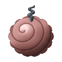
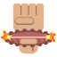
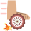
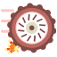
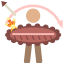

<!-- Generated by tools/build_pack_reference.py. Edit the pack sources and regenerate. -->

# Shari Shari no Mi

{ .entry-page-icon }

[Fruits](index.md) · [Missing Missing no Mi](../../reference/content/inomissing.md)

<!-- fruit inomissing:shari_shari_no_mi -->

| Stat | Value |
| --- | --- |
| Type | Paramecia |
| Tier | 1 |
| Fruit damage scaling | 1.00× at 10,000 Doriki → 2.25× at 50,000 Doriki |
| Abilities | 5 (5 active, 0 passive) |
| Fruit boxes | [Wooden Box](../fruit-boxes.md) |

See [damage calculations](../combat-stats.md#damage-from-doriki).

!!! note "Reading the stats"
    Listed base damage is for the named part of the move. Pack and Doriki multipliers are shown separately. Times assume 20 ticks per second.

<!-- move inomissing:shari_wheel_arms -->

## Wheel Arms

{ .entry-move-icon loading=lazy } *Active*

The user's arms spin like grinding wheels for a while. Each punch with a bare hand keeps grinding and hits a few more times, and the armor of a player wears out twice as fast Iron armor or better holds against the wheels, the extra hits barely scratch it

| Stat | Value |
| --- | --- |
| Cooldown | 15 s (300 ticks) |
| Extra damage | 2 HP |
| Metal damage | 1 HP |

<!-- move inomissing:shari_wheel_feet -->

## Wheel Feet

{ .entry-move-icon loading=lazy } *Active*

The user's feet spin like wheels and they glide fast over the ground for a while, up the steps of a block. Their kicks grind and hit harder

| Stat | Value |
| --- | --- |
| Cooldown | 12 s (240 ticks) |

<!-- move inomissing:shari_wheel_roll -->

## Wheel Roll

{ .entry-move-icon loading=lazy } *Active*

The user curls up into a whole grinding wheel and rolls fast where they look. They go through every enemy on the way, each one gets hurt and thrown aside. A wall stops the roll

| Stat | Value |
| --- | --- |
| Base damage | 10 HP |
| Cooldown | 10 s (200 ticks) |

<!-- move inomissing:shari_spinning_top -->

## Spinning Top

{ .entry-move-icon loading=lazy } *Active*

The user's upper body spins like a top for a few seconds. The enemies around get hit again and again and the projectiles coming from any side are sent back to their shooter. The user moves slower while spinning

| Stat | Value |
| --- | --- |
| Base damage | 3 HP |
| Cooldown | 14 s (280 ticks) |

<!-- move inomissing:shari_great_wheel -->

## Great Wheel

{ .entry-move-icon loading=lazy } *Active*

A giant grinding wheel leaves the user's arm and rolls far ahead, up the small steps, grinding every enemy on the way. At the end or on a wall it rolls back to the user and grinds the enemies again on the way. It breaks no block

| Stat | Value |
| --- | --- |
| Base damage | 14 HP |
| Cooldown | 60 s (1200 ticks) |

