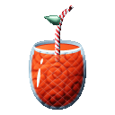
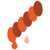

<!-- Generated by tools/build_pack_reference.py. Edit the pack sources and regenerate. -->

# Shibo Shibo no Mi

{ .entry-page-icon }

[Fruits](index.md) · [Missing Missing no Mi](../../reference/content/inomissing.md)

<!-- fruit inomissing:shibo_shibo_no_mi -->

| Stat | Value |
| --- | --- |
| Type | Paramecia |
| Tier | 2 |
| Fruit damage scaling | 1.00× at 10,000 Doriki → 2× at 50,000 Doriki |
| Abilities | 5 (4 active, 1 passive) |
| Fruit boxes | [Iron Box](../fruit-boxes.md) |

See [damage calculations](../combat-stats.md#damage-from-doriki).

!!! note "Reading the stats"
    Listed base damage is for the named part of the move. Pack and Doriki multipliers are shown separately. Times assume 20 ticks per second.

<!-- move inomissing:shibo_wringing_blade -->

## Wringing Blade

{ .entry-move-icon loading=lazy } *Passive*

The weapon held by the user wrings whoever it hits. Each hit dries them out a little and gives the user some juice Shows the juice reserve the user filled by wringing people. Juicy Giant uses it and water never fills it

| Stat | Value |
| --- | --- |
| Pack multiplier when dealing damage | 5× |

<!-- move inomissing:shibo_wring -->

## Wring

{ .entry-move-icon loading=lazy } *Active*

The user grabs the one in front of them and wrings the life juice out of them. It hurts through armour, dries them out so their max health goes down for a while and heals the user. Each wring fills the juice reserve and the good effects of the one wrung pass to the user. Water gives a dried body its health back The one wrung is held 3 seconds, then dropped. The one wrung is held 1 second, then thrown where the user looks, the drier the farther. They get hurt with whoever they hit. The one wrung is held 1 second, then crushed to the ground, stunned. Their juice splashes and slows the enemies around.

| Stat | Value |
| --- | --- |
| Pack multiplier when dealing damage | 5× |

<!-- move inomissing:shibo_self_wring -->

## Self Wring

{ .entry-move-icon loading=lazy } *Active*

The user wrings themself and the poison and every bad effect comes out of their body with a bit of their health

| Stat | Value |
| --- | --- |
| Cooldown | 20 s (400 ticks) |
| Conditional cooldown | 0.5 s (10 ticks) |
| Pack multiplier when dealing damage | 5× |

<!-- move inomissing:shibo_juice_drain -->

## Juice Drain

{ .entry-move-icon loading=lazy } *Active*

The user drains the life juice of every enemy around while charging. They get dried out and slowed down and the juice goes in the reserve Use it again to stop early, the juice already taken is kept

| Stat | Value |
| --- | --- |
| Cooldown | 20 s (400 ticks) |
| Pack multiplier when dealing damage | 5× |

<!-- move inomissing:shibo_juicy_giant -->

## Juicy Giant

{ .entry-move-icon loading=lazy } *Active*

The user grows into a giant as big as their juice reserve. The reserve empties little by little and the user gets smaller with it until they are back to normal. Their punches, reach and wrings grow with them Use it again to stop being a giant

| Stat | Value |
| --- | --- |
| Least cooldown | 10 s (200 ticks) |
| Most cooldown | 60 s (1200 ticks) |
| Pack multiplier when dealing damage | 5× |

