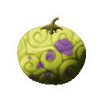
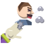

<!-- Generated by tools/build_pack_reference.py. Edit the pack sources and regenerate. -->

# Shiku Shiku no Mi

{ .entry-page-icon }

[Fruits](index.md) · [Missing Missing no Mi](../../reference/content/inomissing.md)

<!-- fruit inomissing:shiku_shiku_no_mi -->

| Stat | Value |
| --- | --- |
| Type | Paramecia |
| Tier | 2 |
| Fruit damage scaling | 1.00× at 10,000 Doriki → 2× at 50,000 Doriki |
| Abilities | 5 |
| Fruit boxes | [Iron Box](../fruit-boxes.md) |

See [damage calculations](../combat-stats.md#damage-from-doriki).

!!! note "Reading the stats"
    Listed base damage is for the named part of the move. Pack and Doriki multipliers are shown separately. Times assume 20 ticks per second.

<!-- move inomissing:shiku_fever -->

## Fever

{ .entry-move-icon loading=lazy }

The user gives a fever to the enemy they look at. The sick one moves slower and hits weaker. It passes to everyone near the sick one but never back to the user. A strong Haki breaks it and cures the sick around.

| Stat | Value |
| --- | --- |
| Cooldown | 15 s (300 ticks) |
| Pack multiplier when dealing damage | 2× |

<!-- move inomissing:shiku_wasting -->

## Wasting

{ .entry-move-icon loading=lazy }

The user makes the enemy they look at waste away. The sick one loses life every second and nothing heals it. It passes to everyone near the sick one but never back to the user. A strong Haki breaks it and cures the sick around.

| Stat | Value |
| --- | --- |
| Cooldown | 18 s (360 ticks) |
| Pack multiplier when dealing damage | 2× |

<!-- move inomissing:shiku_coughing_fit -->

## Coughing Fit

{ .entry-move-icon loading=lazy }

The user gives a coughing fit to the enemy they look at. Now and then one of its abilities fails and has to wait. It passes to everyone near the sick one but never back to the user. A strong Haki breaks it and cures the sick around.

| Stat | Value |
| --- | --- |
| Cooldown | 20 s (400 ticks) |
| Pack multiplier when dealing damage | 2× |

<!-- move inomissing:shiku_feminization -->

## Feminization Disease

{ .entry-move-icon loading=lazy }

The user gives the Feminization Disease to the enemy they look at. A player takes the other build, anyone who catches it is dazed a moment and hits weaker. It lasts the longest and passes the furthest, to everyone near the sick one but never back to the user. A strong Haki breaks it and cures the sick around.

| Stat | Value |
| --- | --- |
| Cooldown | 45 s (900 ticks) |
| Pack multiplier when dealing damage | 2× |

<!-- move inomissing:shiku_epidemic -->

## Epidemic

{ .entry-move-icon loading=lazy } *Active*

The user lays a cloud of the last disease they gave where they look. Everyone who is in it catches the disease for as long as its own ability gives it, but never the user.

| Stat | Value |
| --- | --- |
| Cooldown | 40 s (800 ticks) |
| Conditional cooldown | 0.5 s (10 ticks) |
| Pack multiplier when dealing damage | 2× |

