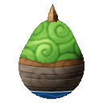
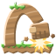
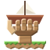
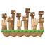
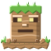
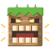

<!-- Generated by tools/build_pack_reference.py. Edit the pack sources and regenerate. -->

# Shima Shima no Mi

{ .entry-page-icon }

[Fruits](index.md) · [Missing Missing no Mi](../../reference/content/inomissing.md)

<!-- fruit inomissing:shima_shima_no_mi -->

| Stat | Value |
| --- | --- |
| Type | Paramecia |
| Tier | 3 |
| Fruit damage scaling | 1.00× at 10,000 Doriki → 1.75× at 50,000 Doriki |
| Abilities | 8 (7 active, 1 passive) |
| Fruit boxes | [Golden Box](../fruit-boxes.md) |

See [damage calculations](../combat-stats.md#damage-from-doriki).

!!! note "Reading the stats"
    Listed base damage is for the named part of the move. Pack and Doriki multipliers are shown separately. Times assume 20 ticks per second.

<!-- move inomissing:shima_merge -->

## Merge

{ .entry-move-icon loading=lazy } *Active*

The user sinks into the ground and becomes the spirit of the island. Unseen and out of reach, they fly through everything around the place they sank and can raise the ground anywhere there. Used again they come back out where they aim, or by their face if they aim at nothing. Only their arms and face can be hurt, and that hurts them. A blow while sinking stops it. The more solid ground around, the bigger the arms, face and spikes rise.

| Stat | Value |
| --- | --- |
| Min cooldown | 10 s (200 ticks) |
| Cooldown | 10 s (200 ticks) |
| Conditional cooldown | 0.5 s (10 ticks) |
| Pack multiplier when dealing damage | 2.1× |

<!-- move inomissing:shima_island_arm -->

## Island Arm

{ .entry-move-icon loading=lazy } *Active*

A giant arm of ground rises and strikes down where the user aims, hitting every enemy around the blow, then goes back into the ground. Hitting the arm while it is up hurts the user. Only while merged, anywhere on their land. The bigger the island the bigger and stronger it rises.

| Stat | Value |
| --- | --- |
| Base damage | 26 HP |
| Cooldown | 8 s (160 ticks) |
| Conditional cooldown | 0.5 s (10 ticks) |
| Pack multiplier when dealing damage | 2.1× |

<!-- move inomissing:shima_island_hand -->

## Island Hand

{ .entry-move-icon loading=lazy } *Active*

A giant hand of ground rises, seizes the one the user aims at and holds them up. Used again it throws them where the user looks. It holds less on players and bosses. Only while merged, anywhere on their land. The bigger the island the bigger and stronger it rises.

| Stat | Value |
| --- | --- |
| Base damage | 14 HP |
| Cooldown | 10 s (200 ticks) |
| Pack multiplier when dealing damage | 2.1× |

<!-- move inomissing:shima_arm_swarm -->

## Arm Swarm

{ .entry-move-icon loading=lazy } *Active*

A field of small arms of ground rises where the user aims and they strike down on every creature there, each creature once. Hitting an arm while it is up hurts the user. Only while merged, anywhere on their land. The bigger the island the bigger and stronger they rise.

| Stat | Value |
| --- | --- |
| Base damage | 14 HP |
| Cooldown | 15 s (300 ticks) |
| Pack multiplier when dealing damage | 2.1× |

<!-- move inomissing:shima_island_face -->

## Island Face

{ .entry-move-icon loading=lazy } *Active*

A huge face of rock rises where the user sank when they merge, and stays until they come back out. It speaks when they talk and they feel the creatures around it. Hitting it hurts the user. Used it rises again where the user aims, out of the ground or out of a rock face. Only while merged.

| Stat | Value |
| --- | --- |
| Cooldown | 3 s (60 ticks) |
| Pack multiplier when dealing damage | 2.1× |

<!-- move inomissing:shima_face_bite -->

## Face Bite

{ .entry-move-icon loading=lazy } *Active*

The face of rock turns to the nearest enemy and bites everything in front of its mouth. Only while merged and with the face out. The bigger the island the further and harder it bites.

| Stat | Value |
| --- | --- |
| Base damage | 20 HP |
| Cooldown | 6 s (120 ticks) |
| Pack multiplier when dealing damage | 1.55× |

<!-- move inomissing:shima_rising_ground -->

## Rising Ground

*Active*

Only while merged. A line of spikes jumps out where the user aims, one after the other, and throws the enemies up. Only while merged. A wall rises across the user's sight where the user aims. It stops enemies and projectiles until it sinks back or the user uses it again.

| Stat | Value |
| --- | --- |
| Base damage | 18 HP |
| Spike cooldown | 7 s (140 ticks) |
| Wall cooldown | 15 s (300 ticks) |
| Pack multiplier when dealing damage | 1.55× |

<!-- move inomissing:shima_itch -->

## Itch

{ .entry-move-icon loading=lazy } *Passive*

While merged the user feels every creature that stands on their land, and those around their face, and sees them through the ground.

| Stat | Value |
| --- | --- |
| Pack multiplier when dealing damage | 2.1× |

