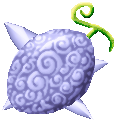

<!-- Generated by tools/build_pack_reference.py. Edit the pack sources and regenerate. -->

# Shio Shio no Mi

{ .entry-page-icon }

[Fruits](index.md) · [InoFruits](../../reference/content/inofruits.md)

<!-- fruit inofruits:shio_shio_no_mi -->

| Stat | Value |
| --- | --- |
| Type | Logia |
| Tier | 3 |
| Fruit damage scaling | 1.00× at 10,000 Doriki → 1.75× at 50,000 Doriki |
| Abilities | 9 (8 active, 1 passive) |
| Fruit boxes | [Golden Box](../fruit-boxes.md) |

See [damage calculations](../combat-stats.md#damage-from-doriki).

!!! note "Reading the stats"
    Listed base damage is for the named part of the move. Pack and Doriki multipliers are shown separately. Times assume 20 ticks per second.

<!-- move inofruits:logia_invulnerability_shio -->

## Logia Invulnerability Shio

{ .entry-move-icon loading=lazy } *Passive*

| Stat | Value |
| --- | --- |
| Base damage | 2 HP |
| Pack multiplier when dealing damage | 1.75× |

<!-- move inofruits:kessho_no_yari -->

## Kessho no Yari

{ .entry-move-icon loading=lazy } *Active*

Hardens the salt under the user and makes a line of spikes come out of the ground.

| Stat | Value |
| --- | --- |
| Base damage | 18 HP |
| Cooldown | 6 s (120 ticks) |
| Pack multiplier when dealing damage | 1.4× |

<!-- move inofruits:shiozuke -->

## Shiozuke

{ .entry-move-icon loading=lazy } *Active*

Throws salt at enemies in front of the user, which stops their regeneration and halves any other healing.

| Stat | Value |
| --- | --- |
| Base damage | 5 HP |
| Cooldown | 8 s (160 ticks) |
| Pack multiplier when dealing damage | 1.75× |

<!-- move inofruits:shio_barai -->

## Shio-barai

{ .entry-move-icon loading=lazy } *Active*

Throws salt in a ring around the user, burning undead enemies and removing bad effects from allies.

| Stat | Value |
| --- | --- |
| Base damage | 12 HP |
| Undead damage | 36 HP |
| Cooldown | 12 s (240 ticks) |
| Pack multiplier when dealing damage | 1.75× |

<!-- move inofruits:shio_no_ame -->

## Shio no Ame

{ .entry-move-icon loading=lazy } *Active*

Makes salt rain down where the user is looking, even far away.

| Stat | Value |
| --- | --- |
| Base damage | 12 HP |
| Cooldown | 9 s (180 ticks) |
| Pack multiplier when dealing damage | 1.75× |

<!-- move inofruits:shio_nagare -->

## Shio Nagare

{ .entry-move-icon loading=lazy } *Active*

The user turns into a current of salt and flies through the air, salting anything it passes through

| Stat | Value |
| --- | --- |
| Base damage | 4 HP |
| Cooldown | 25 s (500 ticks) |
| Pack multiplier when dealing damage | 1.75× |

<!-- move inofruits:shio_no_wa -->

## Shio no Wa

{ .entry-move-icon loading=lazy } *Active*

Pours a ring of salt on the ground that pushes the undead out and salts enemies crossing it.

| Stat | Value |
| --- | --- |
| Undead damage | 3 HP |
| Cooldown | 20 s (400 ticks) |
| Pack multiplier when dealing damage | 1.75× |

<!-- move inofruits:dassui -->

## Dassui

{ .entry-move-icon loading=lazy } *Active*

Draws the water out of every enemy around the user, hurting, slowing and salting them and pulling them slightly towards the user.

| Stat | Value |
| --- | --- |
| Base damage | 6 HP |
| Cooldown | 14 s (280 ticks) |
| Pack multiplier when dealing damage | 1.75× |

<!-- move inofruits:shio_bashira -->

## Shio Bashira

{ .entry-move-icon loading=lazy } *Active*

Covers the target in a pillar of salt, hurting it and making it unable to move for 3 seconds and unable to heal for 10 seconds

| Stat | Value |
| --- | --- |
| Base damage | 20 HP |
| Cooldown | 30 s (600 ticks) |
| Conditional cooldown | 0.5 s (10 ticks) |
| Pack multiplier when dealing damage | 1.75× |

