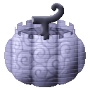
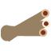
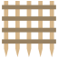
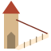
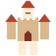
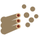

<!-- Generated by tools/build_pack_reference.py. Edit the pack sources and regenerate. -->

# Shiro Shiro no Mi

{ .entry-page-icon }

[Fruits](index.md) · [Missing Missing no Mi](../../reference/content/inomissing.md)

<!-- fruit inomissing:shiro_shiro_no_mi -->

| Stat | Value |
| --- | --- |
| Type | Paramecia |
| Tier | 3 |
| Fruit damage scaling | 1.00× at 10,000 Doriki → 1.75× at 50,000 Doriki |
| Abilities | 7 (7 active, 0 passive) |
| Fruit boxes | [Golden Box](../fruit-boxes.md) |

See [damage calculations](../combat-stats.md#damage-from-doriki).

!!! note "Reading the stats"
    Listed base damage is for the named part of the move. Pack and Doriki multipliers are shown separately. Times assume 20 ticks per second.

<!-- move inomissing:shiro_open_doors -->

## Open the Doors

{ .entry-move-icon loading=lazy } *Active*

The castle inside the user's body has two doors Anyone who right clicks the user goes in, and the user right clicks their own animals and summons to send them in The user goes in, their body stays outside and does not move. Use it again or go through the portal to come back. If the body is hit the user is brought back and takes the hit Use it while crouching, in either mode, to throw out everyone inside who is not an ally

| Stat | Value |
| --- | --- |
| Cooldown | 2 s (40 ticks) |
| Enter cooldown | 5 s (100 ticks) |
| Conditional cooldown | 0.5 s (10 ticks) |
| Pack multiplier when dealing damage | 2.55× |

<!-- move inomissing:shiro_body_cannons -->

## Body Cannons

{ .entry-move-icon loading=lazy } *Active*

Cannons come out of the user's shoulders and chest and fire 3 cannonballs where the user looks Each shot takes a cannonball from a chest put in the castle inside the user, without one it is a weak shot

| Stat | Value |
| --- | --- |
| Base damage | 12 HP |
| Cooldown | 6 s (120 ticks) |
| Pack multiplier when dealing damage | 2.55× |

<!-- move inomissing:shiro_portcullis -->

## Portcullis

{ .entry-move-icon loading=lazy } *Active*

As Big Father, a castle portcullis falls on each enemy in a wide cone in front of the user and hurts everyone under it

| Stat | Value |
| --- | --- |
| Base damage | 18 HP |
| Cooldown | 8 s (160 ticks) |
| Conditional cooldown | 0.5 s (10 ticks) |
| Pack multiplier when dealing damage | 2.55× |

<!-- move inomissing:shiro_drawbridge -->

## Drawbridge

{ .entry-move-icon loading=lazy } *Active*

As Big Father, a drawbridge slams down in front of the user, enemies under it are hurt and thrown away

| Stat | Value |
| --- | --- |
| Base damage | 14 HP |
| Cooldown | 6 s (120 ticks) |
| Pack multiplier when dealing damage | 1.8× |

<!-- move inomissing:shiro_castle_tank -->

## Castle Tank

{ .entry-move-icon loading=lazy } *Active*

The user's legs turn into tank treads, the user rolls much faster and crushes and throws away the enemies in the way, also as Big Father It lasts 30 seconds, 10 as Big Father, use it again to stop sooner

| Stat | Value |
| --- | --- |
| Base damage | 14 HP |
| Cooldown | 5 s (100 ticks) |
| Pack multiplier when dealing damage | 1.8× |

<!-- move inomissing:shiro_big_father -->

## Big Father

{ .entry-move-icon loading=lazy } *Active*

The user becomes a giant walking fortress covered with cannons, the fortress takes the hits instead of the user and its cannons fire by themselves at enemies nearby Use it again to stop. The less is left of the fortress the longer the cooldown, if it is destroyed everyone inside the castle is thrown out next to the user

| Stat | Value |
| --- | --- |
| Full cooldown | 10 s (200 ticks) |
| Empty cooldown | 120 s (2400 ticks) |
| Auto damage | 10 HP |
| Pack multiplier when dealing damage | 2.55× |

**Stats while transformed**

| Stat | Value |
| --- | --- |
| Punch damage | +10 HP |
| Step height | +1.5 blocks |

<!-- move inomissing:shiro_big_volley -->

## Big Volley

{ .entry-move-icon loading=lazy } *Active*

As Big Father every cannon of the fortress fires at once where the user looks, each shot takes a cannonball from a chest put in the castle and is weak without one

| Stat | Value |
| --- | --- |
| Base damage | 14 HP |
| Cooldown | 20 s (400 ticks) |
| Pack multiplier when dealing damage | 2.55× |

