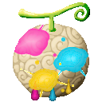

<!-- Generated by tools/build_pack_reference.py. Edit the pack sources and regenerate. -->

# Some Some no Mi

{ .entry-page-icon }

[Fruits](index.md) · [InoFruits](../../reference/content/inofruits.md)

<!-- fruit inofruits:some_some_no_mi -->

| Stat | Value |
| --- | --- |
| Type | Paramecia |
| Tier | 1 |
| Fruit damage scaling | 1.00× at 10,000 Doriki → 2.25× at 50,000 Doriki |
| Abilities | 5 (5 active, 0 passive) |
| Fruit boxes | [Wooden Box](../fruit-boxes.md) |

See [damage calculations](../combat-stats.md#damage-from-doriki).

!!! note "Reading the stats"
    Listed base damage is for the named part of the move. Pack and Doriki multipliers are shown separately. Times assume 20 ticks per second.

<!-- move inofruits:enogu_dama -->

## Enogu Dama

{ .entry-move-icon loading=lazy } *Active*

Throws a paint blob that does a little damage and blinds the target for 5 seconds

| Stat | Value |
| --- | --- |
| Cooldown | 6 s (120 ticks) |
| Pack multiplier when dealing damage | 3.5× |

<!-- move inofruits:shirushi -->

## Shirushi

{ .entry-move-icon loading=lazy } *Active*

Paints a mark on the first target in the way which can be seen through walls.

| Stat | Value |
| --- | --- |
| Cooldown | 15 s (300 ticks) |
| Pack multiplier when dealing damage | 6× |

<!-- move inofruits:hogoshoku -->

## Hogoshoku

{ .entry-move-icon loading=lazy } *Active*

The user takes on the colors of what's behind them, only works while standing still

| Stat | Value |
| --- | --- |
| Cooldown | 20 s (400 ticks) |
| Pack multiplier when dealing damage | 6× |

<!-- move inofruits:ikusa_gesho -->

## Ikusa Gesho

{ .entry-move-icon loading=lazy } *Active*

Paints the user for battle, giving a different bonus for each of the 16 colors. White gives +2 toughness Orange makes the user immune to fire Magenta gives +0.3 knockback resistance Light Blue gives +30% jump height Yellow gives +4 armor Lime stops the user from getting hungry Pink gives +4 max health Gray gives +8 fall resistance Light Gray gives haste Cyan gives +20% attack speed Purple gives +2 luck Blue gives +15% movement speed Brown gives +0.3 friction Green doubles the natural regeneration Red gives +2 punch damage Black gives night vision

| Stat | Value |
| --- | --- |
| Cooldown | 30 s (600 ticks) |
| Pack multiplier when dealing damage | 6× |

<!-- move inofruits:enogu -->

## Enogu

{ .entry-move-icon loading=lazy } *Active*

Produces some dye, changing the ability mode picks the next one of the 16 colors The color picked also changes Shirushi's mark, Enogu Dama's splash and Ikusa Gesho's bonus.

| Stat | Value |
| --- | --- |
| Cooldown | 0.5 s (10 ticks) |
| Pack multiplier when dealing damage | 6× |

