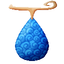

<!-- Generated by tools/build_pack_reference.py. Edit the pack sources and regenerate. -->

# Sui Sui no Mi

{ .entry-page-icon }

[Fruits](index.md) · [Mine Mine no Mi](../../reference/content/mineminenomi.md)

<!-- fruit mineminenomi:sui_sui_no_mi -->

| Stat | Value |
| --- | --- |
| Type | Paramecia |
| Tier | 2 |
| Fruit damage scaling | 1.00× at 10,000 Doriki → 2× at 50,000 Doriki |
| Abilities | 4 (4 active, 0 passive) |
| Fruit boxes | [Iron Box](../fruit-boxes.md) |

See [damage calculations](../combat-stats.md#damage-from-doriki).

[Jump to awakening](#awakening)

!!! note "Reading the stats"
    Listed base damage is for the named part of the move. Pack and Doriki multipliers are shown separately. Times assume 20 ticks per second.

<!-- move mineminenomi:free_swimming -->

## Free Swimming

{ .entry-move-icon loading=lazy } *Active*

Lets the user swim trough blocks. Swimming is activated by running into a ground block.

| Stat | Value |
| --- | --- |
| Cooldown | 1 s (20 ticks) |
| Pack multiplier when dealing damage | 2.65× |

<!-- move mineminenomi:nekomimi_punch -->

## Nekomimi Punch

{ .entry-move-icon loading=lazy } *Active*

Propels the swimming user forward and deals huge damage to all entities they hit.

| Stat | Value |
| --- | --- |
| Cooldown | 6 s (120 ticks) |
| Base damage | 20 HP |
| Pack multiplier when dealing damage | 1.8× |

<!-- move mineminenomi:nyan_nyan_suplex -->

## Nyan Nyan Suplex

{ .entry-move-icon loading=lazy } *Active*

While swimming, grabs the nearest enemy from the back and launches them into the ground, dealing moderate damage and creating a small crater.

| Stat | Value |
| --- | --- |
| Cooldown | 10 s (200 ticks) |
| Base damage | 20 HP |
| Pack multiplier when dealing damage | 2.65× |

<!-- move mineminenomi:nyan_nyan_suplex_baby_buster -->

## Nyan Nyan Suplex: Baby Buster

{ .entry-move-icon loading=lazy } *Active*

While swimming, grabs the nearest enemy from the back and launches them into the sky on when hitting the ground it creates a big crater.

| Stat | Value |
| --- | --- |
| Cooldown | 15 s (300 ticks) |
| Base damage | 40 HP |
| Pack multiplier when dealing damage | 2.65× |

## Awakening

**Source** · Awaken Awaken no Mi

| Stat | Value |
| --- | --- |
| Doriki | 40,000 |
| Active time with the fruit | About 24 hours (1,728,000 ticks) |

<!-- move awakenawakennomi:waterpool_domain -->

### Waterpool Domain { #awakening-waterpool-domain }

{ .entry-move-icon loading=lazy } *Active*

Turns the ground into liquid, the user and their allies can swim in it while enemies sink and drown. Inside it the user counts as swimming for Nekomimi Punch and the Nyan Nyan Suplexes.

| Stat | Value |
| --- | --- |
| Cooldown | 120 s (2400 ticks) |

<!-- move awakenawakennomi:undertow -->

### Undertow { #awakening-undertow }

{ .entry-move-icon loading=lazy } *Active*

Grabs the enemy in front and drags them down into the ground, swimming off with them while they drown. Using it again, or holding on too long, throws them back out of the ground wherever the user is.

| Stat | Value |
| --- | --- |
| Drown damage | 10 HP |
| Exit damage | 40 HP |
| Cooldown | 30 s (600 ticks) |
| Miss cooldown | 2 s (40 ticks) |

<!-- move awakenawakennomi:breach -->

### Breach { #awakening-breach }

{ .entry-move-icon loading=lazy } *Active*

Sends a fin swimming through the ground toward the targeted enemy, then it bursts out from under them. Enemies close to the target get hit too.

| Stat | Value |
| --- | --- |
| Base damage | 70 HP |
| Splash damage | 35 HP |
| Cooldown | 25 s (500 ticks) |
| Miss cooldown | 2 s (40 ticks) |
| Fizzle cooldown | 5 s (100 ticks) |

