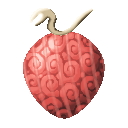

<!-- Generated by tools/build_pack_reference.py. Edit the pack sources and regenerate. -->

# Suji Suji no Mi

{ .entry-page-icon }

[Fruits](index.md) · [InoFruits](../../reference/content/inofruits.md)

<!-- fruit inofruits:suji_suji_no_mi -->

| Stat | Value |
| --- | --- |
| Type | Paramecia |
| Tier | 2 |
| Fruit damage scaling | 1.00× at 10,000 Doriki → 2× at 50,000 Doriki |
| Abilities | 5 (5 active, 0 passive) |
| Fruit boxes | [Iron Box](../fruit-boxes.md) |

See [damage calculations](../combat-stats.md#damage-from-doriki).

!!! note "Reading the stats"
    Listed base damage is for the named part of the move. Pack and Doriki multipliers are shown separately. Times assume 20 ticks per second.

<!-- move inofruits:suji_suji_upper_point -->

## Suji Suji Upper Point

{ .entry-move-icon loading=lazy } *Active · Transformation*

Muscle fibers grow over the chest and arms, hitting extremely hard but very slowly

| Stat | Value |
| --- | --- |
| Pack multiplier when dealing damage | 1.05× |

**Stats while transformed**

| Stat | Value |
| --- | --- |
| Punch damage | +12 HP |
| Movement speed | -15% of base |
| Armour | +4 |
| Toughness | +1.5 |

<!-- move inofruits:suji_suji_lower_point -->

## Suji Suji Lower Point

{ .entry-move-icon loading=lazy } *Active · Transformation*

Muscle fibers grow over the legs, making the user run faster and jump higher without hitting harder.

| Stat | Value |
| --- | --- |
| Pack multiplier when dealing damage | 1.05× |

**Stats while transformed**

| Stat | Value |
| --- | --- |
| Movement speed | +90% of base |
| Jump | +3 |
| Armour | +1 |

<!-- move inofruits:suji_suji_full_point -->

## Suji Suji Full Point

{ .entry-move-icon loading=lazy } *Active · Transformation*

Muscle fibers grow over the whole body, hitting harder and moving faster but less than the other two forms

| Stat | Value |
| --- | --- |
| Pack multiplier when dealing damage | 1.05× |

**Stats while transformed**

| Stat | Value |
| --- | --- |
| Punch damage | +7 HP |
| Movement speed | +45% of base |
| Jump | +1.6 |
| Armour | +3 |
| Toughness | +1 |

<!-- move inofruits:hasai -->

## Hasai

{ .entry-move-icon loading=lazy } *Active*

Punches forward sending a shockwave that goes through enemies and walls. With the arm fibers it reaches further and goes through stone.

| Stat | Value |
| --- | --- |
| Cooldown | 25 s (500 ticks) |
| Aborted cooldown | 2 s (40 ticks) |
| Pack multiplier when dealing damage | 1.05× |

<!-- move inofruits:choyaku -->

## Choyaku

{ .entry-move-icon loading=lazy } *Active*

The user jumps a long way with their legs, hitting whatever is under them when landing With the leg fibers the jump goes further and higher, and the landing hits a wider area.

| Stat | Value |
| --- | --- |
| Base damage | 13 HP |
| Amplified damage | 28 HP |
| Cooldown | 25 s (500 ticks) |
| Aborted cooldown | 2 s (40 ticks) |
| Pack multiplier when dealing damage | 1.05× |

