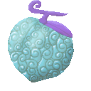

<!-- Generated by tools/build_pack_reference.py. Edit the pack sources and regenerate. -->

# Suke Suke no Mi

{ .entry-page-icon }

[Fruits](index.md) · [Mine Mine no Mi](../../reference/content/mineminenomi.md)

<!-- fruit mineminenomi:suke_suke_no_mi -->

| Stat | Value |
| --- | --- |
| Type | Paramecia |
| Tier | 1 |
| Fruit damage scaling | 1.00× at 10,000 Doriki → 2.25× at 50,000 Doriki |
| Abilities | 3 (3 active, 0 passive) |
| Fruit boxes | [Wooden Box](../fruit-boxes.md) |

See [damage calculations](../combat-stats.md#damage-from-doriki).

[Jump to awakening](#awakening)

After awakening, this fruit’s original damaging moves deal **1.5× damage**. The awakening techniques below have their own values.

!!! note "Reading the stats"
    Listed base damage is for the named part of the move. Pack and Doriki multipliers are shown separately. Times assume 20 ticks per second.

<!-- move mineminenomi:skatting -->

## Skatting

{ .entry-move-icon loading=lazy } *Active*

Turns the user's entire body invisible.

| Stat | Value |
| --- | --- |
| Pack multiplier when dealing damage | 2.95× |

<!-- move mineminenomi:shisha_no_te -->

## Shisha no Te

{ .entry-move-icon loading=lazy } *Active*

Shoots invisible projectiles that explode upon impact.

| Stat | Value |
| --- | --- |
| Cooldown | 8 s (160 ticks) |
| Pack multiplier when dealing damage | 2.95× |

<!-- move mineminenomi:suke_punch -->

## Suke Punch

{ .entry-move-icon loading=lazy } *Active*

Turns an entity's entire body invisible after hitting them.

| Stat | Value |
| --- | --- |
| Pack multiplier when dealing damage | 2.95× |

## Awakening

**Source** · Awaken Awaken no Mi

| Stat | Value |
| --- | --- |
| Doriki | 40,000 |
| Active time with the fruit | About 24 hours (1,728,000 ticks) |

<!-- move awakenawakennomi:invisible_touch -->

### Invisible Touch { #awakening-invisible-touch }

{ .entry-move-icon loading=lazy } *Active*

Turns the block the user hits invisible.

<!-- move awakenawakennomi:diffraction -->

### Diffraction { #awakening-diffraction }

{ .entry-move-icon loading=lazy } *Active*

The user turns into a prism and fires 7 rainbow beams one after another.

| Stat | Value |
| --- | --- |
| Cooldown | 60 s (1200 ticks) |

<!-- move awakenawakennomi:unseen -->

### Unseen { #awakening-unseen }

{ .entry-move-icon loading=lazy } *Passive*

While invisible, swings and projectiles from anyone who can't see the user often pass straight through them. Observation Haki sees through it and explosions, shockwaves, fire and magic still hit them.
