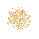

<!-- Generated by tools/build_pack_reference.py. Edit the pack sources and regenerate. -->

# Suna Suna no Mi

{ .entry-page-icon }

[Fruits](index.md) · [Mine Mine no Mi](../../reference/content/mineminenomi.md)

<!-- fruit mineminenomi:suna_suna_no_mi -->

| Stat | Value |
| --- | --- |
| Type | Logia |
| Tier | 3 |
| Fruit damage scaling | 1.00× at 10,000 Doriki → 1.75× at 50,000 Doriki |
| Abilities | 13 (9 active, 4 passive) |
| Fruit boxes | [Golden Box](../fruit-boxes.md) |

See [damage calculations](../combat-stats.md#damage-from-doriki).

[Jump to awakening](#awakening)

!!! note "Reading the stats"
    Listed base damage is for the named part of the move. Pack and Doriki multipliers are shown separately. Times assume 20 ticks per second.

<!-- move mineminenomi:desert_spada -->

## Desert Spada

{ .entry-move-icon loading=lazy } *Active*

The user forms their hand into a blade and stabs it into the ground, creating a sand blade that destroys anything on its path. While in a desert the cooldown of this ability is reduced by %s and the damage is increased by %s.

| Stat | Value |
| --- | --- |
| Cooldown | 8 s (160 ticks) |
| Pack multiplier when dealing damage | 2.5× |

<!-- move mineminenomi:desert_grande_espada -->

## Desert Grande Espada

{ .entry-move-icon loading=lazy } *Active*

Spawns a large sand blade cutting through multiple enemies wherever the user is looking. While in a desert the cooldown of this ability is reduced by %s and the damage is increased by %s.

| Stat | Value |
| --- | --- |
| Cooldown | 20 s (400 ticks) |
| Pack multiplier when dealing damage | 2.5× |

<!-- move mineminenomi:sables -->

## Sables

{ .entry-move-icon loading=lazy } *Active*

The user launches a compressed sandstorm at the opponent, which sends them flying. While in a desert the cooldown of this ability is reduced by %s.

| Stat | Value |
| --- | --- |
| Cooldown | 18 s (360 ticks) |
| Pack multiplier when dealing damage | 2.5× |

<!-- move mineminenomi:grande_sables -->

## Grande Sables

{ .entry-move-icon loading=lazy } *Active*

Surrounds the user into a sand tornado, increasing their speed and pulling all nearby entities towards it damaging them. While in a desert the cooldown of this ability is reduced by %s.

Creates a local sandstorm for 15 seconds.

| Stat | Value |
| --- | --- |
| Cooldown | 10 s (200 ticks) |
| Base damage | 8 HP |
| Pack multiplier when dealing damage | 2.5× |

<!-- move mineminenomi:barjan -->

## Barjan

{ .entry-move-icon loading=lazy } *Active*

Dashes forwards hitting all enemies it touches dehydrating them. While in a desert the cooldown of this ability is reduced by %s and the damage is increased by %s.

| Stat | Value |
| --- | --- |
| Cooldown | 10 s (200 ticks) |
| Base damage | 30 HP |
| Pack multiplier when dealing damage | 2.5× |

<!-- move mineminenomi:desert_encierro -->

## Desert Encierro

{ .entry-move-icon loading=lazy } *Active*

Quickly drains the enemy in front of the user of their moisture, leaving them weak for a few seconds. While in a desert the cooldown of this ability is reduced by %s.

| Stat | Value |
| --- | --- |
| Cooldown | 15 s (300 ticks) |
| Base damage | 20 HP |
| Pack multiplier when dealing damage | 2.5× |

<!-- move mineminenomi:ground_death -->

## Ground Death

{ .entry-move-icon loading=lazy } *Active*

Dries out the surrounding ground turning everything into sand. While in a desert the cooldown of this ability is reduced by %s and range is increased by %s.

| Stat | Value |
| --- | --- |
| Cooldown | 10 s (200 ticks) |
| Pack multiplier when dealing damage | 2.5× |

<!-- move mineminenomi:desert_girasole -->

## Desert Girasole

{ .entry-move-icon loading=lazy } *Active*

A giant pit of quicksand will be formed. Can only be used on sand. While in a desert the cooldown of this ability is reduced by %s and range is increased by %s.

| Stat | Value |
| --- | --- |
| Cooldown | 30 s (600 ticks) |
| Pack multiplier when dealing damage | 2.5× |

<!-- move mineminenomi:suna_special_fly -->

## Suna Special Fly

*Passive*

Allows the user to fly, cannot be used while the user is wet

| Stat | Value |
| --- | --- |
| Pack multiplier when dealing damage | 2.5× |

<!-- move mineminenomi:sables_pesado -->

## Sables: Pesado

{ .entry-move-icon loading=lazy } *Active*

The user compresses a sandstorm to its limits and shoots it at extreme speeds. While in a desert the cooldown of this ability is reduced by %s and charge time is reduced by %s.

| Stat | Value |
| --- | --- |
| Cooldown | 25 s (500 ticks) |
| Pack multiplier when dealing damage | 2.5× |

<!-- move mineminenomi:logia_invulnerability_suna -->

## Logia Invulnerability Suna

{ .entry-move-icon loading=lazy } *Passive*

| Stat | Value |
| --- | --- |
| Pack multiplier when dealing damage | 2.5× |

<!-- move mineminenomi:logia_immunities -->

## Logia Immunities

*Passive*

| Stat | Value |
| --- | --- |
| Pack multiplier when dealing damage | 2.5× |

<!-- move mineminenomi:suna_block_bypassing -->

## Suna Block Bypassing

*Passive*

| Stat | Value |
| --- | --- |
| Pack multiplier when dealing damage | 2.5× |

## Awakening

**Source** · Awaken Awaken no Mi

| Stat | Value |
| --- | --- |
| Doriki | 40,000 |
| Active time with the fruit | About 24 hours (1,728,000 ticks) |

<!-- move awakenawakennomi:sabaku_no_okoku -->

### Sabaku no Okoku { #awakening-sabaku-no-okoku }

{ .entry-move-icon loading=lazy } *Active*

Dries out the ground for a huge area around the user, turning it into the user's desert. Once fully spread quicksand fills the field three blocks deep and only the user can stand on it Everything inside dries up and loses the water it carries.

| Stat | Value |
| --- | --- |
| Cooldown | 60 s (1200 ticks) |
| Min cooldown | 22.5 s (450 ticks) |

<!-- move awakenawakennomi:sabaku_no_sousou -->

### Sabaku no Sousou { #awakening-sabaku-no-sousou }

{ .entry-move-icon loading=lazy } *Active*

Rips the quicksand out of the desert and pushes it forward, burying everything it hits Anything the sand reaches gets dragged under and held there. Damage goes up with the sand swallowed, and the sand goes back into the field

| Stat | Value |
| --- | --- |
| Min cooldown | 15 s (300 ticks) |
| Max cooldown | 35 s (700 ticks) |
| Whiff cooldown | 3 s (60 ticks) |
| Floor damage | 25 HP |
| Max damage | 150 HP |
| Cooldown | 35 s (700 ticks) |

<!-- move awakenawakennomi:kawaki -->

### Kawaki { #awakening-kawaki }

{ .entry-move-icon loading=lazy } *Passive*

Standing on sand makes the user faster, stronger and heal quicker. Their own quicksand works best and stops fall damage Gives nothing on any other ground.
