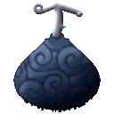
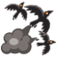
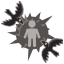
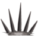
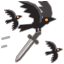
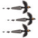
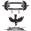

<!-- Generated by tools/build_pack_reference.py. Edit the pack sources and regenerate. -->

# Susu Susu no Mi

{ .entry-page-icon }

[Fruits](index.md) · [Missing Missing no Mi](../../reference/content/inomissing.md)

<!-- fruit inomissing:susu_susu_no_mi -->

| Stat | Value |
| --- | --- |
| Type | Logia |
| Tier | 3 |
| Fruit damage scaling | 1.00× at 10,000 Doriki → 1.75× at 50,000 Doriki |
| Abilities | 8 (6 active, 2 passive) |
| Fruit boxes | [Golden Box](../fruit-boxes.md) |

See [damage calculations](../combat-stats.md#damage-from-doriki).

!!! note "Reading the stats"
    Listed base damage is for the named part of the move. Pack and Doriki multipliers are shown separately. Times assume 20 ticks per second.

<!-- move inomissing:logia_invulnerability_susu -->

## Logia Invulnerability Susu

{ .entry-move-icon loading=lazy } *Passive*

The user's body is made of soot.

| Stat | Value |
| --- | --- |
| Pack multiplier when dealing damage | 2.35× |

<!-- move inomissing:susu_hiko -->

## Susu Hiko

{ .entry-move-icon loading=lazy } *Passive*

The user turns into a cloud of soot allowing them to fly, the speed is higher while not in combat.

| Stat | Value |
| --- | --- |
| Pack multiplier when dealing damage | 2.35× |

<!-- move inomissing:karasusu -->

## Karasusu

{ .entry-move-icon loading=lazy } *Active*

The user makes 3 crows of soot out of their body, they stay with the user and attack whoever hits the user or gets hit by them. Only Haki, Seastone and water can kill a crow and a killed crow is lost until the next use. Use the ability again to call the crows back.

| Stat | Value |
| --- | --- |
| Cooldown | 10 s (200 ticks) |
| Lost cooldown | 30 s (600 ticks) |
| Pack multiplier when dealing damage | 2.35× |

<!-- move inomissing:karasu_renkon -->

## Karasu Renkon

{ .entry-move-icon loading=lazy } *Active*

Karasu Renkon, the user sends a murder of soot crows on the target they look at, the crows cover it and peck it again and again. Rakuro, soot crows whirl around the user hurting the enemies close to them, then they dive beak first on the target the user looks at. Every hit of Rakuro slows a lot.

| Stat | Value |
| --- | --- |
| Whirl damage | 6 HP |
| Dive damage | 18 HP |
| Rakuro cooldown | 16 s (320 ticks) |
| Cooldown | 15 s (300 ticks) |
| Conditional cooldown | 0.5 s (10 ticks) |
| Pack multiplier when dealing damage | 2.35× |

<!-- move inomissing:obelisusu -->

## Obelisusu

{ .entry-move-icon loading=lazy } *Active*

The user dashes past the enemies as soot leaving soot at their feet, then obelisks of soot shoot up under them, piercing them and throwing them up.

| Stat | Value |
| --- | --- |
| Base damage | 20 HP |
| Cooldown | 18 s (360 ticks) |
| Pack multiplier when dealing damage | 2.35× |

<!-- move inomissing:karasu_hiko -->

## Karasu Hiko

{ .entry-move-icon loading=lazy } *Active*

The user comes apart into a murder of soot crows and flies fast where they look, nothing can hit them until they form again. Water and Seastone make them form again. Use the ability again to form again sooner. The crows peck the enemies they go through, once a second, and snatch what they hold in their hand, a crow carries it off and drops it a little further.

| Stat | Value |
| --- | --- |
| Cooldown | 30 s (600 ticks) |
| Pack multiplier when dealing damage | 2.35× |

<!-- move inomissing:shokuro -->

## Shokuro

{ .entry-move-icon loading=lazy } *Active*

Kokuro, the user sends a swarm of soot crows on a small area in front of them. Shokuro, the user sends a wide rush of soot crows in front of them. The enemies hit are hurt and slowed a lot.

| Stat | Value |
| --- | --- |
| K damage | 14 HP |
| K cooldown | 10 s (200 ticks) |
| S damage | 16 HP |
| S cooldown | 16 s (320 ticks) |
| Cooldown | 10 s (200 ticks) |
| Pack multiplier when dealing damage | 2.35× |

<!-- move inomissing:gokuro -->

## Gokuro

{ .entry-move-icon loading=lazy } *Active*

Hijona Kokuu, the user shoots a dense murder of soot crows in a straight line. Gokuro, soot crows swirl over the user then keep falling on the place the user looks at, use the ability again to stop it. The enemies hit are hurt and slowed a lot.

| Stat | Value |
| --- | --- |
| H damage | 16 HP |
| H cooldown | 12 s (240 ticks) |
| Base damage | 4 HP |
| Cooldown | 24 s (480 ticks) |
| Pack multiplier when dealing damage | 2.35× |

