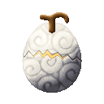
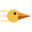
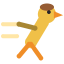

<!-- Generated by tools/build_pack_reference.py. Edit the pack sources and regenerate. -->

# Tama Tama no Mi

{ .entry-page-icon }

[Fruits](index.md) · [Missing Missing no Mi](../../reference/content/inomissing.md)

<!-- fruit inomissing:tama_tama_no_mi -->

| Stat | Value |
| --- | --- |
| Type | Zoan |
| Tier | 1 |
| Fruit damage scaling | 1.00× at 10,000 Doriki → 2.25× at 50,000 Doriki |
| Abilities | 5 (4 active, 1 passive) |
| Fruit boxes | [Wooden Box](../fruit-boxes.md) |

See [damage calculations](../combat-stats.md#damage-from-doriki).

!!! note "Reading the stats"
    Listed base damage is for the named part of the move. Pack and Doriki multipliers are shown separately. Times assume 20 ticks per second.

<!-- move inomissing:tama_peck -->

## Peck

{ .entry-move-icon loading=lazy } *Active*

As a chick or a rooster the user pecks the enemy in front of them with their beak. The rooster hits harder

| Stat | Value |
| --- | --- |
| Chick damage | 8 HP |
| Rooster damage | 10 HP |
| Cooldown | 5 s (100 ticks) |
| Pack multiplier when dealing damage | 1.55× |

<!-- move inomissing:tama_chick_dash -->

## Dash

{ .entry-move-icon loading=lazy } *Active*

As a chick or a rooster the user leans forward and runs much faster for a few seconds

| Stat | Value |
| --- | --- |
| Cooldown | 12 s (240 ticks) |
| Pack multiplier when dealing damage | 2.1× |

<!-- move inomissing:tama_wing_flurry -->

## Wing Flurry

{ .entry-move-icon loading=lazy } *Active*

As a rooster the user beats their wings and throws back all enemies in front of them

| Stat | Value |
| --- | --- |
| Base damage | 10 HP |
| Cooldown | 10 s (200 ticks) |
| Pack multiplier when dealing damage | 2.1× |

<!-- move inomissing:tama_crow -->

## Crow

{ .entry-move-icon loading=lazy } *Active*

As a rooster the user crows so loud that all enemies around them are shaken, slowing and weakening them for a moment

| Stat | Value |
| --- | --- |
| Cooldown | 20 s (400 ticks) |
| Pack multiplier when dealing damage | 2.1× |

<!-- move inomissing:tama_lives -->

## Three Lives

{ .entry-move-icon loading=lazy } *Passive*

The user is an egg with 3 lives. A blow that would kill them cracks them instead. They become a yolk for 5 seconds then are born again in the next form, first a fast chick then a strong rooster. Killed as a rooster the user dies for real The yolk can't move, attack or use abilities and any hit kills it for real The user can't choose their form. After 10 minutes without losing a life the user is an egg again with all 3 lives

| Stat | Value |
| --- | --- |
| Pack multiplier when dealing damage | 2.1× |

