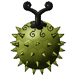
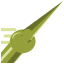
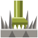
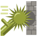
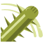
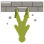

<!-- Generated by tools/build_pack_reference.py. Edit the pack sources and regenerate. -->

# Toge Toge no Mi

{ .entry-page-icon }

[Fruits](index.md) · [Missing Missing no Mi](../../reference/content/inomissing.md)

<!-- fruit inomissing:toge_toge_no_mi -->

| Stat | Value |
| --- | --- |
| Type | Paramecia |
| Tier | 1 |
| Fruit damage scaling | 1.00× at 10,000 Doriki → 2.25× at 50,000 Doriki |
| Abilities | 8 (8 active, 0 passive) |
| Fruit boxes | [Wooden Box](../fruit-boxes.md) |

See [damage calculations](../combat-stats.md#damage-from-doriki).

!!! note "Reading the stats"
    Listed base damage is for the named part of the move. Pack and Doriki multipliers are shown separately. Times assume 20 ticks per second.

<!-- move inomissing:toge_stinger_finger -->

## Stinger Finger

{ .entry-move-icon loading=lazy } *Active*

The user stretches their fingers into long spikes and slashes the enemies in front twice, against a wall the spikes dig a passage through it. Both hands turn into one big spike each and stab the enemy in front again and again. Spikes get stuck in wool, carpets and leather armor and the user can't move for a moment.

| Stat | Value |
| --- | --- |
| Finger damage | 8 HP |
| Finger cooldown | 6 s (120 ticks) |
| Double damage | 3.6 HP |
| Double cooldown | 10 s (200 ticks) |
| Pack multiplier when dealing damage | 1.8× |

<!-- move inomissing:toge_stinger_hedgehog -->

## Stinger Hedgehog

{ .entry-move-icon loading=lazy } *Active · Transformation*

The user rolls up into a ball of spikes like a sea urchin and rolls over the enemies, the ones who hit it by hand get spiked back. Falling on enemies from up high hurts them a lot more.

| Stat | Value |
| --- | --- |
| Contact damage | 6 HP |
| Drop damage | 12 HP |
| Cooldown | 20 s (400 ticks) |
| Pack multiplier when dealing damage | 1.8× |

<!-- move inomissing:toge_sewing_stinger -->

## Sewing Stinger

{ .entry-move-icon loading=lazy } *Active*

The user grows short spikes under their feet and runs faster. A long spike grows under each foot, the user walks up high on them like stilts and tramples the enemies under and next to their feet.

| Stat | Value |
| --- | --- |
| Step damage | 4 HP |
| Cooldown | 25 s (500 ticks) |
| Pack multiplier when dealing damage | 1.8× |

<!-- move inomissing:toge_stinger_step -->

## Stinger Step

{ .entry-move-icon loading=lazy } *Active*

The user stomps with dozens of spikes under their foot, they come out of the ground all around and throw back the enemies near.

| Stat | Value |
| --- | --- |
| Base damage | 9 HP |
| Cooldown | 10 s (200 ticks) |
| Pack multiplier when dealing damage | 1.8× |

<!-- move inomissing:toge_sea_urchin_stinger -->

## Sea Urchin Stinger

{ .entry-move-icon loading=lazy } *Active*

The user turns their hair into a ball of spikes and charges head first, the enemies in the way are thrown back and stone walls get a round hole punched through.

| Stat | Value |
| --- | --- |
| Base damage | 11 HP |
| Cooldown | 14 s (280 ticks) |
| Pack multiplier when dealing damage | 1.8× |

<!-- move inomissing:toge_doping -->

## Toge Toge Doping

{ .entry-move-icon loading=lazy } *Active*

The user stabs spikes into their own shoulders like acupuncture, it hurts them but their arms swell up huge and strong, they hit harder and run faster and the ones who hit them by hand get spiked. Stinger Flail can only be used like this.

| Stat | Value |
| --- | --- |
| Cooldown | 120 s (2400 ticks) |
| Pack multiplier when dealing damage | 1.8× |

<!-- move inomissing:toge_stinger_flail -->

## Stinger Flail

{ .entry-move-icon loading=lazy } *Active*

While under Toge Toge Doping, spikes grow all along the user's swollen arms and they swing them like clubs at all the enemies in front.

| Stat | Value |
| --- | --- |
| Base damage | 14 HP |
| Cooldown | 5 s (100 ticks) |
| Pack multiplier when dealing damage | 1.4× |

<!-- move inomissing:toge_grip -->

## Toge Grip

{ .entry-move-icon loading=lazy } *Active*

The user drives spikes into the ceiling and hangs on it upside down with their hands free, or into a wall and climbs it, crouching holds them still. Using it again or jumping lets go.

| Stat | Value |
| --- | --- |
| Cooldown | 4 s (80 ticks) |
| Pack multiplier when dealing damage | 1.8× |

