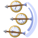

<!-- Generated by tools/build_pack_reference.py. Edit the pack sources and regenerate. -->

# Toki Toki no Mi

{ .entry-page-icon }

[Fruits](index.md) · [Missing Missing no Mi](../../reference/content/inomissing.md)

<!-- fruit inomissing:toki_toki_no_mi -->

| Stat | Value |
| --- | --- |
| Type | Paramecia |
| Tier | 2 |
| Fruit damage scaling | 1.00× at 10,000 Doriki → 2× at 50,000 Doriki |
| Abilities | 4 (4 active, 0 passive) |
| Fruit boxes | [Iron Box](../fruit-boxes.md) |

See [damage calculations](../combat-stats.md#damage-from-doriki).

!!! note "Reading the stats"
    Listed base damage is for the named part of the move. Pack and Doriki multipliers are shown separately. Times assume 20 ticks per second.

<!-- move inomissing:jump_ahead -->

## Jump Ahead

{ .entry-move-icon loading=lazy } *Active*

The user leaps ahead in time, they vanish, out of everyone's reach, and come back at the same place once the chosen time has passed. Used again while away, it brings the user back at once.

| Stat | Value |
| --- | --- |
| Cooldown | 15 s (300 ticks) |
| Pack multiplier when dealing damage | 1.5× |

<!-- move inomissing:shelter -->

## Shelter

{ .entry-move-icon loading=lazy } *Active*

The ally the user touches is sent ahead in time, out of danger, with the allies standing near them, 5 at most. They vanish, out of everyone's reach, and come back at the same place once the chosen time has passed. A player must be crouching to be sent.

| Stat | Value |
| --- | --- |
| Cooldown | 20 s (400 ticks) |
| Conditional cooldown | 0.5 s (10 ticks) |
| Pack multiplier when dealing damage | 1.5× |

<!-- move inomissing:send_ahead -->

## Send Ahead

{ .entry-move-icon loading=lazy } *Active*

The enemy the user touches is sent ahead in time, they vanish, out of everyone's reach, and come back at the same place once the chosen time has passed.

| Stat | Value |
| --- | --- |
| Cooldown | 30 s (600 ticks) |
| Conditional cooldown | 0.5 s (10 ticks) |
| Pack multiplier when dealing damage | 1.5× |

<!-- move inomissing:postpone -->

## Postpone

{ .entry-move-icon loading=lazy } *Active*

The shots in flight in front of the user are sent ahead in time, they vanish and reappear where they were, still on their way, once the chosen time has passed.

| Stat | Value |
| --- | --- |
| Cooldown | 12 s (240 ticks) |
| Conditional cooldown | 0.5 s (10 ticks) |
| Pack multiplier when dealing damage | 1.5× |

